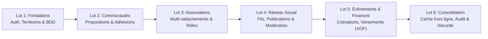

# My Community — Document de Cadrage Stratégique

**Version :** 1.0  
**Date :** 21 octobre 2026  
**Statut :** Validé — Document de référence MVP  

---

## 1. Vision et Mission du Projet

**My Community** est une plateforme numérique multi-communautés, multi-associations et multi-plateformes (Web & Mobile), conçue pour dynamiser la vie locale, renforcer le tissu associatif et rapprocher les citoyens au sein de leurs territoires géographiques (quartiers, villages, communes, arrondissements).

La plateforme concilie la convivialité d'un réseau social de proximité avec la rigueur administrative et financière requise par la gestion associative et territoriale moderne.

---

## 2. Les 5 Décisions Structurantes Fondatrices

Le cadrage du projet repose sur cinq décisions architecturales et organisationnelles non négociables :

1. **Validation préalable des communautés :**  
   Toute personne peut proposer la création d'une communauté, mais celle-ci doit obligatoirement être instruite et validée par un Administrateur de la plateforme avant son activation effective.
2. **Adhésions multi-communautés étanches et indépendantes :**  
   Un citoyen peut appartenir à plusieurs communautés (ex. son quartier de résidence et son village d'origine), chaque adhésion faisant l'objet d'un statut, de droits et d'un historique strictement indépendants.
3. **Associations multi-localités sans duplication d'entité :**  
   Une association constitue une entité juridique et opérationnelle unique. Elle peut intervenir dans plusieurs communautés et territoires sans duplication de fiche ni fragmentation de ses membres ou de ses finances.
4. **Fils d'actualités cloisonnés et vue agrégée contrôlée :**  
   Le fil d'actualité offre une vue générale (qui agrège strictement les publications autorisées des communautés rejointes) et des fils propres à chaque communauté.
5. **Mode hors ligne pragmatique (Consultation en cache) :**  
   L'application mobile permet la consultation des données et publications déjà chargées en local, sans prétendre supporter la synchronisation ou les créations complexes en mode déconnecté pour le MVP.

---

## 3. Typologie des Acteurs et Rôles

Le système met en œuvre un modèle d'autorisation contextuel où un utilisateur peut cumuler plusieurs casquettes selon le périmètre (communauté ou association) considéré :

| Acteur | Responsabilité Principale |
| :--- | :--- |
| **Visiteur** | Découvrir les informations rendues publiques (annuaires publics, événements ouverts). |
| **Utilisateur inscrit** | Gérer son identité, proposer une communauté, postuler à des adhésions. |
| **Membre de communauté** | Accéder aux contenus privés, échanger et participer à la vie locale de sa communauté. |
| **Responsable communautaire** | Traiter les demandes d'adhésion, administrer l'espace local et modérer les publications. |
| **Responsable associatif** | Administrer la fiche associative, gérer les membres, créer des activités et événements. |
| **Trésorier associatif** | Définir les plans de cotisations, enregistrer les versements et suivre les dépenses. |
| **Modérateur** | Traiter les signalements de contenus et d'utilisateurs dans son périmètre attribué. |
| **Administrateur plateforme** | Valider les créations de communautés, superviser la sécurité et administrer les référentiels. |

---

## 4. Périmètre du MVP (Minimum Viable Product)

### 4.1 Modules inclus (MC-01 à MC-09)
- **MC-01 : Identité et profil** (Authentification, sessions, profils sécurisés, préférences).
- **MC-02 : Territoires et communautés** (Découpage administratif, propositions et validation).
- **MC-03 : Adhésions communautaires** (Cycle de vie des demandes, suspensions, historique).
- **MC-04 : Réseau social de proximité** (Fils d'actualité, publications, commentaires, likes, signalements).
- **MC-05 : Associations** (Fiche unique, rattachements multi-communautés, adhésions associatives).
- **MC-06 : Événements** (Calendrier d'activités, inscriptions, visibilité ciblée).
- **MC-07 : Gestion associative et finances** (Plans de cotisations, appels de fonds, versements, dépenses en XOF).
- **MC-08 : Administration, sécurité & audit** (RBAC contextuel, journal d'audit infalsifiable).
- **MC-09 : Notifications et mode hors ligne** (Notifications in-app, cache local sécurisé).

### 4.2 Périmètre explicitement exclu du MVP (Post-MVP)
Pour garantir la qualité, la sécurité et le respect des délais, les fonctionnalités suivantes sont reportées :
- Messagerie instantanée en temps réel de type WhatsApp et appels audio/vidéo.
- Création et rédaction de publications/commentaires en mode hors ligne avec file d'attente de synchronisation.
- Passerelles directes de paiement Mobile Money automatisées (MTN MoMo, Moov Money, Wave, etc.) : enregistrement manuel/justificatif au MVP.
- Comptabilité en partie double et rapprochement bancaire automatisé.
- Algorithmes de recommandation sociale fondés sur le machine learning.
- Régie publicitaire, bannières sponsorisées et monétisation complexe.

---

## 5. Feuille de Route et Lots de Réalisation

Le développement est articulé en 6 lots techniques séquentiels :

---

## 6. Risques et Facteurs Clés de Succès

1. **Étanchéité des données :** L'architecture doit interdire formellement toute fuite d'informations privées entre communautés ou entre associations (garantie par le RBAC contextuel et RLS).
2. **Simplicité d'adoption :** L'expérience utilisateur (UI/UX) doit convenir aussi bien à un utilisateur sur smartphone d'entrée de gamme en zone à connectivité intermittente qu'à un gestionnaire sur interface Web.
3. **Traçabilité financière :** Toute transaction financière enregistrée est immuable et auditée pour prévenir les litiges au sein des associations.
