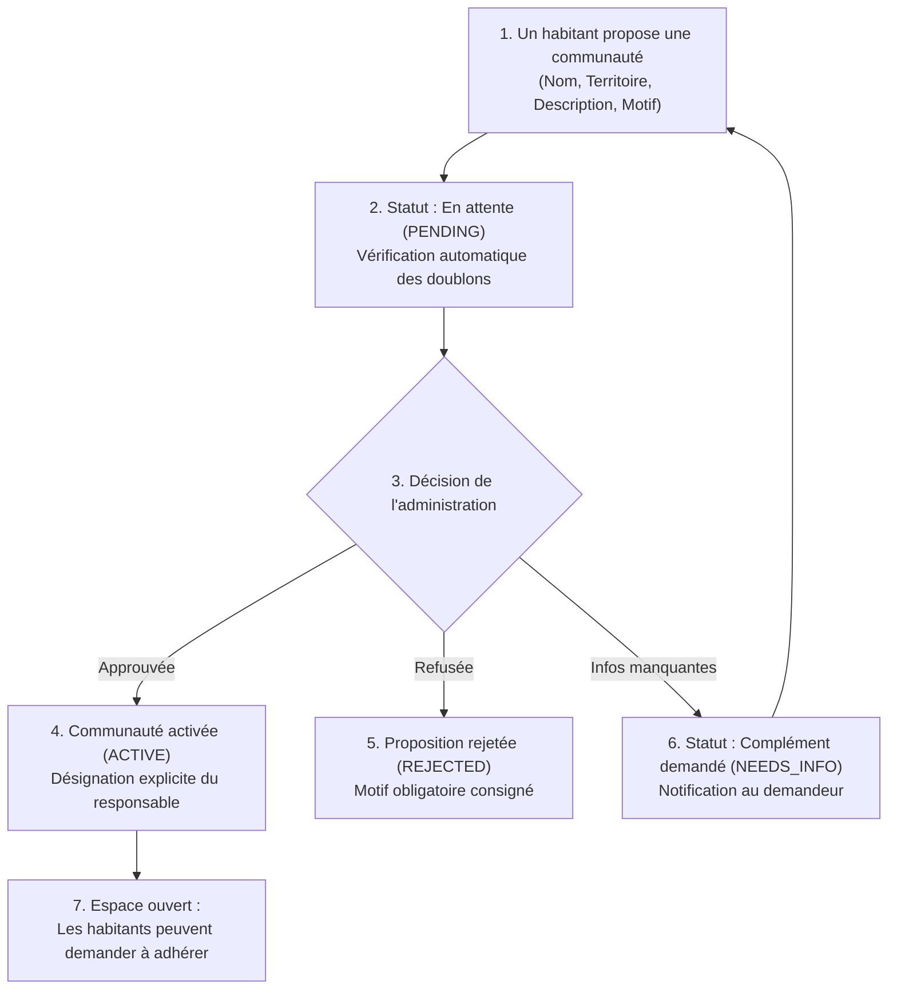
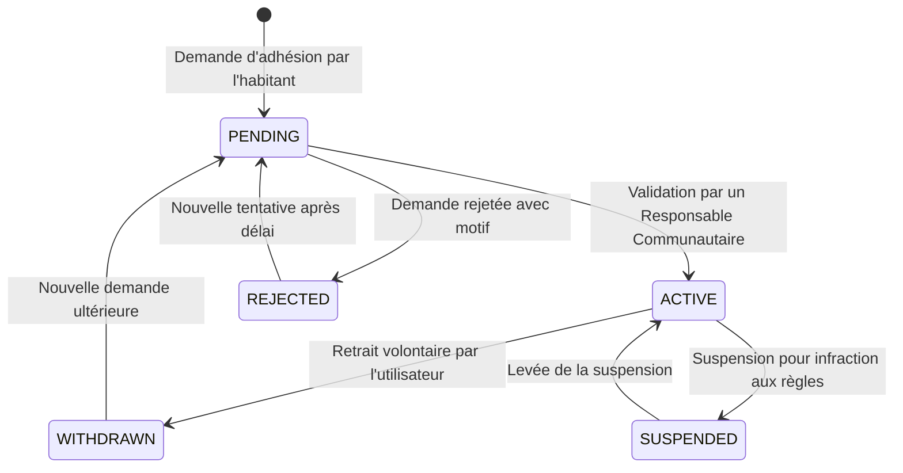
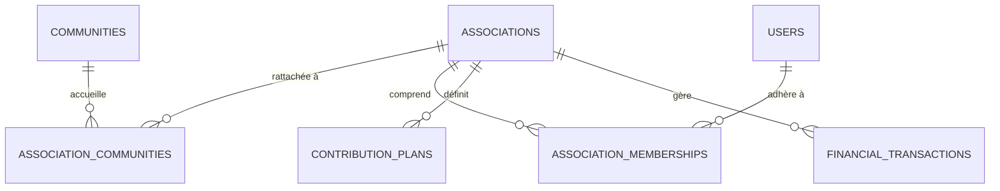
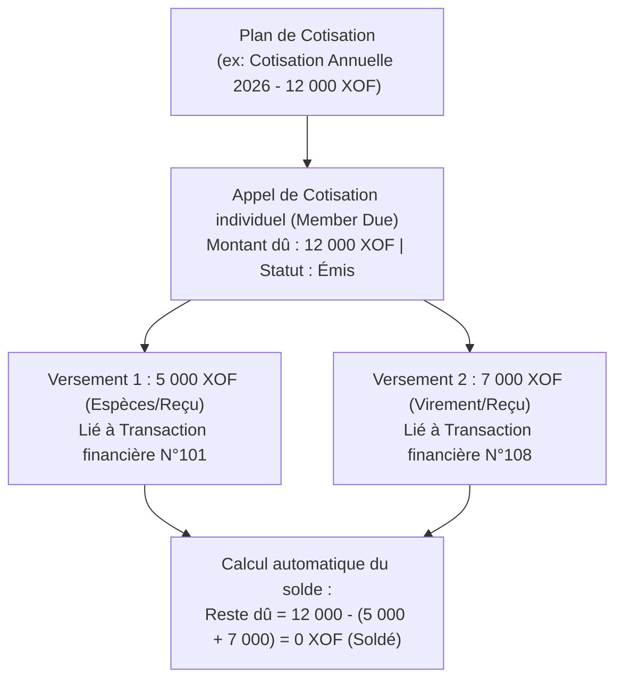

# My Community — Spécifications Fonctionnelles Détaillées

**Version :** 1.0  
**Date :** 21 octobre 2026  
**Document cible :** Équipes Produit, UX/UI & Développeurs Backend/Frontend  

---

## 1. Processus de Création et Validation d'une Communauté

### 1.1 Description du Workflow
La création d'une communauté numérique locale ne peut pas être libre et instantanée. Elle fait l'objet d'un processus de soumission, d'instruction territoriale et de validation explicite par l'administration centrale.

### 1.2 Règles Fonctionnelles Associées
1. **Éligibilité du demandeur :** Tout utilisateur disposant d'un compte actif (`users.status = 'ACTIVE'`) peut soumettre une proposition.
2. **Données minimales requises :** Nom, territoire de rattachement (`territory_id`), description et justification de l'intérêt public local.
3. **Absence d'espace privé prématuré :** Une proposition `PENDING` ou `NEEDS_INFO` ne crée aucun fil de discussion ni espace accessible aux membres.
4. **Contrôle d'unicité et de similitude :** Avant soumission, le système compare la proposition aux communautés existantes ou en cours sur le même territoire ou territoires voisins afin de prévenir la fragmentation.
5. **Désignation du responsable :** La proposition n'attribue pas automatiquement les droits d'administration à son auteur. Lors de l'approbation, l'administrateur confirme ou nomme explicitement le Responsable Communautaire initial (`MANAGER`).
6. **Traçabilité des décisions :** Chaque changement d'état enregistre l'identifiant de l'administrateur (`reviewed_by`), l'horodatage (`reviewed_at`) et la note explicative (`review_note`).
7. **Suspension administrative :** Une communauté passée à l'état `SUSPENDED` gèle immédiatement les nouvelles demandes d'adhésion et la publication de contenus.

---

## 2. Gestion des Adhésions Multi-Communautés

### 2.1 Indépendance Totale des Adhésions
Un utilisateur peut être membre de plusieurs communautés distinctes (ex : communauté de son quartier d'habitation et communauté de son village d'origine). L'état d'adhésion dans l'une n'influe en aucun cas sur l'autre.

### 2.2 Cycle de Vie de l'Adhésion

### 2.3 Rôles Communautaires et Permissions Associées
Une adhésion active (`ACTIVE`) peut être associée à un ou plusieurs rôles dans la table `community_membership_roles` :
- `MEMBER` : Rôle par défaut. Consultation des publications privées, création de posts, commentaires, likes, inscription aux événements.
- `MODERATOR` : Capacités du membre + traitement des signalements locaux, masquage des publications non conformes.
- `MANAGER` : Capacités du modérateur + validation/rejet des demandes d'adhésion, suspension de membres, mise à jour de la fiche communauté, nomination de modérateurs.

---

## 3. Associations Présentes dans Plusieurs Localités

### 3.1 Conception Multi-Rattachement
Une association loi 1901 ou collectif citoyen constitue **une seule et même entité juridique** dans le système :
- Elle possède une fiche publique unique (`associations`), avec son identité, sa description et son responsable légal (`created_by`).
- Elle se rattache à une ou plusieurs communautés locales via la table de liaison `association_communities`.
- Ce modèle évite de dupliquer les associations et permet à une même ONG ou association sportive d'animer des actions à Cotonou, Porto-Novo et Parakou sous une seule identité.

### 3.2 Indépendance des Rôles Associatifs vs Communautaires
- Les adhésions associatives (`association_memberships`) et leurs rôles internes (`association_membership_roles` : `PRESIDENT`, `SECRETARY`, `TREASURER`, `MANAGER`, `MEMBER`) sont **strictement indépendants** des rôles communautaires.
- Un Responsable Communautaire d'une localité n'a **aucun droit d'accès** aux données de gestion ou de trésorerie de l'association, même si celle-ci intervient dans sa communauté.

---

## 4. Réseau Social : Fils d'Actualité et Audiences

### 4.1 Règle d'Agrégation du Fil Général
Le **Fil Général** n'est pas un flux public mondial de toutes les données du serveur. Il obéit à la règle stricte :

$$\text{Publications du Fil Général} = \bigcup_{c \in \text{CommunautésActives}(\text{Utilisateur})} \text{PublicationsAutorisées}(c)$$

### 4.2 Matrice d'Accès aux Publications

| Statut Publication | Visibilité | Visiteur non connecté | Membre actif de la communauté | Membre d'une autre communauté |
| :--- | :--- | :---: | :---: | :---: |
| `PUBLISHED` | `PUBLIC` | ✅ Visible | ✅ Visible | ✅ Visible |
| `PUBLISHED` | `MEMBERS` | ❌ Bloqué (404/403) | ✅ Visible | ❌ Bloqué (404/403) |
| `DRAFT` | Indifférent | ❌ Bloqué | ❌ Bloqué (sauf auteur) | ❌ Bloqué |
| `HIDDEN` / `REMOVED`| Indifférent | ❌ Bloqué | ❌ Bloqué (sauf modérateur) | ❌ Bloqué |

---

## 5. Gestion Associative et Trésorerie (XOF)

### 5.1 Modèle des Cotisations et Versements
Le MVP assure le suivi des cotisations périodiques sans imposer un paiement immédiat ou unitaire :

### 5.2 Règles de Gestion Financière
1. **Monnaie obligatoire :** Enregistrement de la devise explicite (défaut : `XOF`).
2. **Traçabilité intégrale :** Tout versement de cotisation (`contribution_payments`) pointe vers une écriture dans `financial_transactions` avec `recorded_by` et horodatage UTC.
3. **Immutabilité des écritures confirmées :** Une transaction passée au statut `POSTED` ne peut plus être modifiée ni supprimée directement. Une erreur doit être corrigée par une écriture de contre-passation (`ADJUSTMENT`).
4. **Cloisonnement des rapports :** Seuls les utilisateurs porteurs des rôles `TREASURER`, `PRESIDENT` ou `MANAGER` de l'association ont accès au grand livre et aux synthèses financières.
