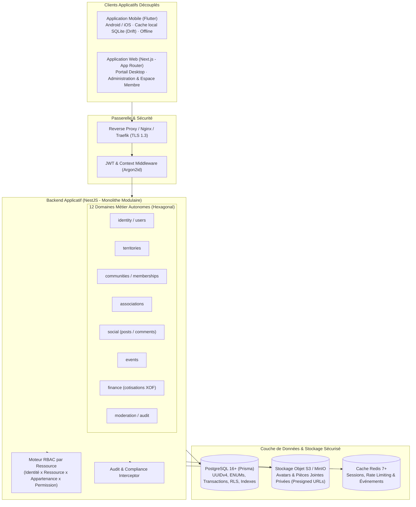
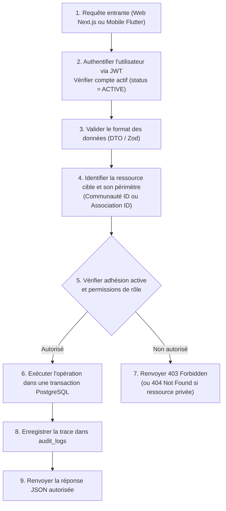

# My Community — Architecture Technique Globale

**Version :** 2.0  
**Date :** 21 octobre 2026  
**Document cible :** Architectes Logiciels, Ingénieurs Backend, Frontend & DevOps  
**Technologies de référence :** Monorepo (pnpm + Turborepo) · NestJS · PostgreSQL (Prisma) · Next.js · Flutter  

---

## 1. Vue d'Ensemble du Système et Topologie

**My Community** adopte une architecture client-serveur moderne, découplée et résiliente, conçue sous la forme d'un **Monolithe Modulaire** backend avec deux clients applicatifs dédiés partageant des contrats OpenAPI stricts.



---

## 2. Découpage Hexagonal des Modules Métier (Clean Architecture)

Chaque module NestJS suit une organisation en quatre couches bien séparées :

```text
module-name/
├── domain/                    # Cœur Métier Pur (indépendant du framework et de la BDD)
│   ├── entities/              # Modèles de domaine invariants
│   ├── value-objects/         # Objets valeurs immuables (ex: MontantXOF, Slug)
│   ├── policies/              # Règles d'autorisation et d'état (ex: CommunityApprovalPolicy)
│   └── errors/                # Exceptions métier spécifiques
│
├── application/               # Cas d'Utilisation (Orchestration des scénarios)
│   ├── commands/              # Mutations métier (ProposeCommunityCommand, etc.)
│   ├── queries/               # Lectures et projections de données
│   └── ports/                 # Interfaces abstraites (CommunityRepositoryPort, etc.)
│
├── infrastructure/            # Implémentations Techniques & Adaptateurs
│   ├── persistence/           # PrismaCommunityRepository, Mappers Entité <-> Prisma
│   └── external/              # Passerelles e-mails, SMS OTP, S3 Storage
│
├── presentation/              # Adaptateurs Entrants (Transport)
│   └── http/
│       ├── controllers/       # Contrôleurs HTTP minces
│       ├── dto/               # Schémas d'entrée validés (class-validator)
│       └── mappers/           # Transformation DTO <-> Commande
│
├── module-name.module.ts      # Déclaration NestJS et câblage de l'injection de dépendances
└── index.ts                   # Façade publique exposant uniquement ce qui est autorisé
```

### Règles Impératives entre les Couches :
1. **Sens des dépendances :** `presentation` $\rightarrow$ `application` $\rightarrow$ `domain` $\leftarrow$ `infrastructure`.
2. **Indépendance du Domaine :** Le dossier `domain/` ne contient aucun décorateur `@Injectable()` NestJS ni aucun type généré par Prisma.
3. **Contrôleurs minces :** Un contrôleur ne contient aucune logique de validation métier ni de calcul de solde. Il délègue immédiatement au cas d'utilisation applicatif.

---

## 3. Exigence Formelle des Principes SOLID (Système Complet)

L'architecture technique de **My Community** impose le respect inconditionnel des **5 principes SOLID** sur le Backend (NestJS), le Web (Next.js) et le Mobile (Flutter) :

- **S (Single Responsibility) :** Chaque classe a une seule raison de changer. Contrôleurs minces (routage uniquement), Cas d'Usage uniques par scénario applicatif (pas de "God Services"), composants d'affichage React/Flutter découplés de la logique réseau.
- **O (Open/Closed) :** Cœur applicatif ouvert à l'extension, fermé à la modification. Strategy Pattern pour les passerelles de paiement (MoMo, Celtiis, Stripe) et fournisseurs OTP ; Domain Events pour découpler les effets secondaires (audit, notifications).
- **L (Liskov Substitution) :** Tout adaptateur concret (`PrismaCommunityRepository`, `InMemoryCommunityRepository` pour les tests unitaire) doit pouvoir se substituer à son abstraction sans changer la sémantique ni provoquer de régression.
- **I (Interface Segregation) :** Proscription des interfaces monolithiques. Ségrégation stricte des ports de lecture (`ReaderPort`) et d'écriture (`WriterPort`). Props UI limitées aux stricts besoins d'affichage.
- **D (Dependency Inversion) :** Le Domaine et l'Application ne dépendent d'aucun détail d'infrastructure (Prisma, S3, Redis, Dio, Drift). Les modules de haut niveau et de bas niveau dépendent d'abstractions (Ports) injectées par IoC.

> 📖 **Référence complète :** [Guide des Principes SOLID](file:///c:/Sikirou/eskay/my_community/docs/architecture/principes-solid.md) · [ADR-011](file:///c:/Sikirou/eskay/my_community/docs/adr/ADR-011-principes-solid-architecture.md)

---

## 4. Architecture des Permissions et du Contrôle d'Accès

Le système met en œuvre un modèle de **RBAC contextuel par ressource**.



---

## 5. Stratégie Multi-Plateforme et Contrats d'API

### 5.1 Contrats Découplés via OpenAPI
- Le backend NestJS sert de **source de vérité** pour les contrats d'API grâce aux décorateurs Swagger/OpenAPI.
- L'export de la spécification OpenAPI (`openapi.json`) permet de générer automatiquement :
  - Un client TypeScript avec types stricts pour l'application **Next.js** (`@my-community/api-client`).
  - Un client Dart fortement typé pour l'application **Flutter** via `openapi_generator_cli`.
- Cette approche élimine toute dérive de contrat entre le serveur et les applications clientes.

### 5.2 Stratégie Hors Ligne Mobile (Flutter)
- **Consultation seule en cache local :** Les publications, fiches d'associations et profils déjà téléchargés sont indexés localement dans une base SQLite embarquée (via **Drift**).
- **Sécurité et Purge :**
  - Aucune information financière ni mot de passe n'est stocké en local.
  - La déconnexion explicite ou le changement de compte déclenche une **purge immédiate et totale** de la base locale de cache.
  - Un bandeau prévient l'utilisateur que les informations affichées peuvent être obsolètes.

---

## 6. Row-Level Security (PostgreSQL RLS)

En complément des gardes NestJS applicatives, PostgreSQL applique des politiques **Row-Level Security (RLS)** pour interdire les fuites en cas de requête directe mal formée :
```sql
ALTER TABLE posts ENABLE ROW LEVEL SECURITY;

CREATE POLICY posts_community_isolation_policy ON posts
  FOR SELECT
  USING (
    visibility = 'PUBLIC'
    OR EXISTS (
      SELECT 1 FROM community_memberships cm
      WHERE cm.community_id = posts.community_id
        AND cm.user_id = current_setting('app.current_user_id', true)::uuid
        AND cm.status = 'ACTIVE'
    )
  );
```
