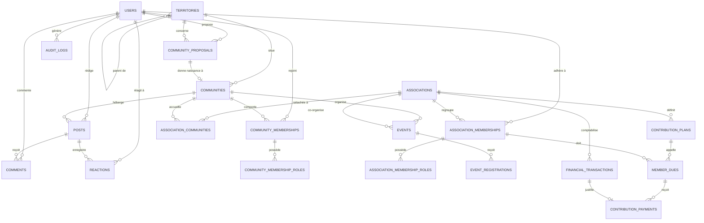

# My Community — Modèle de Base de Données et Script SQL

**Version :** 1.0  
**Date :** 21 octobre 2026  
**SGBD Cible :** PostgreSQL 15 / 16  
**Extension requise :** `pgcrypto` (pour `gen_random_uuid()`)  

---

## 🛠️ Commandes Prisma & Gestion de la Base

Le schéma Prisma officiel est centralisé dans [`database/prisma/schema.prisma`](file:///c:/Sikirou/eskay/my_community/database/prisma/schema.prisma).

```powershell
# Synchroniser le schéma avec la base locale (db push)
pnpm run db:push

# Créer une migration versionnée (Prisma Migrate)
pnpm run db:migrate

# Régénérer le client Prisma typé (@prisma/client)
pnpm run db:generate

# Ouvrir l'explorateur visuel Prisma Studio (http://localhost:5555)
pnpm run db:studio
```

---

## 1. Dictionnaire des Types Énumérés (ENUMs)

```sql
CREATE TYPE user_status AS ENUM ('ACTIVE', 'SUSPENDED', 'CLOSED');
CREATE TYPE community_status AS ENUM ('ACTIVE', 'SUSPENDED', 'ARCHIVED');
CREATE TYPE proposal_status AS ENUM ('PENDING', 'NEEDS_INFO', 'APPROVED', 'REJECTED', 'WITHDRAWN');
CREATE TYPE membership_status AS ENUM ('PENDING', 'ACTIVE', 'REJECTED', 'WITHDRAWN', 'SUSPENDED');
CREATE TYPE association_status AS ENUM ('PENDING', 'ACTIVE', 'SUSPENDED', 'ARCHIVED');
CREATE TYPE content_status AS ENUM ('DRAFT', 'PUBLISHED', 'HIDDEN', 'REMOVED');
CREATE TYPE finance_transaction_type AS ENUM ('INCOME', 'EXPENSE', 'ADJUSTMENT');
CREATE TYPE finance_transaction_status AS ENUM ('PENDING', 'POSTED', 'VOID');
```

---

## 2. Diagramme Entité-Association Global (ERD)



---

## 3. Script SQL de Migration Initiale de Référence

```sql
-- =============================================================================
-- Migration Initiale : My Community MVP
-- Version : 1.0 (21 octobre 2026)
-- =============================================================================

CREATE EXTENSION IF NOT EXISTS pgcrypto;

-- 1. Énumérations
CREATE TYPE user_status AS ENUM ('ACTIVE', 'SUSPENDED', 'CLOSED');
CREATE TYPE community_status AS ENUM ('ACTIVE', 'SUSPENDED', 'ARCHIVED');
CREATE TYPE proposal_status AS ENUM ('PENDING', 'NEEDS_INFO', 'APPROVED', 'REJECTED', 'WITHDRAWN');
CREATE TYPE membership_status AS ENUM ('PENDING', 'ACTIVE', 'REJECTED', 'WITHDRAWN', 'SUSPENDED');
CREATE TYPE association_status AS ENUM ('PENDING', 'ACTIVE', 'SUSPENDED', 'ARCHIVED');
CREATE TYPE content_status AS ENUM ('DRAFT', 'PUBLISHED', 'HIDDEN', 'REMOVED');
CREATE TYPE finance_transaction_type AS ENUM ('INCOME', 'EXPENSE', 'ADJUSTMENT');
CREATE TYPE finance_transaction_status AS ENUM ('PENDING', 'POSTED', 'VOID');

-- 2. Table Utilisateurs
CREATE TABLE users (
  id UUID PRIMARY KEY DEFAULT gen_random_uuid(),
  email TEXT UNIQUE,
  phone TEXT UNIQUE,
  password_hash TEXT,
  display_name TEXT NOT NULL,
  avatar_key TEXT,
  status user_status NOT NULL DEFAULT 'ACTIVE',
  created_at TIMESTAMPTZ NOT NULL DEFAULT now(),
  updated_at TIMESTAMPTZ NOT NULL DEFAULT now(),
  CHECK (email IS NOT NULL OR phone IS NOT NULL)
);

-- 3. Table Territoires (Hiérarchie géographique)
CREATE TABLE territories (
  id UUID PRIMARY KEY DEFAULT gen_random_uuid(),
  parent_id UUID REFERENCES territories(id),
  type TEXT NOT NULL,
  name TEXT NOT NULL,
  normalized_name TEXT NOT NULL,
  country_code CHAR(2) NOT NULL,
  created_at TIMESTAMPTZ NOT NULL DEFAULT now(),
  CHECK (parent_id IS NULL OR parent_id <> id),
  UNIQUE (parent_id, normalized_name, type)
);

-- 4. Table Propositions de Communautés
CREATE TABLE community_proposals (
  id UUID PRIMARY KEY DEFAULT gen_random_uuid(),
  proposed_by UUID NOT NULL REFERENCES users(id),
  territory_id UUID NOT NULL REFERENCES territories(id),
  name TEXT NOT NULL,
  description TEXT NOT NULL,
  status proposal_status NOT NULL DEFAULT 'PENDING',
  reviewed_by UUID REFERENCES users(id),
  reviewed_at TIMESTAMPTZ,
  review_note TEXT,
  created_at TIMESTAMPTZ NOT NULL DEFAULT now()
);

-- 5. Table Communautés Numériques
CREATE TABLE communities (
  id UUID PRIMARY KEY DEFAULT gen_random_uuid(),
  territory_id UUID NOT NULL REFERENCES territories(id),
  name TEXT NOT NULL,
  slug TEXT NOT NULL UNIQUE,
  description TEXT NOT NULL DEFAULT '',
  visibility TEXT NOT NULL DEFAULT 'PRIVATE' CHECK (visibility IN ('PUBLIC', 'PRIVATE')),
  status community_status NOT NULL DEFAULT 'ACTIVE',
  approved_proposal_id UUID UNIQUE REFERENCES community_proposals(id),
  created_at TIMESTAMPTZ NOT NULL DEFAULT now(),
  updated_at TIMESTAMPTZ NOT NULL DEFAULT now()
);

-- 6. Adhésions Communautaires
CREATE TABLE community_memberships (
  id UUID PRIMARY KEY DEFAULT gen_random_uuid(),
  community_id UUID NOT NULL REFERENCES communities(id),
  user_id UUID NOT NULL REFERENCES users(id),
  status membership_status NOT NULL DEFAULT 'PENDING',
  requested_at TIMESTAMPTZ NOT NULL DEFAULT now(),
  decided_by UUID REFERENCES users(id),
  decided_at TIMESTAMPTZ,
  ended_at TIMESTAMPTZ,
  UNIQUE (community_id, user_id)
);

-- 7. Rôles Communautaires
CREATE TABLE community_membership_roles (
  membership_id UUID NOT NULL REFERENCES community_memberships(id),
  role TEXT NOT NULL CHECK (role IN ('MEMBER', 'MODERATOR', 'MANAGER')),
  granted_by UUID NOT NULL REFERENCES users(id),
  granted_at TIMESTAMPTZ NOT NULL DEFAULT now(),
  PRIMARY KEY (membership_id, role)
);

-- 8. Associations
CREATE TABLE associations (
  id UUID PRIMARY KEY DEFAULT gen_random_uuid(),
  name TEXT NOT NULL,
  slug TEXT NOT NULL UNIQUE,
  description TEXT NOT NULL DEFAULT '',
  created_by UUID NOT NULL REFERENCES users(id),
  status association_status NOT NULL DEFAULT 'PENDING',
  visibility TEXT NOT NULL DEFAULT 'PUBLIC' CHECK (visibility IN ('PUBLIC', 'MEMBERS')),
  created_at TIMESTAMPTZ NOT NULL DEFAULT now()
);

-- 9. Rattachements Multi-Communautés pour Associations
CREATE TABLE association_communities (
  association_id UUID NOT NULL REFERENCES associations(id),
  community_id UUID NOT NULL REFERENCES communities(id),
  status TEXT NOT NULL DEFAULT 'ACTIVE' CHECK (status IN ('ACTIVE', 'INACTIVE')),
  created_at TIMESTAMPTZ NOT NULL DEFAULT now(),
  PRIMARY KEY (association_id, community_id)
);

-- 10. Adhésions Associatives
CREATE TABLE association_memberships (
  id UUID PRIMARY KEY DEFAULT gen_random_uuid(),
  association_id UUID NOT NULL REFERENCES associations(id),
  user_id UUID NOT NULL REFERENCES users(id),
  status membership_status NOT NULL DEFAULT 'PENDING',
  requested_at TIMESTAMPTZ NOT NULL DEFAULT now(),
  decided_by UUID REFERENCES users(id),
  decided_at TIMESTAMPTZ,
  UNIQUE (association_id, user_id)
);

-- 11. Rôles Associatifs
CREATE TABLE association_membership_roles (
  membership_id UUID NOT NULL REFERENCES association_memberships(id),
  role TEXT NOT NULL CHECK (role IN ('MEMBER', 'PRESIDENT', 'SECRETARY', 'TREASURER', 'MANAGER')),
  granted_by UUID NOT NULL REFERENCES users(id),
  granted_at TIMESTAMPTZ NOT NULL DEFAULT now(),
  PRIMARY KEY (membership_id, role)
);

-- 12. Publications (Posts)
CREATE TABLE posts (
  id UUID PRIMARY KEY DEFAULT gen_random_uuid(),
  community_id UUID NOT NULL REFERENCES communities(id),
  author_id UUID NOT NULL REFERENCES users(id),
  association_id UUID REFERENCES associations(id),
  body TEXT NOT NULL,
  visibility TEXT NOT NULL DEFAULT 'MEMBERS' CHECK (visibility IN ('PUBLIC', 'MEMBERS')),
  status content_status NOT NULL DEFAULT 'DRAFT',
  published_at TIMESTAMPTZ,
  created_at TIMESTAMPTZ NOT NULL DEFAULT now(),
  updated_at TIMESTAMPTZ NOT NULL DEFAULT now()
);

-- 13. Commentaires
CREATE TABLE comments (
  id UUID PRIMARY KEY DEFAULT gen_random_uuid(),
  post_id UUID NOT NULL REFERENCES posts(id),
  author_id UUID NOT NULL REFERENCES users(id),
  body TEXT NOT NULL,
  status content_status NOT NULL DEFAULT 'PUBLISHED',
  created_at TIMESTAMPTZ NOT NULL DEFAULT now()
);

-- 14. Réactions
CREATE TABLE reactions (
  post_id UUID NOT NULL REFERENCES posts(id),
  user_id UUID NOT NULL REFERENCES users(id),
  reaction_type TEXT NOT NULL DEFAULT 'LIKE',
  created_at TIMESTAMPTZ NOT NULL DEFAULT now(),
  PRIMARY KEY (post_id, user_id, reaction_type)
);

-- 15. Événements
CREATE TABLE events (
  id UUID PRIMARY KEY DEFAULT gen_random_uuid(),
  community_id UUID NOT NULL REFERENCES communities(id),
  association_id UUID REFERENCES associations(id),
  created_by UUID NOT NULL REFERENCES users(id),
  title TEXT NOT NULL,
  description TEXT NOT NULL DEFAULT '',
  starts_at TIMESTAMPTZ NOT NULL,
  ends_at TIMESTAMPTZ,
  location_text TEXT,
  visibility TEXT NOT NULL DEFAULT 'MEMBERS' CHECK (visibility IN ('PUBLIC', 'MEMBERS')),
  status TEXT NOT NULL DEFAULT 'DRAFT' CHECK (status IN ('DRAFT', 'PUBLISHED', 'CANCELLED', 'COMPLETED')),
  created_at TIMESTAMPTZ NOT NULL DEFAULT now(),
  CHECK (ends_at IS NULL OR ends_at >= starts_at)
);

-- 16. Inscriptions aux Événements
CREATE TABLE event_registrations (
  event_id UUID NOT NULL REFERENCES events(id),
  user_id UUID NOT NULL REFERENCES users(id),
  status TEXT NOT NULL DEFAULT 'REGISTERED' CHECK (status IN ('REGISTERED', 'CANCELLED', 'ATTENDED')),
  registered_at TIMESTAMPTZ NOT NULL DEFAULT now(),
  PRIMARY KEY (event_id, user_id)
);

-- 17. Transactions Financières
CREATE TABLE financial_transactions (
  id UUID PRIMARY KEY DEFAULT gen_random_uuid(),
  association_id UUID NOT NULL REFERENCES associations(id),
  type finance_transaction_type NOT NULL,
  status finance_transaction_status NOT NULL DEFAULT 'PENDING',
  amount NUMERIC(14,2) NOT NULL CHECK (amount > 0),
  currency CHAR(3) NOT NULL DEFAULT 'XOF',
  description TEXT NOT NULL,
  occurred_at TIMESTAMPTZ NOT NULL,
  recorded_by UUID NOT NULL REFERENCES users(id),
  validated_by UUID REFERENCES users(id),
  validated_at TIMESTAMPTZ,
  created_at TIMESTAMPTZ NOT NULL DEFAULT now()
);

-- 18. Plans de Cotisations
CREATE TABLE contribution_plans (
  id UUID PRIMARY KEY DEFAULT gen_random_uuid(),
  association_id UUID NOT NULL REFERENCES associations(id),
  name TEXT NOT NULL,
  amount NUMERIC(14,2) NOT NULL CHECK (amount > 0),
  currency CHAR(3) NOT NULL DEFAULT 'XOF',
  frequency TEXT NOT NULL CHECK (frequency IN ('ONCE', 'MONTHLY', 'QUARTERLY', 'YEARLY')),
  active BOOLEAN NOT NULL DEFAULT TRUE,
  created_at TIMESTAMPTZ NOT NULL DEFAULT now()
);

-- 19. Appels de Cotisations (Dues)
CREATE TABLE member_dues (
  id UUID PRIMARY KEY DEFAULT gen_random_uuid(),
  plan_id UUID NOT NULL REFERENCES contribution_plans(id),
  association_membership_id UUID NOT NULL REFERENCES association_memberships(id),
  period_start DATE NOT NULL,
  period_end DATE NOT NULL,
  amount_due NUMERIC(14,2) NOT NULL CHECK (amount_due >= 0),
  created_at TIMESTAMPTZ NOT NULL DEFAULT now(),
  CHECK (period_end >= period_start),
  UNIQUE (plan_id, association_membership_id, period_start, period_end)
);

-- 20. Paiements et Versements de Cotisations
CREATE TABLE contribution_payments (
  id UUID PRIMARY KEY DEFAULT gen_random_uuid(),
  due_id UUID NOT NULL REFERENCES member_dues(id),
  transaction_id UUID NOT NULL UNIQUE REFERENCES financial_transactions(id),
  amount NUMERIC(14,2) NOT NULL CHECK (amount > 0),
  received_at TIMESTAMPTZ NOT NULL,
  recorded_by UUID NOT NULL REFERENCES users(id),
  receipt_reference TEXT,
  created_at TIMESTAMPTZ NOT NULL DEFAULT now()
);

-- 21. Notifications In-App
CREATE TABLE notifications (
  id UUID PRIMARY KEY DEFAULT gen_random_uuid(),
  user_id UUID NOT NULL REFERENCES users(id),
  type TEXT NOT NULL,
  payload JSONB NOT NULL DEFAULT '{}'::jsonb,
  read_at TIMESTAMPTZ,
  created_at TIMESTAMPTZ NOT NULL DEFAULT now()
);

-- 22. Signalements (Modération)
CREATE TABLE reports (
  id UUID PRIMARY KEY DEFAULT gen_random_uuid(),
  reporter_id UUID NOT NULL REFERENCES users(id),
  target_type TEXT NOT NULL,
  target_id UUID NOT NULL,
  reason TEXT NOT NULL,
  details TEXT,
  status TEXT NOT NULL DEFAULT 'OPEN' CHECK (status IN ('OPEN', 'REVIEWING', 'RESOLVED', 'DISMISSED')),
  assigned_to UUID REFERENCES users(id),
  created_at TIMESTAMPTZ NOT NULL DEFAULT now(),
  resolved_at TIMESTAMPTZ
);

-- 23. Journal d'Audit Système
CREATE TABLE audit_logs (
  id UUID PRIMARY KEY DEFAULT gen_random_uuid(),
  actor_id UUID REFERENCES users(id),
  action TEXT NOT NULL,
  resource_type TEXT NOT NULL,
  resource_id UUID,
  community_id UUID REFERENCES communities(id),
  association_id UUID REFERENCES associations(id),
  metadata JSONB NOT NULL DEFAULT '{}'::jsonb,
  created_at TIMESTAMPTZ NOT NULL DEFAULT now()
);

-- =============================================================================
-- Index de Performance et d'Accélérations de Requêtes
-- =============================================================================

CREATE INDEX idx_memberships_user_status ON community_memberships(user_id, status);
CREATE INDEX idx_memberships_community_status ON community_memberships(community_id, status);
CREATE INDEX idx_association_members_user ON association_memberships(user_id, status);

CREATE INDEX idx_posts_community_feed ON posts(community_id, published_at DESC, id DESC) WHERE status = 'PUBLISHED';
CREATE INDEX idx_events_community_date ON events(community_id, starts_at);
CREATE INDEX idx_transactions_association_date ON financial_transactions(association_id, occurred_at DESC);
CREATE INDEX idx_notifications_user_date ON notifications(user_id, created_at DESC);
```

---

## 4. Compléments Obligatoires Avant Mise en Production

1. **Validation croisée Association / Communauté :** Lors de la création d'un post ou d'un événement mentionnant une association et une communauté, une fonction trigger ou validation de service applicatif doit vérifier que le couple existe bien dans `association_communities` avec le statut `ACTIVE`.
2. **Cohérence financière stricte :** Garantie qu'une transaction liée à un `contribution_payments` appartient à la même association que celle du `contribution_plans`.
3. **Immutabilité des transactions confirmées :** Trigger empêchant la modification (`UPDATE`) ou la suppression physique (`DELETE`) d'une ligne de `financial_transactions` ayant le statut `POSTED`.
