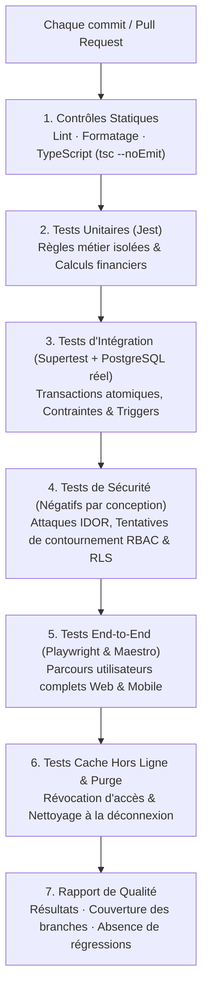
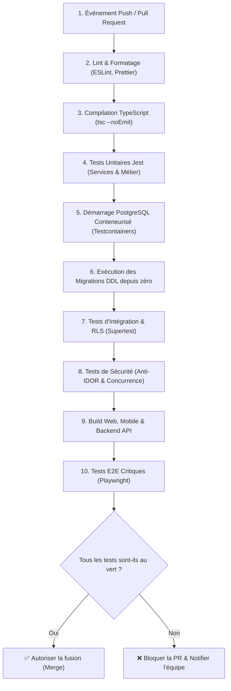

# My Community — Stratégie Complète de Tests Automatisés

**Plan de qualité logicielle :** NestJS · PostgreSQL · Next.js · React Native / Flutter  
**Version :** 1.0  
**Date de référence :** 21 octobre 2026  
**Document cible :** Équipes QA, Ingénieurs Backend, Frontend & DevOps  

---

## 1. Principes Fondamentaux de la Stratégie de Test

Pour **My Community**, aucune fonctionnalité n'est considérée comme achevée ou fiable tant que ses règles métier, ses permissions contextuelles et ses cas d'échec ne sont pas testés automatiquement.

Le risque majeur identifié n'est pas uniquement un dysfonctionnement applicatif : c'est qu'une fonctionnalité s'exécute correctement pour un utilisateur habilité, mais **laisse fuiter des données privées** vers un autre utilisateur qui ne devrait en aucun cas y avoir accès (failles IDOR, défauts d'isolation entre communautés ou associations).

La stratégie d'assurance qualité couvre cinq dimensions complémentaires :
1. **Tests unitaires :** Valider les règles métier isolément de tout service externe.
2. **Tests d'intégration :** Valider le comportement réel de NestJS, des transactions PostgreSQL et de l'intégrité relationnelle.
3. **Tests de sécurité :** Tenter explicitement de contourner le RBAC par ressource et les contrôles d'accès.
4. **Tests End-to-End (E2E) :** Valider les parcours critiques des utilisateurs sur navigateur Web et terminaux mobiles.
5. **Tests du cache hors ligne :** Valider la conservation des données, la révocation d'accès et la purge intégrale à la déconnexion.

---

## 2. Stack Technique de Tests Recommandée

| Composant | Outil Recommandé | Rôle & Objectif |
| :--- | :--- | :--- |
| **Backend NestJS** | Jest | Tests unitaires isolés et tests des services métier |
| **API HTTP** | Supertest | Tests d'intégration d'API et validation des codes HTTP |
| **Base de données** | PostgreSQL réel en conteneur | Validation des transactions, contraintes, triggers, index et RLS |
| **Environnement de test** | Testcontainers / Docker Compose | Environnement de base de données éphémère et déterministe |
| **Frontend Web** | Playwright | Scénarios E2E sur navigateurs réels (Chromium, Firefox, WebKit) |
| **Mobile (React Native / Flutter)** | Jest + Testing Library | Tests des composants visuels, états locaux et logique du cache |
| **Mobile E2E** | Maestro ou Detox | Scénarios automatisés sur émulateurs Android et simulateurs iOS |
| **Couverture de code** | Jest Coverage / Istanbul | Analyse fine de couverture (lignes, branches, fonctions) |
| **CI/CD** | GitHub Actions | Exécution automatisée bloquante à chaque Pull Request |

> [!IMPORTANT]
> **Pas de base simulée (SQLite/In-Memory) pour l'intégration :** Ne jamais substituer PostgreSQL par SQLite pour les tests d'intégration. Les contraintes d'intégrité, les transactions concurrentes et les politiques Row-Level Security (RLS) doivent impérativement être validées sur le moteur PostgreSQL réel.

---

## 3. Architecture Globale de la Chaîne de Tests



---

## 4. Environnements et Données de Test (Fixtures Déterministes)

L'environnement de test est totalement étanche et distinct de la production. Chaque test s'exécute avec des fixtures stables et déterministes.

### Jeu de Données de Référence

| Identifiant Logique | Profil Utilisateur | Rôle & Permissions Attribuées |
| :--- | :--- | :--- |
| `admin_1` | Administrateur Plateforme | Peut instruire et approuver les propositions de communauté |
| `alice` | Habitante / Membre | Peut proposer et rejoindre des communautés (membre de A et B) |
| `bruno` | Habitant Ordinaire | Membre ordinaire de B, aucun droit de gestion ni accès financier |
| `carole` | Responsable Communautaire | Gestionnaire (`MANAGER`) de la communauté A uniquement |
| `david` | Trésorier Associatif | Trésorier (`TREASURER`) de l'association A, gère cotisations et livre des comptes |
| `eve` | Membre Externe | Membre d'une autre communauté C, sert à valider le rejet des accès croisés |
| `association_A` | Association Culturelle | Rattachée aux communautés A et B via `association_communities` |
| `community_A` | Quartier A | Première communauté validée et active (`ACTIVE`) |
| `community_B` | Quartier B | Deuxième communauté validée et active (`ACTIVE`) |
| `community_pending` | Proposition en attente | Communauté soumise au statut `PENDING` (aucun espace membre actif) |

### Protocole d'Isolation entre Tests
1. Démarrer un conteneur PostgreSQL isolé via **Testcontainers**.
2. Appliquer les migrations DDL depuis zéro (`schema.sql`).
3. Insérer le jeu de données déterministe avant chaque suite.
4. Exécuter le test unitaire ou d'intégration.
5. Nettoyer les données ou réinitialiser la transaction (`ROLLBACK` ou purge contrôlée).
6. Vérifier que la suite de tests est totalement idempotente et s'exécute dans n'importe quel ordre.

---

## 5. Tests Unitaires : Règles Métier NestJS

Les tests unitaires mockent les dépendances externes (S3, base de données, réseau) pour se focaliser sur l'exactitude des calculs et la logique d'état.

### 5.1 Module Communautés (`CommunityProposalsService`, `CommunityMembershipsService`)

| Identifiant | Scénario Testé | Résultat Attendu |
| :--- | :--- | :--- |
| `COM-U01` | Alice soumet une proposition avec des données complètes et valides | Proposition enregistrée avec le statut `PENDING` |
| `COM-U02` | Soumission d'une proposition sans territoire de rattachement | Rejet immédiat par validation DTO (`BadRequestException`) |
| `COM-U03` | Alice consulte le suivi de sa propre proposition | Statut et motif de suivi retournés avec succès |
| `COM-U04` | Alice tente d'approuver sa propre proposition de communauté | Action interdite (`ForbiddenException`) |
| `COM-U05` | Un administrateur de plateforme habilité valide la proposition | Statut `APPROVED`, génération du slug, création de l'espace |
| `COM-U06` | Un administrateur refuse la proposition avec un motif | Statut `REJECTED`, motif consigné dans l'historique |
| `COM-U07` | Alice demande à rejoindre la Communauté A puis la Communauté B | Deux adhésions distinctes créées, totalement indépendantes |
| `COM-U08` | Alice soumet deux demandes simultanées pour la même communauté A | Une seule adhésion courante créée (rejet du doublon) |
| `COM-U09` | L'adhésion d'Alice à la Communauté A est suspendue | Ses droits d'accès et d'écriture dans A sont immédiatement révoqués |
| `COM-U10` | Alice consulte la Communauté B après sa suspension dans A | Ses droits actifs dans la Communauté B demeurent inchangés |

### 5.2 Module Associations (`AssociationsService`, `AssociationMembershipsService`)
- Une association peut être rattachée aux communautés A et B sans duplication d'entité.
- L'ajout d'une communauté hôte B ne crée pas une seconde fiche d'association.
- Une demande de rattachement déjà existante ne peut pas être dupliquée en base.
- Une adhésion associative (`association_memberships`) est strictement étanche par rapport à l'adhésion communautaire.
- Un membre de communauté ne devient jamais trésorier ou responsable d'une association sans nomination explicite.
- Le Trésorier de l'association A n'a aucun droit de consultation sur l'association B.
- La dissociation d'une communauté ne détruit pas l'association ni son historique comptable.

### 5.3 Module Réseau Social (`FeedService`, `PostsService`, `CommentsService`)

| Identifiant | Scénario Testé | Résultat Attendu |
| :--- | :--- | :--- |
| `SOC-U01` | Alice est membre actif de A et B | Le fil général agrège les publications autorisées de A et B |
| `SOC-U02` | Alice n'est pas membre de la communauté C | Aucun contenu privé de C n'apparaît dans son fil général |
| `SOC-U03` | Alice consulte le fil dédié de la communauté B | Seules les publications autorisées de B sont retournées |
| `SOC-U04` | Une publication est à l'état brouillon (`DRAFT`) | Elle n'apparaît dans aucun fil public ni membre |
| `SOC-U05` | L'adhésion d'Alice est suspendue dans A | Les publications privées de A deviennent inaccessibles en ligne |
| `SOC-U06` | Alice commente une publication autorisée | Le commentaire est créé et rattaché au post |
| `SOC-U07` | Eve tente de commenter un post privé auquel elle n'a pas accès | Rejet strict de l'écriture sans enregistrement |

### 5.4 Module Finances Associatives (`ContributionService`, `FinancialReportsService`)
- **Cotisation multi-versements :** Cotisation de 12 000 XOF réglée par 5 000 XOF puis 7 000 XOF -> Solde calculé égal à 0 XOF.
- **Versement partiel :** Versement de 5 000 XOF sur 12 000 XOF -> Solde restant dû égal à 7 000 XOF.
- **Paiement excédentaire :** Versement supérieur au montant restant dû -> Rejet sauf politique de crédit d'avance explicite.
- **Montant négatif ou nul :** Rejet systématique (`amount > 0`).
- **Précision monétaire :** Utilisation obligatoire de bibliothèques arithmétiques décimales exactes (ex: `decimal.js`), interdiction formelle des calculs sur nombres flottants JS IEEE 754.

```typescript
// Exemple de test unitaire Jest de calcul financier exact
import { Decimal } from 'decimal.js';

describe('ContributionService - Règle de calcul des soldes', () => {
  it('calcule exactement le solde restant dû après paiements partiels', () => {
    const amountDue = new Decimal('12000.00');
    const payments = [new Decimal('5000.00'), new Decimal('7000.00')];

    const totalPaid = payments.reduce(
      (acc, payment) => acc.plus(payment),
      new Decimal(0),
    );
    const balance = amountDue.minus(totalPaid);

    expect(totalPaid.toString()).toBe('12000.00');
    expect(balance.isZero()).toBe(true);
  });

  it('conserve un solde positif lors d’un versement partiel', () => {
    const amountDue = new Decimal('12000.00');
    const payments = [new Decimal('5000.00')];

    const totalPaid = payments.reduce(
      (acc, payment) => acc.plus(payment),
      new Decimal(0),
    );
    const balance = amountDue.minus(totalPaid);

    expect(balance.toString()).toBe('7000.00');
  });
});
```

---

## 6. Tests d'Intégration : NestJS et PostgreSQL Réel

Les tests d'intégration valident la persistance réelle des données, les transactions ACID et les contraintes SQL.

### 6.1 Matrice des Tests d'Intégration Prioritaires

| ID | Intitulé du Test | Vérification Réalisée |
| :--- | :--- | :--- |
| `DB-01` | **Approbation atomique** | Décision d'approbation et création de l'espace membre au sein d'une seule transaction |
| `DB-02` | **Rollback sur incident** | En cas d'erreur pendant la création de la communauté, aucun enregistrement orphelin n'est créé |
| `DB-03` | **Unicité de l'adhésion** | La contrainte `UNIQUE (community_id, user_id)` bloque toute duplication simultanée |
| `DB-04` | **Rattachements multiples** | Une association peut être liée à $N$ communautés via `association_communities` sans doublon |
| `DB-05` | **Requête du fil agrégé** | La requête SQL filtre à la source les publications selon les adhésions actives de l'utilisateur |
| `DB-06` | **Cohérence des versements** | Le montant cumulé des `contribution_payments` correspond aux transactions `POSTED` |
| `DB-07` | **Paiements concurrents** | Deux requêtes concurrentes de paiement ne créent aucun dépassement de solde |
| `DB-08` | **Immutabilité comptable** | Tentative de suppression d'une transaction `POSTED` bloquée au niveau de la base |
| `DB-09` | **Migrations depuis zéro** | Toutes les tables, contraintes, extensions et index sont créés sans avertissement |
| `DB-10` | **Cloisonnement multi-associations** | Une requête financière sur l'association A n'expose aucune ligne de l'association B |

### 6.2 Test d'Atomicité de l'Approbation Administrative

```typescript
it('exécute l’approbation de communauté et l’audit dans une transaction atomique', async () => {
  await prisma.$transaction(async (tx) => {
    const proposal = await tx.communityProposal.findUnique({
      where: { id: proposalId },
    });

    if (!proposal || proposal.status !== 'PENDING') {
      throw new ConflictException('La proposition n’est plus en attente.');
    }

    const community = await tx.community.create({
      data: {
        name: proposal.name,
        slug: 'communaute-quartier-a',
        territoryId: proposal.territoryId,
        approvedProposalId: proposal.id,
        status: 'ACTIVE',
      },
    });

    await tx.communityProposal.update({
      where: { id: proposal.id },
      data: {
        status: 'APPROVED',
        reviewedBy: adminId,
        reviewedAt: new Date(),
      },
    });

    await tx.auditLog.create({
      data: {
        actorId: adminId,
        action: 'COMMUNITY_PROPOSAL_APPROVED',
        resourceType: 'COMMUNITY',
        resourceId: community.id,
      },
    });
  });

  const createdCommunity = await prisma.community.findFirst({
    where: { approvedProposalId: proposalId },
  });
  expect(createdCommunity).toBeDefined();
  expect(createdCommunity?.status).toBe('ACTIVE');
});
```

---

## 7. Tests de Sécurité : Contournement et Étanchéité (Négatifs par Conception)

### 7.1 Matrice des Tests de Pénétration Applicatifs

| ID | Tentative d'Attaque | Résultat Impératif |
| :--- | :--- | :--- |
| `SEC-01` | Un utilisateur ordinaire appelle la route d'approbation administrative | `403 Forbidden` |
| `SEC-02` | Remplacement de l'ID de communauté dans l'URL par l'ID d'une communauté privée non rejointe (IDOR) | `404 Not Found` ou `403 Forbidden` |
| `SEC-03` | Demande d'accès au livre financier associatif par un non-trésorier | `403 Forbidden` |
| `SEC-04` | Consultation des publications privées par un utilisateur avec adhésion `PENDING` | `403 Forbidden` |
| `SEC-05` | Réutilisation d'une session JWT active après suspension de l'adhésion | Blocage immédiat de tout contenu privé |
| `SEC-06` | Injection d'un rôle `MANAGER` ou `TREASURER` dans le corps JSON d'inscription | Privilège ignoré, rôle par défaut `MEMBER` |
| `SEC-07` | Tentative d'ajout d'un commentaire sur un post privé via API directe | Rejet strict et aucune écriture en base |
| `SEC-08` | Téléchargement direct d'une pièce jointe privée sans token pré-signé valide | `403 Forbidden` |
| `SEC-09` | Un responsable communautaire local tente d'approuver une communauté nationale | `403 Forbidden` |
| `SEC-10` | Tentative de suppression HTTP (`DELETE`) d'une transaction financière `POSTED` | `405 Method Not Allowed` ou `403 Forbidden` |

### 7.2 Exemple de Test Supertest d'Autorisation NestJS

```typescript
import request from 'supertest';

describe('Sécurité - Validation des permissions administratives', () => {
  it('interdit formellement à un membre ordinaire d’approuver une proposition', async () => {
    const res = await request(app.getHttpServer())
      .post(`/api/v1/admin/community-proposals/${proposalId}/approve`)
      .set('Authorization', `Bearer ${memberToken}`)
      .send({ managerUserId: memberId })
      .expect(403);

    expect(res.body.statusCode).toBe(403);

    // Vérification de non-altération en base
    const proposal = await prisma.communityProposal.findUnique({
      where: { id: proposalId },
    });
    expect(proposal?.status).toBe('PENDING');
  });
});
```

---

## 8. Tests End-to-End (E2E) : Parcours Utilisateurs Complets

### 8.1 Scénarios Web Playwright

- **E2E-01 (Proposition & Approbation) :** Connexion d'Alice, soumission d'une communauté, vérification du statut `PENDING`. Déconnexion, connexion d'`admin_1`, approbation du dossier. Reconnexion d'Alice, affichage de la communauté activée avec statut `MANAGER`.
- **E2E-02 (Adhésions Multiples) :** Alice postule à la Communauté A et à la Communauté B. Le responsable de A valide, celui de B laisse en attente. Alice accède au fil privé de A mais est bloquée sur l'espace privé de B.
- **E2E-03 (Multi-Rattachement Associatif) :** Rattachement de l'association X aux communautés A et B. L'annuaire public de chaque communauté présente la même entité.
- **E2E-04 (Agrégation du Fil Général) :** Le fil général d'Alice affiche les posts autorisés de A et de B, mais aucun contenu privé de la Communauté C.
- **E2E-05 (Paiements Échelonnés de Cotisation) :** David (Trésorier) enregistre un premier versement de 5 000 XOF puis un second de 7 000 XOF. L'interface affiche l'extinction progressive de la dette jusqu'à solde zéro.
- **E2E-06 (Protection des Écrans Financiers) :** Bruno tente d'accéder aux rapports financiers par navigation et par saisie directe d'URL. L'écran de refus s'affiche et aucune donnée sensible ne transite dans les requêtes réseau.
- **E2E-07 (Révocation Immédiate) :** Carole suspend l'adhésion d'Alice. Lors de la navigation suivante, Alice est redirigée avec un message explicite de suspension.

```typescript
// Exemple de test E2E Playwright
import { test, expect } from '@playwright/test';

test('Un membre ordinaire ne peut pas visualiser les rapports financiers associatifs', async ({ page }) => {
  await loginUser(page, 'bruno@example.com', 'SecurePassword123!');
  
  // Tentative d'accès direct par URL
  await page.goto('/associations/association-culturelle/finances');

  // Vérification de l'affichage de refus
  await expect(page.getByText(/accès non autorisé|réservé aux trésoriers/i)).toBeVisible();
  await expect(page.getByTestId('financial-ledger-table')).toHaveCount(0);
});
```

---

## 9. Tests Spécifiques du Cache Hors Ligne (Clients Mobiles & Web)

| ID | Scénario Testé | Résultat Attendu |
| :--- | :--- | :--- |
| `OFF-01` | Chargement d'un post privé en ligne puis coupure réseau | Le contenu déjà chargé reste lisible avec indicateur de cache |
| `OFF-02` | Tentative d'accès hors ligne à un post jamais chargé | L'application indique que le contenu requiert une connexion |
| `OFF-03` | Déconnexion explicite du compte | Purge immédiate de la base SQLite/Isar locale contenant les données privées |
| `OFF-04` | Connexion d'un second utilisateur sur le même terminal | Aucune trace des données privées de l'utilisateur précédent |
| `OFF-05` | Suspension d'un membre alors que son appareil est hors ligne | La révocation s'applique dès la première synchronisation serveur |
| `OFF-06` | Expiration de la durée de validité du cache (TTL) | Les données obsolètes sont invalidées et ne sont plus présentées |
| `OFF-07` | Distinction des erreurs réseau vs erreurs de droit | Une panne réseau n'est pas traitée comme un refus d'autorisation (`403`) |
| `OFF-08` | Redémarrage de l'application en mode hors ligne | Seuls les contenus locaux valides sont restaurés à l'écran |

---

## 10. Pipeline d'Intégration Continue (CI/CD)



### Critères Bloquants pour la Fusion d'une Pull Request
- Tout échec de test unitaire, d'intégration ou E2E.
- Toute régression dans l'étanchéité des communautés (accès croisé non autorisé).
- Tout échec de migration DDL sur une base vierge.
- Toute anomalie de calcul financier ou perte de traçabilité d'audit.
- Baisse de la couverture de test en dessous des seuils minimaux requis.

---

## 11. Objectifs de Couverture de Code et Priorités de Déploiement

| Domaine | Seuil Minimal de Couverture | Priorité de Déploiement |
| :--- | :---: | :---: |
| **Sécurité & Isolation RBAC / RLS** | **100 %** des règles critiques | **P0 (Immédiat)** |
| **Calculs Financiers & Transactions** | **100 %** des branches métier | **P0 (Immédiat)** |
| **Approbation & Adhésions Communautaires** | **100 %** des flux d'état | **P1 (Majeur)** |
| **Services Métier NestJS** | **$\ge$ 85 %** des lignes de code | **P1 (Majeur)** |
| **Parcours Sociaux & Événements** | **$\ge$ 80 %** de couverture | **P2 (Normal)** |
| **Expérience Multiplateforme & Cache** | **100 %** des scénarios de purge | **P3 (Consolidation)** |
