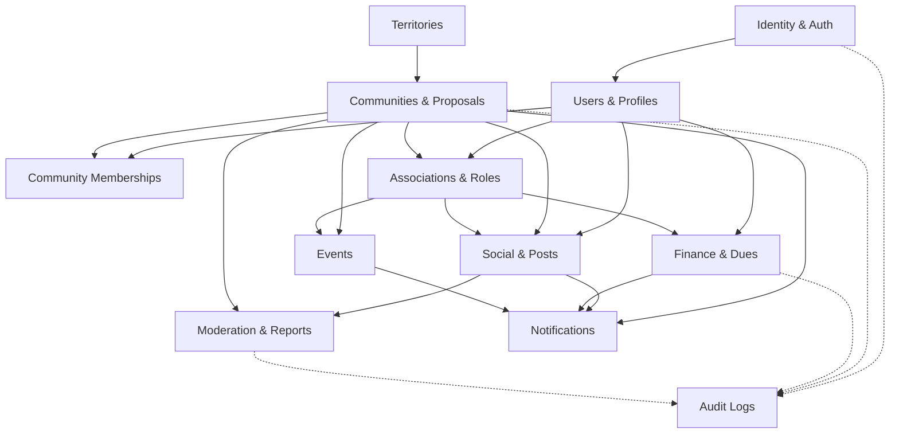

# My Community — Architecture Système et Structure du Monorepo

**Version :** 2.0  
**Date :** 21 octobre 2026  
**Stack de référence :** Monorepo (pnpm + Turborepo) · NestJS (Monolithe Modulaire) · PostgreSQL (Prisma) · Next.js (Web) · Flutter (Mobile)  

---

## 1. Vision et Principes Architecturaux

L'architecture de **My Community** est conçue pour évoluer sur plusieurs années sans s'effondrer sous la complexité du couplage. Elle repose sur quatre piliers :

1. **Monolithe Modulaire Backend (NestJS) :** Un seul artefact déployable, mais un découpage strict en modules métier autonomes respectant les principes de l'architecture hexagonale (Clean Architecture). Aucun microservice prématuré.
2. **Dualité Clients Web & Mobile :**
   - **Web (Next.js) :** Portail d'administration, consultation grand écran, référencement et espace communautaire desktop.
   - **Mobile (Flutter) :** Application native pour Android et iOS, optimisée pour l'ergonomie tactile, la résilience aux réseaux instables et la consultation en cache local.
3. **Contrats d'API Découplés (OpenAPI) :** L'API RESTful exposée par NestJS documente formellement ses contrats via OpenAPI (Swagger). Les clients Flutter (Dart) et Next.js (TypeScript) consomment des clients d'API générés et strictement typés.
4. **Base Relationnelle Unique et Solide (PostgreSQL) :** Source unique de vérité, garantissant l'intégrité relationnelle, l'isolation logique des communautés/associations, les transactions financières atomiques et la traçabilité via `audit_logs`.
5. **Exigence Stricte des Principes SOLID :** Sur l'ensemble du monorepo (NestJS, Next.js, Flutter, Packages), la conception applique rigoureusement les 5 principes SOLID pour garantir le découpage en responsabilités uniques (SRP), l'extensibilité par stratégie/événements (OCP), la substituabilité des adaptateurs (LSP), la ségrégation des interfaces (ISP), et l'inversion des dépendances vers les abstractions (DIP). (Voir [ADR-011](file:///c:/Sikirou/eskay/my_community/docs/adr/ADR-011-principes-solid-architecture.md) et [Guide SOLID](file:///c:/Sikirou/eskay/my_community/docs/architecture/principes-solid.md)).

---

## 2. Structure Complète du Monorepo

```text
my-community/
├── apps/
│   ├── api/                           # Backend NestJS (Monolithe Modulaire)
│   │   ├── src/
│   │   │   ├── main.ts
│   │   │   ├── app.module.ts
│   │   │   ├── platform/              # Socle technique transversal (Cross-cutting)
│   │   │   │   ├── config/            # Variables d'environnement validées
│   │   │   │   ├── database/          # PrismaService, connexions, transactions
│   │   │   │   ├── security/          # JWT, Guards contextuels, hashing Argon2id
│   │   │   │   ├── observability/     # Logger JSON structuré, métriques, audit
│   │   │   │   └── http/              # Filtres RFC 7807, intercepteurs
│   │   │   └── modules/               # Les 12 Domaines Métier Étanche
│   │   │       ├── identity/          # Auth, sessions, tokens
│   │   │       ├── users/             # Profils, avatars, préférences
│   │   │       ├── territories/       # Découpage hiérarchique géographique
│   │   │       ├── communities/       # Propositions, validation, cycle de vie
│   │   │       ├── memberships/       # Adhésions communautaires et rôles locaux
│   │   │       ├── associations/      # Entités uniques, multi-rattachement (N-N)
│   │   │       ├── social/            # Posts, commentaires, réactions, fils
│   │   │       ├── events/            # Événements et inscriptions
│   │   │       ├── finance/           # Cotisations, paiements (XOF), grand livre
│   │   │       ├── notifications/     # Notifications in-app, alertes
│   │   │       ├── moderation/        # Signalements, instruction des abus
│   │   │       └── audit/             # Journalisation immuable des événements
│   │   └── test/
│   │
│   ├── web/                           # Application Web (Next.js - App Router)
│   │   └── src/
│   │       ├── app/                   # Routes et layouts Next.js
│   │       ├── features/              # Découpage par fonctionnalité utilisateur
│   │       ├── components/            # Composants UI partagés
│   │       ├── lib/                   # Client API, hooks, utilitaires
│   │       └── styles/                # Design tokens & styles
│   │
│   └── mobile/                        # Application Mobile (Flutter)
│       ├── android/
│       ├── ios/
│       ├── assets/
│       ├── test/
│       ├── lib/
│       │   ├── main.dart
│       │   ├── app/                   # Router (go_router), bootstrap, thème
│       │   ├── core/                  # Network (Dio), storage (Drift), sécurité
│       │   ├── shared/                # Widgets et modèles réutilisables
│       │   └── features/              # Feature-first : auth, communities, etc.
│       └── pubspec.yaml
│
├── packages/
│   ├── api-client/                    # Client HTTP TypeScript généré depuis OpenAPI
│   ├── contracts/                     # Contrats d'API publics & DTOs
│   ├── validation/                    # Schémas de validation partagés (Zod)
│   ├── design-tokens/                 # Couleurs, typographie, espacements
│   └── tooling/                       # ESLint, Prettier, TypeScript configs
│
├── database/
│   ├── prisma/
│   │   ├── schema.prisma              # Schéma de référence des entités
│   │   ├── migrations/                # Historique des migrations versionnées
│   │   └── seed.ts                    # Données de démarrage et référentiels
│   └── test-fixtures/                 # Données déterministes pour tests
│
├── infrastructure/
│   ├── docker/                        # Dockerfile, docker-compose.yml
│   └── deployment/                    # Manifestes Kubernetes, scripts CI/CD
│
├── docs/
│   ├── architecture/
│   └── adr/                           # Architecture Decision Records
│
├── package.json
├── pnpm-workspace.yaml
├── turbo.json
└── README.md
```

---

## 3. Cartographie et Graphe des Dépendances Métier

Les dépendances entre modules sont strictement orientées et contrôlées. Aucune dépendance circulaire n'est tolérée.



---

## 4. Les Trois Frontières Critiques à Protéger Absolument

### A. Communauté ≠ Association
- Une association intervient dans plusieurs localités sans jamais être dupliquée (`association_communities`).
- Être membre d'une communauté ne confère **aucun droit automatique** dans les associations partenaires hébergées.
- Les données internes d'une association (adhérents, délibérations, trésorerie) sont hermétiques aux responsables de la communauté territoriale hôte.

### B. Autorisation Contextuelle par Ressource ≠ Rôle Global Plat
Toute permission est calculée dynamiquement sur le quadruplet :
$$\text{Autorisation} = f(\text{Utilisateur}, \text{Ressource visée}, \text{Statut d'adhésion}, \text{Rôle contextuel})$$

### C. Opération Financière ≠ Simple Modification CRUD
- Tout versement (`contribution_payments`) est immuable et lié à une transaction (`financial_transactions`).
- Interdiction formelle du `DELETE` physique sur une opération au statut `POSTED`.
- Toute correction s'effectue via une opération compensatrice (`ADJUSTMENT`).
- Les soldes sont systématiquement recalculés par le backend en devises exactes (`XOF`), jamais acceptés aveuglément depuis le client.

---

## 5. Flux de Données et Sécurité des Requêtes

1. **Interception & Extraction :** L'API intercepte le jeton JWT et valide le statut actif de l'utilisateur (`req.user.id`).
2. **Résolution du périmètre :** L'URL fournit la communauté (`communityId`) ou l'association (`associationId`) ciblée.
3. **Contrôle d'accès :** Le service vérifie la présence d'une adhésion `ACTIVE` et le rôle requis (`MANAGER`, `TREASURER`, etc.).
4. **Exécution transactionnelle :** L'écriture s'effectue dans une transaction atomique PostgreSQL via Prisma.
5. **Trace d'audit :** L'opération est consignée de manière immuable dans `audit_logs`.
