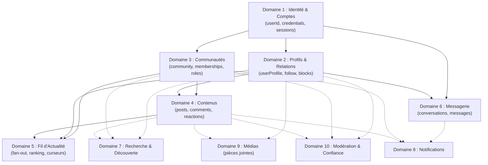
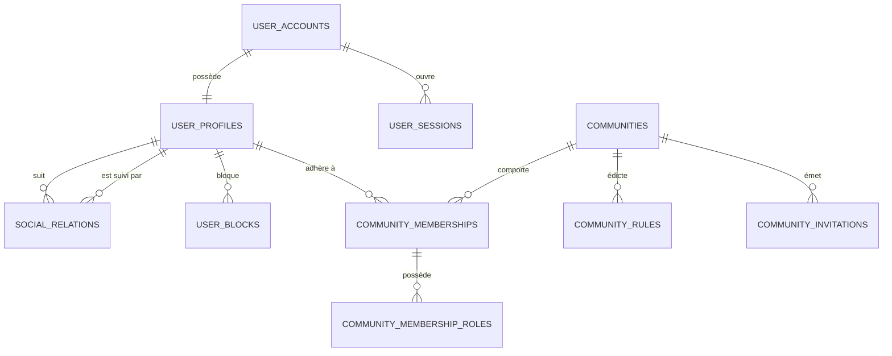
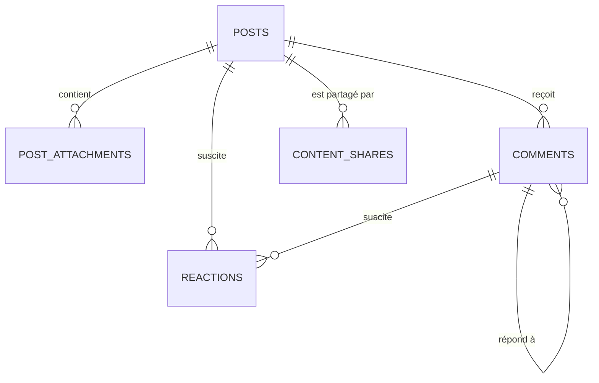
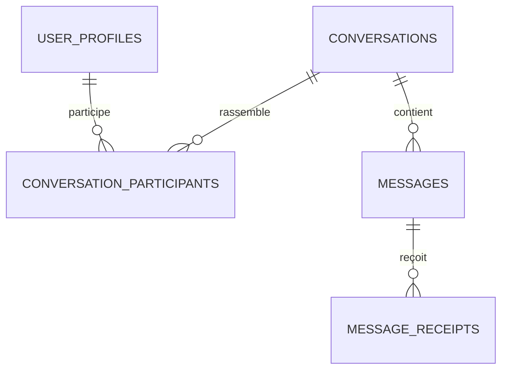
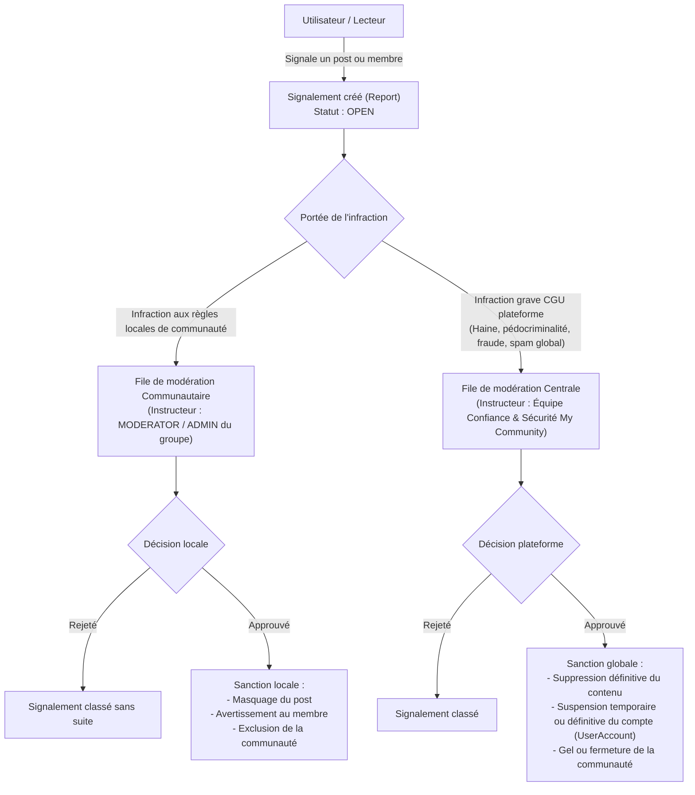
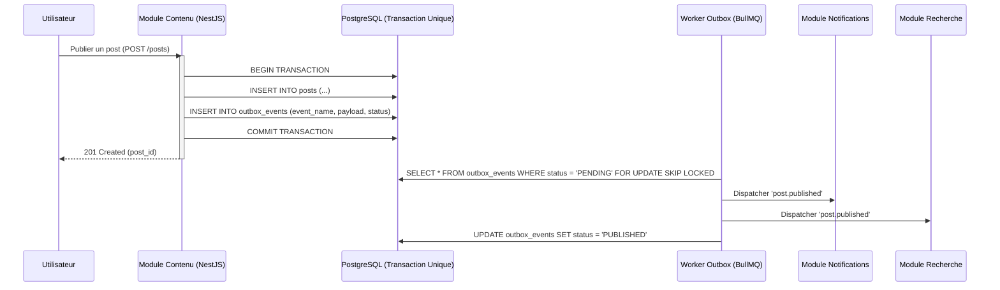

# My Community — Cartographie fonctionnelle de référence

Pour My Community, nous partons sur un réseau social généraliste à vocation internationale, dans lequel les communautés constituent un pilier central de l’expérience. Chaque personne pourra se créer un profil, développer ses relations, publier du contenu, participer à des communautés publiques ou privées et communiquer avec d’autres membres.

L’objectif architectural est de permettre au produit de commencer avec une architecture maîtrisable, puis d’évoluer vers des dizaines d’équipes et des millions d’utilisateurs sans devoir réécrire toute la plateforme.

Nous allons distinguer quatre notions :

- Domaine métier : un ensemble de responsabilités fonctionnelles cohérentes.
- Module logiciel : une implémentation d’un domaine dans le code.
- Service déployable : une application pouvant être déployée indépendamment.
- Données propriétaires : les données dont un domaine est responsable et qu’il est le seul à pouvoir modifier directement.

Ces notions ne doivent pas être confondues. Au lancement, plusieurs domaines pourront vivre dans une seule API NestJS modulaire et partager une base PostgreSQL, tout en respectant des frontières claires.

---

## 1. Vue d’ensemble des domaines

1. **Identité et sécurité des comptes** : Qui est l'utilisateur et comment accède-t-il à la plateforme ?
2. **Profils et relations sociales** : Qui suis-je, qui connais-je et avec qui suis-je en relation ?
3. **Communautés** : Groupes, adhésions, invitations et rôles.
4. **Contenus** : Publications, commentaires et réactions.
5. **Fil d’actualité** : Classement et distribution des contenus.
6. **Messagerie** : Conversations et messages privés.
7. **Recherche et découverte** : Personnes, communautés et contenus.
8. **Notifications** : Alertes et préférences de réception.
9. **Médias** : Images, vidéos et fichiers.
10. **Modération et confiance** : Signalements, sanctions et protection des utilisateurs.
11. **Administration et gouvernance** : Gestion opérationnelle, politiques et audit.
12. **Analytique produit** : Usage, engagement, qualité et indicateurs métier.

Les médias, les notifications, la sécurité et l'observabilité sont des capacités transversales : plusieurs domaines les utilisent, mais cela ne signifie pas qu'ils doivent tous devenir des microservices dès le départ.

---

## 2. Cartographie détaillée de chaque domaine

### Domaine 1 — Identité, comptes et accès

Responsabilité : garantir que chaque compte est identifiable, authentifiable et protégé.

| Élément | Définition |
| :--- | :--- |
| **Fonctionnalités** | Inscription, connexion, déconnexion, récupération de compte, vérification d'adresse e-mail ou de téléphone, gestion des sessions, appareils connectés, MFA |
| **Données principales** | `UserAccount`, `Credential`, `UserSession`, `VerifiedContact`, `RecoveryRequest` |
| **Dépendances** | Fournisseur d'e-mail/SMS, gestion des secrets, services de sécurité |
| **Ne doit pas gérer** | Les publications, les adhésions aux communautés ou le classement du fil |

Le compte technique ne doit pas être confondu avec le profil social. Un utilisateur peut avoir un compte authentifié et compléter son profil progressivement.

*Règle importante :* les autres domaines consomment une identité stable (`userId`) ; ils ne doivent jamais lire directement les mots de passe ou modifier les informations d'authentification.

### Domaine 2 — Profils et relations sociales

Responsabilité : représenter la présence sociale des utilisateurs et leurs relations.

| Élément | Définition |
| :--- | :--- |
| **Fonctionnalités** | Profil public, avatar, biographie, langues, préférences, abonnements, demandes d'amitié si retenues, blocage, désabonnement |
| **Données principales** | `UserProfile`, `Follow`, `Friendship`, `UserBlock`, `ProfilePreference` |
| **Dépendances** | Identité, médias, confidentialité |
| **Ne doit pas gérer** | Les adhésions aux groupes ni les permissions d'administration globale |

Il faut choisir un modèle relationnel explicite : un réseau fondé sur les abonnements, un réseau d'amitié réciproque, ou une combinaison des deux. Ces relations n'ont pas les mêmes règles métier.

Les blocages doivent avoir un effet cohérent sur les interactions, les messages, la visibilité des profils et la découverte.

### Domaine 3 — Communautés

Responsabilité : permettre aux utilisateurs de créer, découvrir et administrer des espaces collectifs.

C'est l'un des domaines les plus stratégiques de My Community.

| Élément | Définition |
| :--- | :--- |
| **Fonctionnalités** | Création, modification, archivage, catégories, règles, visibilité, adhésion, invitation, demande d'adhésion, approbation, exclusion, rôles et paramètres |
| **Données principales** | `Community`, `CommunityMembership`, `CommunityInvitation`, `MembershipRequest`, `CommunityRole`, `CommunityRule` |
| **Dépendances** | Identité, profils, médias, modération, notifications |
| **Ne doit pas gérer** | L'authentification générale ni le contenu complet des publications |

Il faut distinguer deux dimensions :
- **Visibilité :** une communauté publique peut être découverte par tous ; une communauté privée doit protéger sa visibilité selon la politique choisie.
- **Adhésion :** accès libre, approbation obligatoire ou invitation.

Les rôles peuvent inclure propriétaire, administrateur, modérateur et membre. Ils doivent être limités au périmètre de la communauté, et non confondus avec les rôles des administrateurs de la plateforme.

Le domaine devra également gérer les transferts de propriété, les départs du dernier administrateur, les suspensions et la suppression ou l'archivage d'une communauté.

### Domaine 4 — Contenus et interactions

Responsabilité : gérer la création et le cycle de vie des contenus publiés.

| Élément | Définition |
| :--- | :--- |
| **Fonctionnalités** | Publications textuelles, images et vidéos, commentaires, réponses, réactions, modifications, suppressions, partage, mentions et hashtags |
| **Données principales** | `Post`, `PostAttachment`, `Comment`, `Reaction`, `Mention`, `Hashtag`, `ContentShare` |
| **Dépendances** | Identité, profils, communautés, médias, confidentialité, modération |
| **Ne doit pas gérer** | Le classement du fil d'actualité ni la transmission des notifications |

Chaque contenu doit avoir une politique d'audience : public, réservé aux abonnés selon les règles retenues, limité à une communauté ou privé. Il faut déterminer explicitement ce qui arrive à une publication lorsqu'un utilisateur est bloqué, quitte un groupe ou que son compte est suspendu.

Les compteurs de réactions et de commentaires peuvent être des projections optimisées. Ils ne doivent pas remplacer les données qui font autorité.

### Domaine 5 — Fil d'actualité et recommandations

Responsabilité : sélectionner et ordonner les contenus qu'un utilisateur peut voir.

| Élément | Définition |
| :--- | :--- |
| **Fonctionnalités** | Fil des abonnements, fil des communautés, contenus recommandés, classement, pagination, exclusion de contenus masqués et actualisation |
| **Données principales** | `FeedEntry`, `FeedCandidate`, `FeedPreference`, `RankingSignal` |
| **Dépendances** | Contenus, profils et relations, communautés, confidentialité, modération, analytique |
| **Ne doit pas gérer** | La création de publications ni les règles de propriété des contenus |

Ce domaine est distinct du stockage des publications. Il peut référencer les identifiants de contenus et conserver des données de classement ou de distribution.

Pour démarrer, un fil calculé à la demande avec pagination par curseur peut suffire. À mesure que le trafic augmente, des stratégies hybrides, des caches et une distribution asynchrone pourront être ajoutés.

*Règle non négociable :* le fil d'actualité ne doit jamais exposer un contenu que l'utilisateur n'est pas autorisé à consulter, même si ce contenu est présent dans un cache ou une liste pré-calculée.

### Domaine 6 — Messagerie et conversations

Responsabilité : assurer les échanges privés entre utilisateurs.

| Élément | Définition |
| :--- | :--- |
| **Fonctionnalités** | Conversations individuelles et, éventuellement, de groupe, envoi et réception, pièces jointes, accusés de réception, historique, blocage, signalement |
| **Données principales** | `Conversation`, `ConversationParticipant`, `Message`, `MessageReceipt`, `ConversationPreference` |
| **Dépendances** | Identité, relations sociales, médias, modération, notifications |
| **Ne doit pas gérer** | Les publications publiques ou le fil d'actualité |

Les exigences à définir comprennent l'ordre des messages, les doublons lors des reconnexions, la synchronisation entre appareils, la rétention des données et les règles de suppression.

Les WebSockets peuvent apporter une livraison en temps réel, mais ils ne doivent pas constituer l'unique mécanisme de conservation ou de récupération des messages.

Le chiffrement de bout en bout est une décision structurante à prendre tôt si l'on souhaite le proposer : il influence la recherche, la modération, la récupération de compte et les fonctionnalités multi-appareils.

### Domaine 7 — Recherche et découverte

Responsabilité : permettre de trouver des personnes, des communautés et des contenus pertinents.

| Élément | Définition |
| :--- | :--- |
| **Fonctionnalités** | Recherche de profils, communautés et publications, filtres, suggestions, tendances et découverte par catégories |
| **Données principales** | `SearchDocument`, `SearchPreference`, `DiscoverySignal` |
| **Dépendances** | Profils, communautés, contenus, confidentialité, modération |
| **Ne doit pas gérer** | La source officielle des profils, des publications ou des adhésions |

Les résultats indexés sont des représentations dérivées. Le système doit pouvoir les reconstruire depuis les domaines propriétaires.

Au début, PostgreSQL peut prendre en charge une recherche simple. Un moteur spécialisé pourra être introduit si le volume, la pertinence ou la latence le justifient.

### Domaine 8 — Notifications

Responsabilité : informer les utilisateurs des événements qui les concernent.

| Élément | Définition |
| :--- | :--- |
| **Fonctionnalités** | Notifications dans l'application, push mobile, e-mail, préférences, lecture, regroupement et déduplication |
| **Données principales** | `Notification`, `NotificationPreference`, `NotificationDelivery`, `NotificationTemplate` |
| **Dépendances** | Événements provenant des domaines métier, services push, e-mail et SMS |
| **Ne doit pas gérer** | La décision métier initiale qui déclenche une notification |

Exemples d'événements : nouvelle demande d'adhésion, invitation, commentaire, réponse, message reçu ou changement de rôle.

Il faut distinguer l'événement métier de la notification délivrée. Une action peut générer plusieurs canaux de notification, et un canal peut échouer sans annuler l'action d'origine.

### Domaine 9 — Gestion des médias

Responsabilité : traiter et distribuer les fichiers associés aux profils, publications et messages.

| Élément | Définition |
| :--- | :--- |
| **Fonctionnalités** | Téléversement, validation, redimensionnement, miniatures, transcodage vidéo, métadonnées, suppression et distribution |
| **Données principales** | `MediaAsset`, `MediaVariant`, `MediaProcessingJob`, `MediaAccessPolicy` |
| **Dépendances** | Stockage objet, CDN, file de tâches, antivirus ou analyse de fichiers |
| **Ne doit pas gérer** | Les droits métier sur une publication ou une conversation |

Les fichiers doivent être stockés dans un système adapté aux objets, plutôt que directement dans PostgreSQL. La base conserve les métadonnées et les références nécessaires.

Le service média doit vérifier que l'utilisateur est autorisé à téléverser un fichier et que son association à un contenu respecte les règles d'accès. Une URL de fichier ne doit pas rendre public un média privé par accident.

### Domaine 10 — Modération, confiance et sécurité communautaire

Responsabilité : protéger les personnes et faire appliquer les règles de la plateforme.

| Élément | Définition |
| :--- | :--- |
| **Fonctionnalités** | Signalements, examen des contenus, sanctions, appels, anti-spam, détection d'abus et historique des décisions |
| **Données principales** | `Report`, `ModerationCase`, `ModerationDecision`, `EnforcementAction`, `Appeal`, `AbuseSignal` |
| **Dépendances** | Identité, profils, contenus, communautés, messagerie, administration et audit |
| **Ne doit pas gérer** | L'authentification générale ou les publications elles-mêmes |

Les sanctions peuvent viser un contenu, un compte ou une communauté. Il faut définir leur portée, leur durée, les personnes autorisées à les appliquer et les possibilités de contestation.

Une communauté peut disposer de modérateurs locaux, tandis que les équipes de My Community conservent une autorité globale sur les violations des règles de la plateforme.

### Domaine 11 — Administration et gouvernance

Responsabilité : administrer la plateforme sans contourner les règles de sécurité.

| Élément | Définition |
| :--- | :--- |
| **Fonctionnalités** | Gestion des opérateurs, rôles internes, politiques globales, paramètres, traitement des escalades, audit et support |
| **Données principales** | `AdminRole`, `AdminPermission`, `AuditRecord`, `PlatformPolicy`, `ConfigurationVersion` |
| **Dépendances** | Identité, modération, tous les domaines concernés par une action administrative |
| **Ne doit pas gérer** | Les données métier en dehors des interfaces et règles prévues par chaque domaine |

Les administrateurs internes doivent avoir des permissions distinctes de celles des propriétaires de communautés. Les actions sensibles doivent être journalisées et, selon le risque, nécessiter une validation supplémentaire.

### Domaine 12 — Analytique et mesure du produit

Responsabilité : mesurer l'usage, la qualité et la santé du produit pour orienter les décisions.

| Élément | Définition |
| :--- | :--- |
| **Fonctionnalités** | Statistiques d'utilisation, activation, rétention, participation aux communautés, performance des fonctionnalités et détection de tendances |
| **Données principales** | `ProductEvent`, `MetricAggregate`, `AnalyticsDimension` |
| **Dépendances** | Événements métier, pipeline analytique et outils de visualisation |
| **Ne doit pas gérer** | Les données transactionnelles officielles ni les autorisations |

Les événements analytiques doivent être définis de manière cohérente et minimiser les données personnelles collectées. Les statistiques ne doivent pas devenir une source de vérité pour les adhésions, les droits ou les paiements si ceux-ci sont ajoutés ultérieurement.

---

## 3. Les capacités transversales

En plus des douze domaines, My Community devra disposer de capacités techniques communes. Elles ne sont pas toutes des domaines métier à part entière.

| Capacité | Rôle | Choix de départ envisageable |
| :--- | :--- | :--- |
| **Autorisation et confidentialité** | Vérifier les droits sur chaque ressource | Politique d'accès centralisée dans le backend, appliquée par domaine |
| **Événements métier** | Informer les autres domaines qu'une action a eu lieu | Événements internes typés (Event Bus / Outbox) |
| **Tâches asynchrones** | Traiter les médias, notifications et traitements différés | File de tâches Redis / BullMQ |
| **Temps réel** | Messages, présence et mises à jour instantanées | WebSockets (Socket.io ou WS natif) avec Redis Adapter |
| **Stockage des fichiers** | Conserver les médias | Stockage objet compatible S3 avec URLs pré-signées |
| **Observabilité** | Diagnostiquer les erreurs et mesurer la disponibilité | Logs structurés Pino, métriques Prometheus, OpenTelemetry |
| **Sécurité opérationnelle** | Protéger les secrets, les déploiements et les données | Gestionnaire de secrets, contrôle d'accès RBAC et audit |
| **Internationalisation** | Adapter les interfaces aux langues, formats et fuseaux horaires | Clés i18n, dates UTC et préférences locales utilisateur |

La règle de conception est simple : les capacités transversales fournissent des mécanismes communs, mais les règles métier restent sous la responsabilité du domaine concerné.

Par exemple, un service de notifications peut distribuer une invitation ; seul le domaine Communautés décide si cette invitation est valide.

---

## 4. Les dépendances entre domaines

Il faut éviter qu'un module puisse librement modifier les données internes de tous les autres modules. Voici les principales relations fonctionnelles :



### Règles de dépendance à imposer dans le code

1. Un domaine possède ses propres règles métier et ses opérations d'écriture.
2. Un autre domaine ne modifie pas directement ses tables pour contourner son API interne.
3. Les dépendances synchrones sont réservées aux décisions nécessitant une réponse immédiate (ex. validation d'autorisation).
4. Les événements servent aux réactions différées : notification, indexation, analytique ou mise à jour de projections.
5. Les vérifications de confidentialité et d'autorisation doivent être appliquées à chaque accès, y compris aux caches et aux traitements asynchrones.
6. Les dépendances circulaires entre domaines sont interdites, ou doivent être résolues en redéfinissant les responsabilités.

### Exemple concret : publier dans une communauté privée

Lorsqu'un membre publie un message dans une communauté privée :

1. **Identité** authentifie l'utilisateur (`userId`).
2. **Communautés** vérifie son adhésion active et ses permissions de publication.
3. **Contenus** valide le format, le texte et enregistre la publication rattachée à la communauté.
4. **Médias**, si nécessaire, associe les pièces jointes pré-téléversées et valide leurs clés de stockage.
5. **Fil d'actualité** décide quels membres autorisés recevront la référence dans leur flux.
6. **Notifications** informe les membres abonnés aux publications du groupe selon leurs préférences.
7. **Modération** applique les filtres automatiques anti-spam et prépare l'instruction d'éventuels signalements.

Ces étapes n'ont pas toutes besoin de s'exécuter dans la même transaction. L'enregistrement de la publication et de ses droits doit être fiable ; les notifications, l'indexation et certaines opérations de distribution peuvent être différées.

---

## 5. Les principales données et leurs propriétaires

Cette répartition devra être formalisée avant la conception définitive du schéma PostgreSQL.

| Donnée | Domaine propriétaire |
| :--- | :--- |
| Compte, identifiants, sessions, vérifications | **Identité** |
| Profil, biographie, abonnements, blocages | **Profils et relations** |
| Communauté, adhésion, rôles locaux, règles | **Communautés** |
| Publications, commentaires, réactions, partages | **Contenus** |
| Entrées pré-calculées du fil, signaux d'affinité | **Fil d'actualité** |
| Conversations, messages, accusés de réception | **Messagerie** |
| Documents indexés et préférences de recherche | **Recherche et découverte** |
| Notifications et tentatives de livraison | **Notifications** |
| Fichiers, métadonnées et variantes de médias | **Médias** |
| Signalements, dossiers, décisions, sanctions | **Modération** |
| Rôles administratifs et journaux d'audit | **Administration et gouvernance** |
| Événements analytiques et métriques agrégées | **Analytique** |

---

## 6. Ce qu'il faut développer en premier (Phasage produit)

Nous ne devons pas développer les douze domaines avec le même niveau de priorité. Voici le découpage recommandé :

### Phase 1 — Fondations du réseau social
- Identité et comptes
- Profils et relations sociales de base
- Communautés publiques et privées
- Publications, commentaires et réactions
- Gestion des médias essentiels (images, avatars)
- Confidentialité, blocage et signalements simples
- Fil d'actualité chronologique initial

*Objectif :* permettre à un utilisateur de s'inscrire, créer ou rejoindre une communauté, publier et interagir en toute sécurité.

### Phase 2 — Expérience sociale complète
- Recherche textuelle de profils et de communautés
- Invitations et demandes d'adhésion avancées avec formulaires
- Notifications push mobiles et in-app
- Messagerie privée 1-à-1 et de groupe
- Découverte et recommandations thématiques
- Console de modération pour responsables communautaires et équipe centrale

*Objectif :* dynamiser les échanges directs, la découvrabilité et la rétention quotidienne.

### Phase 3 — Montée en charge et expansion
- Algorithme de classement et d'affinité du fil d'actualité
- Distribution asynchrone optimisée (Fan-out hybride)
- Recherche vectorielle / moteur dédié (Meilisearch ou Elasticsearch)
- Traitements asynchrones renforcés (file distribuée, outbox pattern)
- Analytique produit avancée et observabilité granulaire
- Extraction éventuelle de domaines à haute charge (Médias, Messagerie temps réel)

---

## 7. Architecture logicielle de départ

Organisation recommandée : Monorepo pnpm avec une API NestJS modulaire, Flutter pour le mobile, Next.js pour le Web, et PostgreSQL avec Prisma pour la persistance relationnelle.

```
my-community/
├── apps/
│   ├── api/                    # NestJS Modulaire (Hexagonal par domaine)
│   │   └── src/
│   │       ├── modules/
│   │       │   ├── identity/
│   │       │   ├── profiles/
│   │       │   ├── communities/
│   │       │   ├── content/
│   │       │   ├── feed/
│   │       │   ├── messaging/
│   │       │   ├── search/
│   │       │   ├── notifications/
│   │       │   ├── media/
│   │       │   ├── moderation/
│   │       │   ├── administration/
│   │       │   └── analytics/
│   │       ├── platform/
│   │       │   ├── database/
│   │       │   ├── events/
│   │       │   ├── security/
│   │       │   └── observability/
│   │       └── main.ts
│   ├── mobile/                 # Flutter (Architecture feature-first / Riverpod)
│   │   └── lib/
│   │       ├── app/
│   │       ├── core/
│   │       └── features/
│   └── web/                    # Next.js App Router
│       └── src/
├── packages/
│   ├── api-contracts/          # Spécifications OpenAPI v3 et types partagés
│   └── tooling/                # Configurations ESLint, TypeScript, Prettier
├── infrastructure/
│   ├── docker/
│   ├── database/
│   └── deployment/
└── docs/
```

---

## 8. Arbitrage des 5 décisions structurantes

Pour lever les incertitudes mentionnées avant la conception détaillée des entités, voici les cinq arbitrages fondateurs retenus pour My Community :

### Décision 1 — Relations sociales : Abonnements asymétriques avec détection de relation réciproque
- **Choix retenu :** Modèle d'abonnements asymétriques (*Follower / Following*) complété par un statut calculé de *relation mutuelle* (*Mutuals / Friends*).
- **Justification :** Un réseau international généraliste exige la liberté de suivre des créateurs, experts ou figures publiques sans imposer leur accord réciproque. Les relations mutuelles débloquent automatiquement des privilèges de proximité (ex. autorisation de messagerie directe sans passer par les demandes de contact).

### Décision 2 — Portée des publications : Publications de profil et publications de communauté
- **Choix retenu :** Modèle dual explicite.
  1. *Publication de profil (User Post)* : Rattachée à la chronologie de l'utilisateur avec sélecteur d'audience (`PUBLIC`, `FOLLOWERS_ONLY`, `PRIVATE`).
  2. *Publication de communauté (Community Post)* : Rattachée obligatoirement à un `communityId`. Son audience est gouvernée par la politique de la communauté (accessible à tous si la communauté est publique, réservée aux membres si la communauté est privée).
- **Justification :** Ce modèle combine la liberté d'expression individuelle d'un réseau social ouvert avec la puissance thématique et collective des communautés.

### Décision 3 — Communautés privées : Modèle à trois niveaux de visibilité
- **Choix retenu :**
  1. `PUBLIC` : Référencée publiquement, description et publications visibles de tous, adhésion libre ou modérée.
  2. `PRIVATE_LISTED` (Fermée découvrable) : Référencée dans l'annuaire et la recherche ; nom, description et règles visibles, mais publications et membres strictement masqués aux non-adhérents.
  3. `SECRET` (Secrète / Invisible) : Totalement absente des résultats de recherche et de l'annuaire. Accessible uniquement via lien d'invitation chiffré généré par un administrateur.
- **Justification :** Permet d'héberger aussi bien des clubs d'intérêt généraux désireux de recruter des membres que des cercles professionnels ou privés nécessitant une discrétion absolue.

### Décision 4 — Messagerie privée : Système mixte avec boîte de demandes et garde-fous
- **Choix retenu :** Échanges directs instantanés pour les relations mutuelles ou co-membres de communautés autorisées ; boîte de réception filtrée (*Message Requests*) pour les tiers, avec possibilité de refuser ou bloquer avant acceptation.
- **Justification :** Prévient le spam et le cyber-harcèlement tout en préservant l'opportunité de nouer de nouveaux contacts internationaux.

### Décision 5 — Fil d'actualité : Deux flux complémentaires commutables
- **Choix retenu :**
  - **Flux 1 : "Abonnements & Communautés" (Par défaut)** : Chronologique inversé strict, transparent et déterministe, garantissant que l'utilisateur voit tous les contenus de ses cercles.
  - **Flux 2 : "Découvrir" (Recommandé / Algorithmique léger)** : Classement fondé sur l'affinité thématique, la fraîcheur temporelle et l'engagement des publications publiques de la plateforme.
- **Justification :** Offre le contrôle total à l'utilisateur tout en favorisant la sérendipité et la croissance organique des communautés.

---

## 9. Modèle relationnel fondamental (Utilisateurs et Communautés)

Les domaines Identité, Profils et Communautés constituent le socle de données sur lequel reposent toutes les autres fonctionnalités.



### 9.1 Découplage strict entre Compte d'Identité et Profil Social

Pour garantir la sécurité et la conformité RGPD / privacy internationale, les données d'authentification et les données sociales sont scindées en deux entités distinctes :

```sql
-- Entité Propriétaire : Domaine Identité
CREATE TABLE user_accounts (
  id UUID PRIMARY KEY DEFAULT gen_random_uuid(),
  email VARCHAR(255) UNIQUE,
  phone VARCHAR(32) UNIQUE,
  password_hash VARCHAR(255) NOT NULL,
  status VARCHAR(32) NOT NULL DEFAULT 'ACTIVE', -- ACTIVE, SUSPENDED, DELETED
  is_email_verified BOOLEAN NOT NULL DEFAULT FALSE,
  is_phone_verified BOOLEAN NOT NULL DEFAULT FALSE,
  mfa_enabled BOOLEAN NOT NULL DEFAULT FALSE,
  created_at TIMESTAMPTZ NOT NULL DEFAULT now(),
  updated_at TIMESTAMPTZ NOT NULL DEFAULT now(),
  deleted_at TIMESTAMPTZ
);

-- Entité Propriétaire : Domaine Profils
CREATE TABLE user_profiles (
  user_id UUID PRIMARY KEY REFERENCES user_accounts(id) ON DELETE CASCADE,
  handle VARCHAR(40) UNIQUE NOT NULL,          -- Identifiant unique @nom_utilisateur
  display_name VARCHAR(100) NOT NULL,
  bio TEXT,
  avatar_url TEXT,
  banner_url TEXT,
  locale VARCHAR(10) NOT NULL DEFAULT 'fr',    -- Langue d'interface préférée
  timezone VARCHAR(50) NOT NULL DEFAULT 'UTC',
  is_private BOOLEAN NOT NULL DEFAULT FALSE,   -- Si TRUE, les abonnements nécessitent acceptation
  created_at TIMESTAMPTZ NOT NULL DEFAULT now(),
  updated_at TIMESTAMPTZ NOT NULL DEFAULT now()
);
```

### 9.2 Modèle des Relations Sociales et Contrôle de Blocage

Le système de relations gère les abonnements unidirectionnels, les demandes en attente pour les comptes privés et la table des blocages impératifs :

```sql
-- Entité Propriétaire : Domaine Profils et Relations
CREATE TABLE social_relations (
  follower_id UUID NOT NULL REFERENCES user_profiles(user_id) ON DELETE CASCADE,
  following_id UUID NOT NULL REFERENCES user_profiles(user_id) ON DELETE CASCADE,
  status VARCHAR(20) NOT NULL DEFAULT 'ACTIVE', -- ACTIVE, PENDING (compte privé)
  created_at TIMESTAMPTZ NOT NULL DEFAULT now(),
  PRIMARY KEY (follower_id, following_id),
  CHECK (follower_id <> following_id)
);

CREATE TABLE user_blocks (
  blocker_id UUID NOT NULL REFERENCES user_profiles(user_id) ON DELETE CASCADE,
  blocked_id UUID NOT NULL REFERENCES user_profiles(user_id) ON DELETE CASCADE,
  reason VARCHAR(255),
  created_at TIMESTAMPTZ NOT NULL DEFAULT now(),
  PRIMARY KEY (blocker_id, blocked_id),
  CHECK (blocker_id <> blocked_id)
);
```

### 9.3 Modèle des Communautés, Adhésions et Permissions Locales

Une communauté possède sa propre gouvernance interne, distincte des privilèges de la plateforme :

```sql
-- Entité Propriétaire : Domaine Communautés
CREATE TABLE communities (
  id UUID PRIMARY KEY DEFAULT gen_random_uuid(),
  slug VARCHAR(80) UNIQUE NOT NULL,
  name VARCHAR(120) NOT NULL,
  description TEXT,
  visibility VARCHAR(20) NOT NULL DEFAULT 'PUBLIC', -- PUBLIC, PRIVATE_LISTED, SECRET
  join_policy VARCHAR(20) NOT NULL DEFAULT 'OPEN',   -- OPEN, APPROVAL_REQUIRED, INVITE_ONLY
  avatar_url TEXT,
  banner_url TEXT,
  rules TEXT,
  creator_id UUID NOT NULL REFERENCES user_accounts(id),
  status VARCHAR(20) NOT NULL DEFAULT 'ACTIVE',      -- ACTIVE, SUSPENDED, ARCHIVED
  members_count INT NOT NULL DEFAULT 1,
  created_at TIMESTAMPTZ NOT NULL DEFAULT now(),
  updated_at TIMESTAMPTZ NOT NULL DEFAULT now()
);

CREATE TABLE community_memberships (
  id UUID PRIMARY KEY DEFAULT gen_random_uuid(),
  community_id UUID NOT NULL REFERENCES communities(id) ON DELETE CASCADE,
  user_id UUID NOT NULL REFERENCES user_accounts(id) ON DELETE CASCADE,
  status VARCHAR(20) NOT NULL DEFAULT 'ACTIVE',     -- PENDING, ACTIVE, REJECTED, SUSPENDED
  created_at TIMESTAMPTZ NOT NULL DEFAULT now(),
  updated_at TIMESTAMPTZ NOT NULL DEFAULT now(),
  UNIQUE (community_id, user_id)
);

CREATE TABLE community_membership_roles (
  membership_id UUID NOT NULL REFERENCES community_memberships(id) ON DELETE CASCADE,
  role VARCHAR(30) NOT NULL,                        -- OWNER, ADMIN, MODERATOR, MEMBER
  granted_at TIMESTAMPTZ NOT NULL DEFAULT now(),
  granted_by UUID REFERENCES user_accounts(id),
  PRIMARY KEY (membership_id, role)
);
```

### 9.4 Matrice des Permissions Contextuelles au sein d'une Communauté

| Action Fonctionnelle | Visiteur / Non-membre | Membre (`MEMBER`) | Modérateur (`MODERATOR`) | Administrateur (`ADMIN`) | Propriétaire (`OWNER`) |
| :--- | :---: | :---: | :---: | :---: | :---: |
| Découvrir la fiche publique (si `PUBLIC` ou `LISTED`) | ✅ | ✅ | ✅ | ✅ | ✅ |
| Consulter les contenus (si communauté `PUBLIC`) | ✅ | ✅ | ✅ | ✅ | ✅ |
| Consulter les contenus (si communauté `PRIVATE`) | ❌ | ✅ | ✅ | ✅ | ✅ |
| Publier un post / Commenter / Réagir | ❌ | ✅ | ✅ | ✅ | ✅ |
| Masquer / Supprimer un commentaire abusif | ❌ | ❌ | ✅ | ✅ | ✅ |
| Traiter les signalements de contenus | ❌ | ❌ | ✅ | ✅ | ✅ |
| Approuver une demande d'adhésion en attente | ❌ | ❌ | ❌ | ✅ | ✅ |
| Bannir un membre de la communauté | ❌ | ❌ | ❌ | ✅ | ✅ |
| Modifier la description, règles et bannières | ❌ | ❌ | ❌ | ✅ | ✅ |
| Nommer ou révoquer un Modérateur | ❌ | ❌ | ❌ | ✅ | ✅ |
| Nommer ou révoquer un Administrateur | ❌ | ❌ | ❌ | ❌ | ✅ |
| Transférer la propriété de la communauté | ❌ | ❌ | ❌ | ❌ | ✅ |
| Supprimer ou archiver définitivement la communauté | ❌ | ❌ | ❌ | ❌ | ✅ |

---

## 10. Modèle des contenus, interactions et distribution

Le domaine des Contenus gère la création des publications (`Post`), des commentaires arborescents (`Comment`) et des réactions énumérées (`Reaction`).



### 10.1 Structure Unifiée des Publications et Audiences

Une publication peut appartenir à un profil individuel ou être rattachée à une communauté :

```sql
CREATE TABLE posts (
  id UUID PRIMARY KEY DEFAULT gen_random_uuid(),
  author_id UUID NOT NULL REFERENCES user_accounts(id) ON DELETE CASCADE,
  community_id UUID REFERENCES communities(id) ON DELETE CASCADE, -- NULL si post personnel
  content_text TEXT,
  visibility VARCHAR(30) NOT NULL DEFAULT 'PUBLIC', -- PUBLIC, FOLLOWERS_ONLY, COMMUNITY_MEMBERS, PRIVATE
  status VARCHAR(20) NOT NULL DEFAULT 'PUBLISHED',   -- DRAFT, PUBLISHED, EDITED, HIDDEN, REMOVED
  likes_count INT NOT NULL DEFAULT 0,
  comments_count INT NOT NULL DEFAULT 0,
  shares_count INT NOT NULL DEFAULT 0,
  created_at TIMESTAMPTZ NOT NULL DEFAULT now(),
  updated_at TIMESTAMPTZ NOT NULL DEFAULT now(),
  CONSTRAINT check_post_content_or_media CHECK (content_text IS NOT NULL)
);

CREATE INDEX idx_posts_author ON posts (author_id, created_at DESC) WHERE status = 'PUBLISHED';
CREATE INDEX idx_posts_community ON posts (community_id, created_at DESC) WHERE status = 'PUBLISHED' AND community_id IS NOT NULL;
```

### 10.2 Commentaires et Réponses (Profondeur Maîtrisée)

Pour garantir une expérience fluide sur mobile et éviter les dégradations de performance des requêtes récursives profondes, l'imbrication des réponses est limitée à 2 niveaux (Commentaire principal $\rightarrow$ Réponse) :

```sql
CREATE TABLE comments (
  id UUID PRIMARY KEY DEFAULT gen_random_uuid(),
  post_id UUID NOT NULL REFERENCES posts(id) ON DELETE CASCADE,
  author_id UUID NOT NULL REFERENCES user_accounts(id) ON DELETE CASCADE,
  parent_id UUID REFERENCES comments(id) ON DELETE CASCADE, -- NULL si commentaire racine
  content_text TEXT NOT NULL,
  status VARCHAR(20) NOT NULL DEFAULT 'PUBLISHED',         -- PUBLISHED, HIDDEN, REMOVED
  likes_count INT NOT NULL DEFAULT 0,
  created_at TIMESTAMPTZ NOT NULL DEFAULT now(),
  updated_at TIMESTAMPTZ NOT NULL DEFAULT now()
);

CREATE INDEX idx_comments_post_root ON comments (post_id, created_at ASC) WHERE parent_id IS NULL;
CREATE INDEX idx_comments_parent ON comments (parent_id, created_at ASC) WHERE parent_id IS NOT NULL;
```

### 10.3 Réactions Typées

```sql
CREATE TABLE reactions (
  id UUID PRIMARY KEY DEFAULT gen_random_uuid(),
  user_id UUID NOT NULL REFERENCES user_accounts(id) ON DELETE CASCADE,
  target_type VARCHAR(20) NOT NULL, -- 'POST' ou 'COMMENT'
  target_id UUID NOT NULL,
  reaction_type VARCHAR(20) NOT NULL DEFAULT 'LIKE', -- LIKE, LOVE, CELEBRATE, SUPPORT, INSIGHTFUL
  created_at TIMESTAMPTZ NOT NULL DEFAULT now(),
  UNIQUE (user_id, target_type, target_id)
);
```

### 10.4 Stratégie Technique de Construction du Fil d'Actualité

La distribution des contenus suit une trajectoire en deux phases pour concilier simplicité initiale et passage à l'échelle :

1. **Phase 1 (MVP à 50 000 utilisateurs actifs) — Fan-out on Read (Calcul à la volée avec pagination par curseur) :**
   - Requête unifiée agrégeant les publications des communautés dont l'utilisateur est membre actif ET les publications publiques des profils suivis, en excluant les auteurs bloqués.
   - Utilisation de la pagination par curseur opaque encodé en base64 (`created_at` + `id`) pour interdire les duplications et sauts lors du défilement infini.

```sql
-- Schéma de principe de la requête de Fil "Abonnements & Communautés"
SELECT p.* FROM posts p
WHERE p.status = 'PUBLISHED'
  AND (
    -- Cas 1 : Publications dans les communautés actives de l'utilisateur
    p.community_id IN (
      SELECT community_id FROM community_memberships 
      WHERE user_id = :current_user_id AND status = 'ACTIVE'
    )
    OR
    -- Cas 2 : Publications personnelles des profils suivis
    (p.community_id IS NULL AND p.author_id IN (
      SELECT following_id FROM social_relations 
      WHERE follower_id = :current_user_id AND status = 'ACTIVE'
    ) AND p.visibility IN ('PUBLIC', 'FOLLOWERS_ONLY'))
  )
  -- Exclusion absolue des utilisateurs bloqués (dans les deux sens)
  AND p.author_id NOT IN (
    SELECT blocked_id FROM user_blocks WHERE blocker_id = :current_user_id
    UNION
    SELECT blocker_id FROM user_blocks WHERE blocked_id = :current_user_id
  )
  AND (p.created_at, p.id) < (:cursor_created_at, :cursor_id)
ORDER BY p.created_at DESC, p.id DESC
LIMIT 20;
```

2. **Phase 2 & 3 (Au-delà de 100 000 utilisateurs) — Fan-out on Write Hybride avec Cache Redis :**
   - Lors de la publication par un utilisateur régulier, un job asynchrone insère l'identifiant du post dans le `Sorted Set` Redis (`ZADD feed:user_id timestamp post_id`) de ses abonnés actifs.
   - Pour les comptes à très forte audience (*comptes VIP / célébrités* ayant > 50 000 abonnés), le système bascule en modèle "Pull" (requête dynamique fusionnée à la lecture) pour éviter une explosion de la mémoire cache.

---

## 11. Modèle de la messagerie instantanée et temps réel

Le domaine de la Messagerie gère les échanges privés synchrones et asynchrones, avec un modèle optimisé pour la connectivité mobile et le mode hors ligne.



### 11.1 Structure des Conversations et Participants

```sql
CREATE TABLE conversations (
  id UUID PRIMARY KEY DEFAULT gen_random_uuid(),
  type VARCHAR(20) NOT NULL DEFAULT 'DIRECT', -- DIRECT (1:1) ou GROUP
  title VARCHAR(100),                         -- Renseigné pour les groupes
  avatar_url TEXT,
  last_message_at TIMESTAMPTZ,
  created_at TIMESTAMPTZ NOT NULL DEFAULT now(),
  updated_at TIMESTAMPTZ NOT NULL DEFAULT now()
);

CREATE TABLE conversation_participants (
  conversation_id UUID NOT NULL REFERENCES conversations(id) ON DELETE CASCADE,
  user_id UUID NOT NULL REFERENCES user_accounts(id) ON DELETE CASCADE,
  role VARCHAR(20) NOT NULL DEFAULT 'MEMBER', -- ADMIN, MEMBER
  status VARCHAR(20) NOT NULL DEFAULT 'ACCEPTED', -- ACCEPTED, PENDING_REQUEST, REJECTED, ARCHIVED
  last_read_message_id UUID,
  is_muted BOOLEAN NOT NULL DEFAULT FALSE,
  joined_at TIMESTAMPTZ NOT NULL DEFAULT now(),
  PRIMARY KEY (conversation_id, user_id)
);
```

### 11.2 Messages et Statuts de Distribution

```sql
CREATE TABLE messages (
  id UUID PRIMARY KEY DEFAULT gen_random_uuid(),
  conversation_id UUID NOT NULL REFERENCES conversations(id) ON DELETE CASCADE,
  sender_id UUID NOT NULL REFERENCES user_accounts(id) ON DELETE CASCADE,
  content_type VARCHAR(20) NOT NULL DEFAULT 'TEXT', -- TEXT, IMAGE, VIDEO, FILE, SYSTEM
  content_text TEXT,
  media_url TEXT,
  status VARCHAR(20) NOT NULL DEFAULT 'SENT',       -- SENT, DELIVERED, READ, DELETED
  sequence_number BIGSERIAL,                        -- Numérotation ordonnée pour rattrapage
  created_at TIMESTAMPTZ NOT NULL DEFAULT now(),
  updated_at TIMESTAMPTZ NOT NULL DEFAULT now()
);

CREATE INDEX idx_messages_conversation_seq ON messages (conversation_id, sequence_number ASC);
```

### 11.3 Architecture Temps Réel et Gestion Mobile Déconnectée

1. **Passerelle WebSocket NestJS (`Gateway`) :**
   - Utilise Socket.io avec l'adaptateur Redis (`@socket.io/redis-adapter`) afin de distribuer les événements temps réel sur plusieurs instances NestJS sans adhérence de session ("sticky session" allégée).
   - Lors de la reconnexion du mobile, le client envoie son dernier `last_sequence_number` connu pour la conversation ; le backend diffuse en batch tous les messages manqués depuis cette séquence.
2. **Architecture Mobile Offline-First (Flutter) :**
   - Stockage local des conversations et messages dans SQLite via Drift.
   - Envoi optimiste : un message rédigé est instantanément inséré en base locale avec le statut `PENDING_SYNC`, puis envoyé via WebSocket dès que le réseau est disponible. En cas de confirmation serveur, son statut passe à `SENT` avec l'UUID définitif.

---

## 12. Modération décentralisée, confiance et sécurité

La gouvernance et la sécurité de My Community reposent sur un équilibre vertueux entre autonomie locale des communautés et autorité souveraine de la plateforme.



### 12.1 Modèle de Données des Signalements et Sanctions

```sql
CREATE TABLE reports (
  id UUID PRIMARY KEY DEFAULT gen_random_uuid(),
  reporter_id UUID NOT NULL REFERENCES user_accounts(id),
  target_type VARCHAR(30) NOT NULL,              -- POST, COMMENT, USER, COMMUNITY, MESSAGE
  target_id UUID NOT NULL,
  community_id UUID REFERENCES communities(id), -- NULL si hors contexte de communauté
  reason_category VARCHAR(50) NOT NULL,          -- SPAM, HARASSMENT, HATE_SPEECH, VIOLENCE, COPYRIGHT, OTHER
  description TEXT,
  status VARCHAR(20) NOT NULL DEFAULT 'OPEN',    -- OPEN, UNDER_REVIEW, RESOLVED, DISMISSED
  assigned_to UUID REFERENCES user_accounts(id),
  resolved_at TIMESTAMPTZ,
  resolution_note TEXT,
  created_at TIMESTAMPTZ NOT NULL DEFAULT now()
);

CREATE TABLE moderation_actions (
  id UUID PRIMARY KEY DEFAULT gen_random_uuid(),
  report_id UUID REFERENCES reports(id),
  moderator_id UUID NOT NULL REFERENCES user_accounts(id),
  action_type VARCHAR(40) NOT NULL,              -- HIDE_CONTENT, REMOVE_CONTENT, WARN_USER, BAN_FROM_COMMUNITY, SUSPEND_ACCOUNT
  scope VARCHAR(20) NOT NULL DEFAULT 'COMMUNITY',-- COMMUNITY ou PLATFORM
  target_user_id UUID REFERENCES user_accounts(id),
  target_community_id UUID REFERENCES communities(id),
  duration_interval INTERVAL,                    -- NULL si permanent
  reason TEXT NOT NULL,
  created_at TIMESTAMPTZ NOT NULL DEFAULT now()
);
```

---

## 13. Schéma conceptuel d'indexation et d'intégrité PostgreSQL

Pour soutenir les performances avec des millions d'utilisateurs sans nécessiter de refonte prématurée, les contraintes et index stratégiques suivants sont exigés :

### 13.1 Index de Haute Performance

```sql
-- 1. Index d'unicité insensible à la casse sur les handles et emails
CREATE UNIQUE INDEX idx_user_profiles_handle_lower ON user_profiles (LOWER(handle));
CREATE UNIQUE INDEX idx_user_accounts_email_lower ON user_accounts (LOWER(email)) WHERE email IS NOT NULL;
CREATE UNIQUE INDEX idx_communities_slug_lower ON communities (LOWER(slug));

-- 2. Index composites pour la timeline et le fil d'actualité
CREATE INDEX idx_posts_feed_composite ON posts (status, created_at DESC, id DESC) 
WHERE status = 'PUBLISHED';

-- 3. Index de vérification de relation rapide
CREATE INDEX idx_social_relations_active ON social_relations (following_id, follower_id) 
WHERE status = 'ACTIVE';

-- 4. Index de blocage bidirectionnel rapide
CREATE INDEX idx_user_blocks_lookup ON user_blocks (blocker_id, blocked_id);

-- 5. Recherche plein texte PostgreSQL (Phase 1)
ALTER TABLE communities ADD COLUMN search_vector tsvector 
GENERATED ALWAYS AS (to_tsvector('french', coalesce(name, '') || ' ' || coalesce(description, ''))) STORED;

CREATE INDEX idx_communities_search ON communities USING GIN (search_vector);
```

---

## 14. Architecture événementielle et Transactional Outbox

Le découplage entre le domaine transactionnel principal (écritures en base de données) et les effets de bord (envoi de notifications, mise à jour des statistiques, indexation de recherche) est garanti par le patron **Transactional Outbox**.



### 14.1 Structure de la table Outbox

```sql
CREATE TABLE outbox_events (
  id UUID PRIMARY KEY DEFAULT gen_random_uuid(),
  aggregate_type VARCHAR(50) NOT NULL, -- 'POST', 'COMMUNITY', 'MEMBERSHIP'
  aggregate_id UUID NOT NULL,
  event_name VARCHAR(100) NOT NULL,    -- 'content.post_created', 'community.member_joined'
  payload JSONB NOT NULL,
  status VARCHAR(20) NOT NULL DEFAULT 'PENDING', -- PENDING, PUBLISHED, FAILED
  retry_count INT NOT NULL DEFAULT 0,
  last_error TEXT,
  created_at TIMESTAMPTZ NOT NULL DEFAULT now(),
  published_at TIMESTAMPTZ
);

CREATE INDEX idx_outbox_pending ON outbox_events (created_at ASC) WHERE status = 'PENDING';
```

---

## 15. Stratégie de passage à l'échelle et décomposition future

L'architecture commence en **monolithe modulaire** (NestJS structuré en 12 modules autonomes) et définit des déclencheurs stricts pour guider l'extraction future en microservices indépendants sans réécriture disruptive.

### 15.1 Critères Déclencheurs d'Extraction en Service Indépendant

Une extraction d'un module en service autonome ne doit intervenir que lorsqu'un des trois critères suivants est vérifié :
1. **Contrainte de dimensionnement asymétrique (I/O & CPU) :** Le module consomme des ressources radicalement différentes du reste du backend (ex. transcodage vidéo gourmand en CPU, ou passerelle WebSocket maintenant 500 000 connexions concurrentes ouvertes).
2. **Autonomie d'équipe :** Une équipe produit dédiée de 6 à 10 ingénieurs travaille exclusivement sur ce domaine et a besoin de déployer plusieurs fois par jour sans coordination avec les autres modules.
3. **Exigences de persistance spécialisée :** Le domaine nécessite un modèle de données incompatible avec PostgreSQL (ex. graphe de relations massif sur Neo4j, moteur d'indexation Elasticsearch dédié).

### 15.2 Ordre d'Extraction Recommandé par Maturité

| Priorité d'extraction | Domaine Candidat | Raison de la scission | Technologies cibles |
| :---: | :--- | :--- | :--- |
| **1** | **Gestion des Médias (`media`)** | Éviter la saturation réseau et processeur de l'API principale lors du traitement d'images/vidéos lourdes. | Go / Node.js + FFMPEG, stockage S3 direct, CDN Cloudflare. |
| **2** | **Passerelle Temps Réel & Messagerie (`messaging`)** | Gestion des sockets persistants, mémoire vive liée aux connexions permanentes distincte des requêtes stateless. | Go / Rust ou NestJS dédié avec cluster Redis Pub/Sub. |
| **3** | **Notifications (`notifications`)** | Volume massif d'envois asynchrones (FCM, APNs, emails transactionnels), résilience aux pannes de fournisseurs tiers. | Worker asynchrone Node.js avec files de priorité BullMQ / SQS. |
| **4** | **Recherche & Découverte (`search`)** | Nécessité d'un moteur de recherche dédié pour la pertinence linguistique multilingue et le filtrage dynamique. | Meilisearch / Elasticsearch synchronisé via CDC (Change Data Capture avec Debezium). |
| **5** | **Moteur de Recommandation & Fil (`feed`)** | Calculs matriciels d'affinité, ML et personnalisation comportementale avancée. | Python / FastAPI avec base de caractéristiques (Feature Store) et Redis. |

---

## 16. Synthèse de l'Architecture Technique Globale

| Axe | Solution de Référence My Community |
| :--- | :--- |
| **Paradigme Global** | Architecture Hexagonale (Ports & Adaptateurs) et Monolithe Modulaire par domaine |
| **Backend API** | NestJS (TypeScript strict), découpage en 12 modules indépendants |
| **Base de Données** | PostgreSQL 16+ avec Prisma ORM, migrations typées et index partiels |
| **Mobile** | Flutter (Dart), architecture Feature-First, Riverpod et persistance locale Drift/SQLite |
| **Web** | Next.js (App Router, React Server Components) |
| **Temps Réel** | WebSockets (Socket.io) avec Redis Pub/Sub Adapter |
| **Tâches et Asynchronisme**| Redis et BullMQ orchestrés via le patron Transactional Outbox |
| **Stockage Fichiers** | Object Storage compatible AWS S3 / Cloudflare R2 avec URLs pré-signées sécurisées |
| **Authentification** | Jetons JWT courts (Access Token) + Jetons de rafraîchissement révocables en base (Refresh Token), hachage Argon2id |
| **Observabilité** | Logs structurés JSON (Pino), Traçabilité distribuée OpenTelemetry, Métriques Prometheus |
