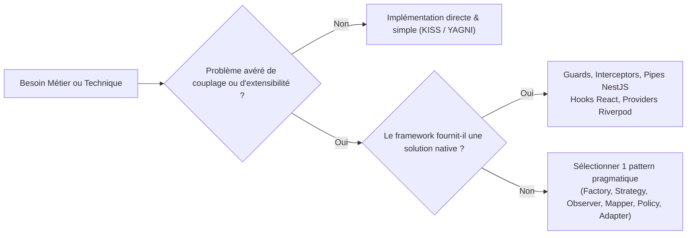

# My Community — Guide des Design Patterns Pragmatiques & Anti-Sur-Ingénierie

**Version :** 1.0  
**Date :** 22 octobre 2026  
**Périmètre :** Système Complet — Backend (NestJS), Web (Next.js), Mobile (Flutter) & Packages  
**Référence ADR :** [ADR-012 : Sélection de Design Patterns Pragmatiques](file:///c:/Sikirou/eskay/my_community/docs/adr/ADR-012-design-patterns-pragmatiques-anti-sur-ingenierie.md) · [ADR-011 : Principes SOLID](file:///c:/Sikirou/eskay/my_community/docs/adr/ADR-011-principes-solid-architecture.md)

---

## 1. La Philosophie : "Just-in-Time Patterns" (KISS & YAGNI)

L'architecture de **My Community** ne cherche pas à exhiber un catalogue encyclopédique de patrons de conception. Elle utilise les **Design Patterns comme des solutions chirurgicales** à des problèmes réels de maintenabilité, d'extensibilité ou de testabilité.



### Principes Directeurs :
1. **Pas d'abstraction sans au moins 2 cas concrets :** Ne pas créer une hiérarchie de classes génériques pour un seul besoin.
2. **Préférer la simplicité lisible à l'élégance obscure :** Un simple mapper statique ou une fonction pure est souvent supérieur à une classe de mapping générique à 5 niveaux de typage.
3. **Privilégier les mécanismes natifs des frameworks :** Ne pas réinventer ce que NestJS, React ou Flutter fournissent déjà nativement.

---

## 2. Le Catalogue des 6 Design Patterns Clés Autorisés

---

### Pattern 1 : Static Factory Method (Création)
* **Problème résolu :** Garantir que les entités du domaine ne soient jamais instanciées dans un état invalide, tout en évitant le boilerplate d'un patron *Builder* complet sur des entités simples.
* **Exemple d'application (`domain/entities/community.entity.ts`) :**

```typescript
export class CommunityEntity {
  private constructor(private readonly props: CommunityProps) {}

  // Fabrique statique : valide les invariants avant instanciation
  public static create(props: CommunityProps): CommunityEntity {
    if (!props.name || props.name.trim().length < 2) {
      throw new Error('Le nom de la communauté doit comporter au moins 2 caractères.');
    }
    if (!props.slug || !/^[a-z0-9-]+$/.test(props.slug)) {
      throw new Error('Le slug de la communauté est invalide.');
    }
    return new CommunityEntity({ ...props });
  }
}
```

* **Règle anti-surcharge :** Ne pas utiliser de *Builder Pattern* (`new CommunityBuilder().withName().withSlug().build()`) si une interface TypeScript et une méthode `create` suffisent.

---

### Pattern 2 : Strategy Pattern (Comportement)
* **Problème résolu :** Gérer des variantes multiples et interchangeables d'un comportement sans accumuler de blocs `if / else` ou `switch` qui violent l'Open/Closed Principle (OCP).
* **Exemple d'application : Passerelles de Paiement XOF (Mobile Money Bénin & International)**

```typescript
// Contrat de stratégie unique
export interface PaymentGatewayStrategy {
  readonly providerName: 'MTN_MOMO' | 'CELTIIS_CASH' | 'MOOV_MONEY' | 'STRIPE';
  charge(command: ChargeCommand): Promise<PaymentResult>;
}

// Registre de stratégies injecté sans modification du Use Case
@Injectable()
export class PaymentStrategyRegistry {
  private readonly strategies = new Map<string, PaymentGatewayStrategy>();

  constructor(strategies: PaymentGatewayStrategy[]) {
    strategies.forEach((s) => this.strategies.set(s.providerName, s));
  }

  get(provider: string): PaymentGatewayStrategy {
    const strategy = this.strategies.get(provider);
    if (!strategy) throw new Error(`Passerelle non supportée : ${provider}`);
    return strategy;
  }
}
```

---

### Pattern 3 : Observer / Domain Events (Comportement)
* **Problème résolu :** Déclencher des effets secondaires transversaux (journalisation d'audit, notifications push, envoi d'e-mails) sans alourdir le Cas d'Usage principal.
* **Exemple d'application : Découplage de l'Approbation de Communauté**

```typescript
// 1. Événement de Domaine immuable
export class CommunityApprovedEvent {
  constructor(
    public readonly communityId: string,
    public readonly adminId: string,
    public readonly approvedAt: Date = new Date(),
  ) {}
}

// 2. Le Cas d'Usage publie l'événement et termine sa tâche principale
@Injectable()
export class ApproveCommunityUseCase {
  constructor(
    private readonly writer: CommunityWriterPort,
    private readonly eventEmitter: EventEmitter2,
  ) {}

  async execute(command: ApproveCommunityCommand): Promise<void> {
    await this.writer.updateStatus(command.communityId, 'ACTIVE');
    this.eventEmitter.emit('community.approved', new CommunityApprovedEvent(command.communityId, command.adminId));
  }
}

// 3. Les écouteurs réagissent de manière indépendante
@Injectable()
export class AuditEventListener {
  @OnEvent('community.approved')
  async handle(event: CommunityApprovedEvent) {
    // Journalisation dans audit_logs
  }
}
```

* **Règle anti-surcharge :** Utiliser l'`EventEmitter2` in-process de NestJS. Ne pas installer Kafka ou RabbitMQ tant que le trafic et l'architecture ne l'exigent pas.

---

### Pattern 4 : Data Mapper (Structure)
* **Problème résolu :** Isoler complètement la structure de la base de données (modèles Prisma générés) et les formats de contrat API (DTOs) du modèle métier pur (Entités).
* **Exemple d'application (`infrastructure/mappers/community.mapper.ts`) :**

```typescript
export class CommunityMapper {
  public static toDomain(record: PrismaCommunity): CommunityEntity {
    return CommunityEntity.create({
      id: record.id,
      name: record.name,
      slug: record.slug,
      description: record.description,
      territoryId: record.territoryId,
      status: record.status,
      createdAt: record.createdAt,
      updatedAt: record.updatedAt,
    });
  }

  public static toResponseDto(entity: CommunityEntity): CommunityResponseDto {
    return {
      id: entity.id,
      name: entity.name,
      slug: entity.slug,
      description: entity.description ?? null,
      territoryId: entity.territoryId,
      status: entity.status,
    };
  }
}
```

* **Règle anti-surcharge :** Des fonctions statiques pures simples. Pas d'AutoMapper lourd ou de bibliothèques avec décorateurs magiques à configuration complexe.

---

### Pattern 5 : Specification / Policy Pattern (Domaine)
* **Problème résolu :** Centraliser des règles métier complexes pour éviter de les disperser dans les contrôleurs, use-cases ou entités.
* **Exemple d'application (`domain/policies/community-approval.policy.ts`) :**

```typescript
export class CommunityApprovalPolicy {
  public static canBeApproved(status: string, actorIsPlatformAdmin: boolean): boolean {
    if (!actorIsPlatformAdmin) return false;
    return status === 'PENDING';
  }
}
```

---

### Pattern 6 : Adapter Pattern (Structure / Ports & Adapters)
* **Problème résolu :** Adapter des bibliothèques externes ou SDKs tiers (AWS S3, MinIO, Twilio, Drift SQLite) aux interfaces de ports abstraites définies par notre application.
* **Exemple d'application :**
  - `S3StorageAdapter` implémente `FileStoragePort`.
  - En environnement de test ou de développement local, `LocalStorageAdapter` implémente ce même `FileStoragePort`.

---

## 3. Exploitation des Mécanismes Natifs (Zéro Boilerplate Custom)

| Mécanisme Natif | Pattern Implémenté Sous le Capot | Utilisation dans My Community |
| :--- | :--- | :--- |
| **NestJS Dependency Injection** | *Inversion of Control (IoC) / Service Locator Container* | Injection de tous les cas d'usage, ports et services sans `new` en dur. |
| **NestJS Guards** | *Chain of Responsibility* | Chaîne d'autorisation : JWT Guard $\rightarrow$ User Active Guard $\rightarrow$ RBAC Resource Guard. |
| **NestJS Interceptors** | *Proxy / Decorator Pattern* | Traçabilité des requêtes, transformation des erreurs RFC 7807, gestion des transactions. |
| **NestJS Pipes** | *Pipeline / Filter Pattern* | Validation des payloads JSON (class-validator/Zod) et transformation (ParseUUIDPipe). |
| **React Compound Components** | *Composite Pattern* | Composants UI riches (`Card`, `Card.Header`, `Card.Content`) découpés et extensibles. |
| **React Custom Hooks** | *Facade / Container Pattern* | Découplage complet de la logique d'état et du rendu JSX. |
| **Flutter Riverpod Providers** | *Observer / Dependency Injection* | Gestion d'état réactive et injection d'abstractions de dépôts. |

---

## 4. Anti-Patterns de Sur-Ingénierie Formellement BANNIS

1. ❌ **L'Abstract Factory de Fabriques :** Proscrite. Les méthodes statiques `Entity.create()` suffisent amplement.
2. ❌ **Le Builder Pattern sur des structures simples :** Proscrit. Un objet de props typé TypeScript offre déjà l'autocomplétion, la lisibilité et la vérification des types sans écrire 50 lignes de méthodes `.withX()`.
3. ❌ **Le CQRS asynchrone complexe / Event Sourcing prématuré :** Proscrit. Des classes de `Command` et de `Query` séparées injectant les ports ségrégués (`ReaderPort` vs `WriterPort`) dans un monolithe modulaire suffisent. Pas besoin de double base de données d'écriture/lecture synchronisée par des bus de messages tant que la charge ne le justifie pas.
4. ❌ **Les Génériques à 4 niveaux d'imbrication (`BaseRepository<T, K, ID, Mapper, Options>`) :** Proscrits. Écrire des interfaces concrètes et claires pour chaque domaine (`CommunityReaderPort`, `UserWriterPort`) plutôt que des classes de base tentaculaires incompréhensibles.
5. ❌ **Les Microservices Prématurés :** Proscrits. Le backend est un **Monolithe Modulaire** unifié.

---

## 5. Synthèse et Règle d'Or

> **« Utilisez un patron de conception uniquement pour clarifier le code et découpler une adhérence technique ou métier avérée, jamais pour anticiper un besoin hypothétique. »**
