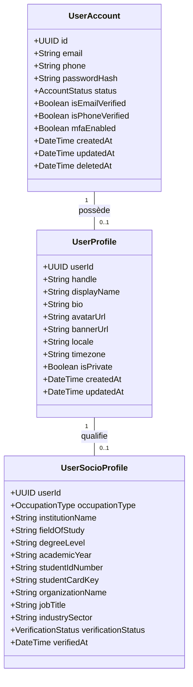
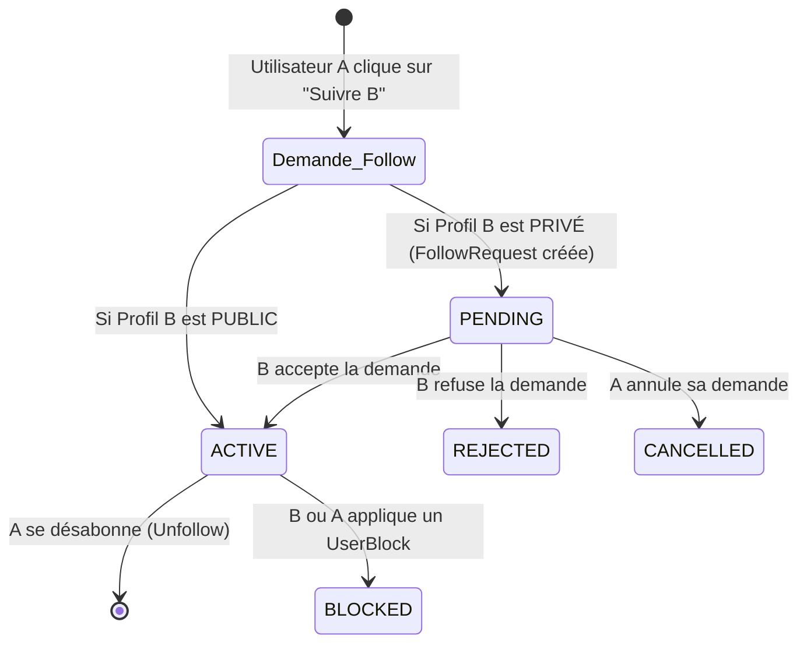
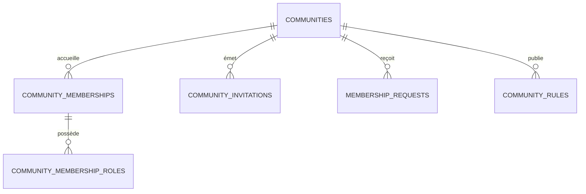
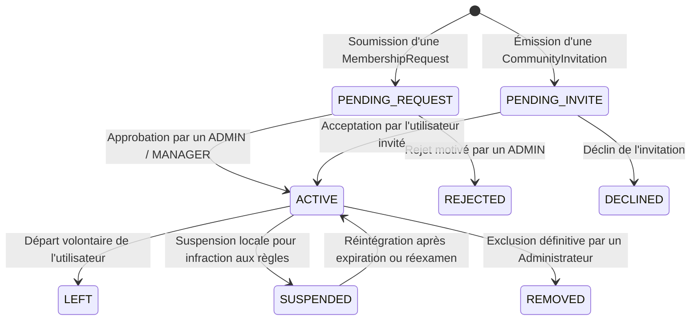

# My Community — Étape 2 : Modèle Métier des Utilisateurs, des Relations et des Communautés

**Version :** 1.0  
**Date :** 21 octobre 2026  
**Statut :** Validé — Spécification Conceptuelle de Référence  
**Domaines couverts :** Identité, Profils, Relations Sociales, Communautés, Adhésions  

---

## 1. Principes Directeurs et Séparation des Responsabilités

Pour permettre à la plateforme d'évoluer d'un produit initial maîtrisé vers un réseau international à très grande échelle sans refonte disruptive, l'architecture sépare formellement quatre responsabilités :
1. **L'identité technique** (authentification, sécurité, intégrité du compte).
2. **Le profil social** (nom public, biographie, avatar, personnalisation).
3. **Les relations sociales** (abonnements unidirectionnels, restrictions, blocages).
4. **L'appartenance collective** (communautés, adhésions, rôles et gouvernance locale).

Cette séparation garantit qu'une action sur un domaine (par exemple la suspension de sécurité d'un compte ou le changement d'avatar) ne dégrade ni les relations existantes, ni l'historique des publications, ni les adhésions aux groupes.

---

## 2. Les Entités Fondamentales

| Entité | Responsabilité & Périmètre |
| :--- | :--- |
| **`UserAccount`** | Identité technique, authentification, sessions, MFA, état de sécurité et cycle de vie du compte. |
| **`UserProfile`** | Nom affiché, identifiant unique `@handle`, biographie, avatar, langue et préférences de visibilité. |
| **`Follow`** | Abonnements unidirectionnels actifs entre utilisateurs (`follower` $\rightarrow$ `followed`). |
| **`FollowRequest`** | Demande d'abonnement en attente lorsque le profil cible est configuré en mode privé (`is_private = true`). |
| **`UserBlock`** | Blocage bilatéral strict et restrictions d'interaction entre deux utilisateurs. |
| **`Community`** | Identité de la communauté, slug unique, présentation, politique de visibilité, règles et statut. |
| **`CommunityMembership`** | Appartenance effective d'un utilisateur à une communauté avec statut (`ACTIVE`, `SUSPENDED`, `LEFT`). |
| **`CommunityMembershipRole`** | Rôles et privilèges accordés au membre au sein de la communauté (`OWNER`, `ADMIN`, `MODERATOR`, `MEMBER`). |
| **`CommunityInvitation`** | Invitation émise à destination d'un utilisateur pour rejoindre une communauté avec durée de validité. |
| **`MembershipRequest`** | Demande formelle d'adhésion soumise par un utilisateur pour les communautés à validation obligatoire. |
| **`CommunityRule`** | Charte et règles de conduite édictées par la communauté, versionnées et opposables aux membres. |

---

## 3. Découplage Compte Technique vs Profil Social

`UserAccount` et `UserProfile` forment une relation 1-à-1 stricte mais logiquement découplée :



### Règles d'or :
- **Création progressive :** Un compte `UserAccount` peut être créé et validé par OTP (email ou SMS) avant que l'utilisateur n'ait complété son `UserProfile`.
- **Profil Socio-Professionnel & Scolaire étendu (`UserSocioProfile`) :** Pour intégrer des associations scolaires / étudiantes (ex: AEECP) ou professionnelles :
  - **Statut Étudiant (`STUDENT`) :** L'utilisateur renseigne son établissement (`institutionName`), sa filière (`fieldOfStudy`), son niveau d'études (`degreeLevel`), l'année académique (`academicYear`) et optionnellement sa carte d'étudiant pour vérification.
  - **Statut Professionnel (`PROFESSIONAL`) :** Renseigne l'organisation employeur (`organizationName`), le poste (`jobTitle`) et le secteur d'activité (`industrySector`).
  - **Statut Autre (`OTHER`) :** Description personnalisée.
  - **Contrôle d'accès associatif :** Une association scolaire peut conditionner l'acceptation de la demande d'adhésion (`MembershipRequest`) à la présence d'un profil étudiant renseigné et validé par le bureau exécutif.
- **Isolation des secrets :** Les hachages de mots de passe (Argon2id), jetons de réinitialisation et sessions sont confinés à `UserAccount`. Le profil public ne manipule jamais de secrets.
- **Cycle de vie indépendant :** La désactivation temporaire ou la suspension d'un `UserAccount` gèle l'accès sans détruire le profil, permettant une réactivation sans perte d'historique.

---

## 4. Modèle des Relations Sociales entre Utilisateurs

Le modèle retient le paradigme des **abonnements asymétriques** (*Follower / Following*), adapté à un réseau généraliste international ouvert.



### 4.1 Entités du Graphe Social

| Entité | Attributs Clés | Invariants et Règles Métier |
| :--- | :--- | :--- |
| **`Follow`** | `follower_id`, `followed_id`, `created_at` | Interdiction stricte de s'auto-suivre (`follower_id <> followed_id`). Unicité de la paire. |
| **`FollowRequest`** | `requester_id`, `target_id`, `status`, `created_at`, `responded_at` | Générée uniquement si `target.is_private = true`. Statuts : `PENDING`, `ACCEPTED`, `REJECTED`. |
| **`UserBlock`** | `blocker_id`, `blocked_id`, `reason`, `created_at` | Entraîne la rupture unilatérale immédiate des liens de suivi existants dans les deux sens. |

### 4.2 Conséquences Impératives du Blocage (`UserBlock`)
Dès l'enregistrement d'un blocage entre l'utilisateur A (bloqueur) et l'utilisateur B (bloqué) :
1. **Suppression des abonnements :** Les éventuelles relations `Follow` de A vers B et de B vers A sont immédiatement supprimées.
2. **Invisibilité des profils :** B ne peut plus consulter le profil public de A, ni voir ses publications.
3. **Fermeture de la messagerie :** Aucune conversation directe ne peut être initiée ou poursuivie.
4. **Exclusion du fil d'actualité :** Les publications et commentaires de A et B sont mutuellement filtrés de leurs fils respectifs.

---

## 5. Modèle des Communautés, Adhésions et Rôles

Une communauté constitue un espace collectif souverain doté de son propre cycle de vie et de sa gouvernance locale.



### 5.1 Politiques de Visibilité et d'Adhésion

La visibilité de la communauté et ses règles d'entrée sont deux dimensions orthogonales :

| Politique de Visibilité | Découverte & Recherche | Accès aux Contenus Publics | Conditions d'Adhésion Possibles |
| :--- | :--- | :--- | :--- |
| **`PUBLIC`** | Référencée publiquement dans l'annuaire | Visibles par tous les visiteurs | `OPEN` (libre) ou `APPROVAL` (sur demande) |
| **`PRIVATE_LISTED`** | Référencée (nom, description, règles) | Réservés aux membres acceptés | `APPROVAL` (demande validée) ou `INVITE_ONLY` |
| **`SECRET`** | Totalement masquée de la recherche | Réservés aux membres acceptés | `INVITE_ONLY` (lien sécurisé ou invitation directe) |

### 5.2 Cycle de Vie de l'Adhésion (`CommunityMembership`)



### 5.3 Hiérarchie des Rôles Locaux
1. **`OWNER` (Propriétaire) :** Pouvoir suprême local. Peut transférer la propriété, nommer des administrateurs, modifier les paramètres critiques et dissoudre/archiver la communauté.
2. **`ADMIN` (Administrateur) :** Gère les adhésions, traite les demandes d'entrée, configure les bannières/règles, nomme des modérateurs et prononce des exclusions de membres.
3. **`MODERATOR` (Modérateur) :** Traite les signalements locaux de publications et commentaires, masque les contenus non conformes à la charte.
4. **`MEMBER` (Membre standard) :** Publie, commente, réagit, participe aux événements et consulte les contenus réservés aux membres.

---

## 6. Règles Métier et Invariants de Sécurité

1. **Unicité de l'adhésion :** Un utilisateur ne peut avoir qu'une seule adhésion active à une communauté donnée (`UNIQUE (community_id, user_id)`).
2. **Pérennité de la propriété :** Une communauté ne peut pas se retrouver sans propriétaire actif. Un propriétaire ne peut quitter la communauté qu'après avoir explicitement transféré son rôle `OWNER` à un autre membre actif.
3. **Non-auto-promotion :** Un modérateur ou administrateur ne peut pas s'auto-attribuer de privilèges supérieurs à son rang actuel.
4. **Protection Zero-Trust :** Les droits d'accès aux contenus d'une communauté privée sont vérifiés à l'exécution de chaque requête par le backend, indépendamment des contrôles d'affichage effectués par l'application Flutter.
5. **Idempotence des invitations et demandes :** Une invitation déjà acceptée, refusée ou expirée ne peut être réutilisée. Une seconde tentative renvoie un code d'erreur explicite sans créer de doublon.

---

## 7. Premiers Contrats d'API (NestJS / OpenAPI)

```
# Authentification et Comptes
POST   /api/v1/auth/register               # Inscription nouveau compte
POST   /api/v1/auth/login                  # Connexion et émission des tokens JWT
POST   /api/v1/auth/logout                 # Révocation de la session active

# Profils et Relations Sociales
GET    /api/v1/profiles/me                 # Récupération du profil connecté
PATCH  /api/v1/profiles/me                 # Mise à jour des informations de profil
GET    /api/v1/profiles/:handle            # Consultation du profil public par handle
POST   /api/v1/users/:userId/follow        # S'abonner à un utilisateur
DELETE /api/v1/users/:userId/follow        # Se désabonner d'un utilisateur
POST   /api/v1/users/:userId/block         # Bloquer un utilisateur

# Communautés et Gouvernance
POST   /api/v1/communities                 # Créer une nouvelle communauté
GET    /api/v1/communities/:slug           # Consulter une communauté par slug
PATCH  /api/v1/communities/:id             # Mettre à jour les paramètres (Admin)
POST   /api/v1/communities/:id/join        # Rejoindre une communauté ouverte
POST   /api/v1/communities/:id/requests    # Soumettre une demande d'adhésion
POST   /api/v1/communities/:id/invitations # Inviter un utilisateur (Admin/Manager)
DELETE /api/v1/communities/:id/members/me  # Quitter volontairement une communauté
```

---

## 8. Transition vers la Prochaine Étape Architecturale

Les entités fondamentales des utilisateurs et des communautés étant formellement posées, la prochaine étape obligatoire consiste à spécifier le **Modèle métier des contenus, des interactions et du système de confidentialité (Étape 3)**.

Ce domaine gouvernera la création des publications (`Post`), leur rattachement contextuel (profil personnel ou communauté hôte), les commentaires arborescents, les réactions affectives, la sécurisation des médias et l'algorithme d'autorisation d'accès en temps réel.
