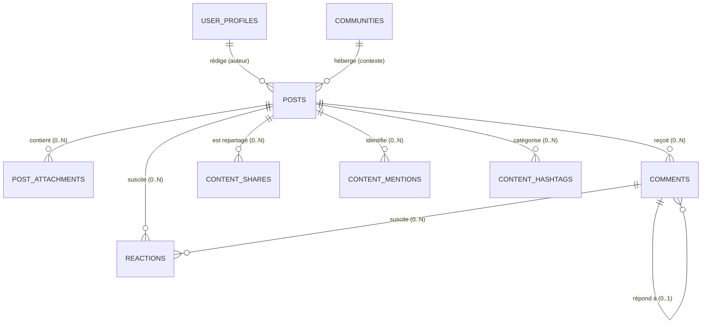
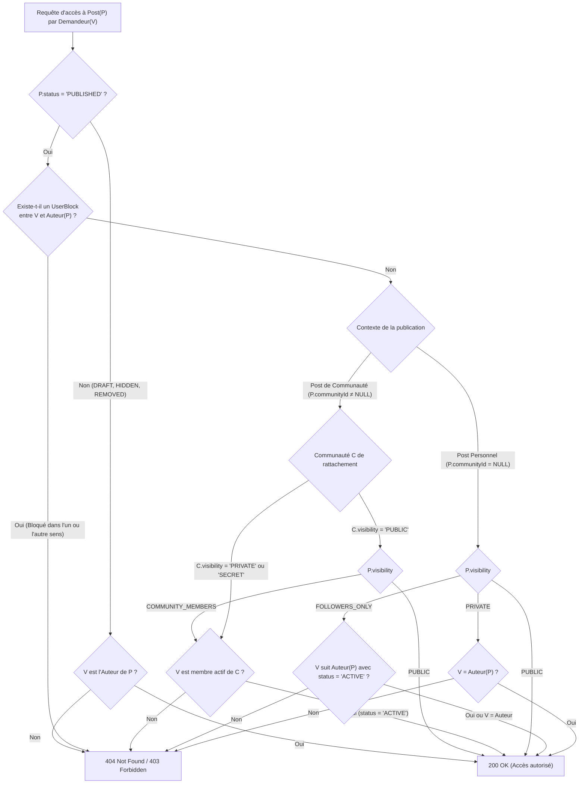
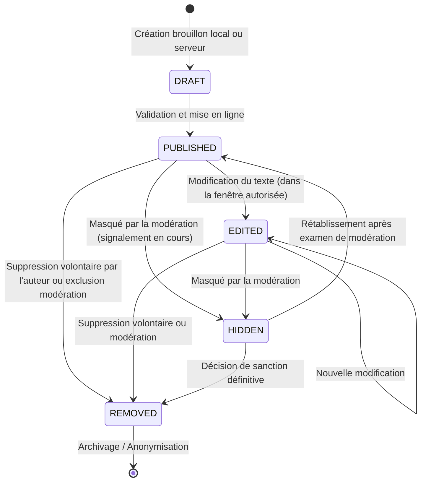
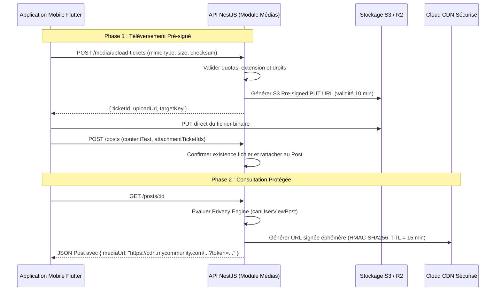

# My Community — Étape 3 : Modèle Métier des Contenus, des Interactions et du Système de Confidentialité

**Version :** 1.0  
**Date :** 21 octobre 2026  
**Statut :** Validé — Spécification Conceptuelle de Référence  
**Domaines couverts :** Contenus (`content`), Interactions (`reactions`, `comments`), Confidentialité & Autorisation (`privacy`), Médias (`media-attachments`)  

---

## 1. Principes Directeurs du Domaine Contenus

Dans My Community, le contenu publié est le catalyseur de la vie sociale et communautaire. Pour garantir une expérience riche, sécurisée et évolutive, le domaine des contenus repose sur quatre principes directeurs non négociables :

1. **Rattachement contextuel explicite :** Aucun contenu n'est orphelin. Une publication appartient soit à la chronologie personnelle d'un utilisateur (*User Post*), soit à une communauté collective (*Community Post*).
2. **Moteur de confidentialité Zero-Trust :** La visibilité d'un contenu n'est jamais déterminée par une simple propriété statique en base, mais résolue dynamiquement par un **moteur de règles de confidentialité** (*Privacy Engine*) évaluant l'identité du demandeur, le statut de la publication, le contexte de la communauté et les blocages bilatéraux.
3. **Séparation entre création et distribution :** Le domaine `content` est propriétaire de l'intégrité, du cycle de vie et du stockage des publications. Il ne gère pas le classement du fil d'actualité ni l'algorithme de recommandation, qui relèvent exclusivement du domaine `feed`.
4. **Sécurité et intégrité des médias :** Les fichiers multimédias attachés (photos, vidéos, documents) ne sont jamais accessibles via des URLs publiques permanentes si la publication est privée. Leur accès est verrouillé par des signatures cryptographiques éphémères.

---

## 2. Diagramme de Modélisation du Domaine Contenus



---

## 3. Les Entités Fondamentales et leurs Attributs

### 3.1 Entité `Post` (La Publication)

Cette entité représente l'unité atomique d'expression sur la plateforme.

| Champ | Type Logique | Description & Rôle Métier |
| :--- | :--- | :--- |
| `id` | UUID | Identifiant immuable de la publication (clé primaire). |
| `authorId` | UUID | Référence obligatoire au profil de l'auteur (`user_profiles.user_id`). |
| `communityId` | UUID nullable | `NULL` si publication de profil individuel ; référence à `communities.id` si publication de communauté. |
| `contentText` | Texte nullable | Corps textuel de la publication (supporte Markdown léger et emojis). |
| `visibility` | Enum | Portée de visibilité demandée par l'auteur (`PUBLIC`, `FOLLOWERS_ONLY`, `COMMUNITY_MEMBERS`, `PRIVATE`). |
| `status` | Enum | État opérationnel (`DRAFT`, `PUBLISHED`, `EDITED`, `HIDDEN`, `REMOVED`). |
| `allowComments` | Booléen | Permet à l'auteur de désactiver les commentaires sous sa publication. |
| `isPinned` | Booléen | Épinglé en tête de profil ou en haut de la communauté (réservé aux modérateurs/propriétaires). |
| `likesCount` | Entier | Projection dénormalisée optimisée pour la lecture rapide. |
| `commentsCount` | Entier | Projection dénormalisée du nombre de commentaires actifs. |
| `sharesCount` | Entier | Projection dénormalisée du nombre de partages externes ou internes. |
| `publishedAt` | Date/Heure | Date de mise en ligne effective (pour l'ordonnancement chronologique). |
| `editedAt` | Date/Heure nullable | Horodatage de la dernière modification textuelle. |
| `createdAt` | Date/Heure | Horodatage d'insertion en base. |
| `updatedAt` | Date/Heure | Horodatage de dernière mutation technique. |

### 3.2 Entité `PostAttachment` (Pièces Jointes Médias)

Assure le pont étanche entre le domaine des contenus et le stockage d'objets (S3) :

| Champ | Type Logique | Description & Rôle Métier |
| :--- | :--- | :--- |
| `id` | UUID | Identifiant unique de la pièce jointe. |
| `postId` | UUID | Publication parente propriétaire de la pièce jointe. |
| `mediaKey` | Texte | Clé unique du fichier dans le stockage objet (ex: `posts/attachments/2026/10/uuid.webp`). |
| `mediaType` | Enum | Type MIME normalisé (`IMAGE`, `VIDEO`, `DOCUMENT`, `AUDIO`). |
| `fileSizeBytes` | Grand entier | Taille exacte du fichier pour la gestion des quotas et l'optimisation mobile. |
| `dimensions` | JSON nullable | Métadonnées de rendu (`width`, `height`, `aspectRatio`) pour éviter les sauts d'affichage (*layout shifts*). |
| `altText` | Texte nullable | Description textuelle pour l'accessibilité aux personnes malvoyantes. |
| `sortOrder` | Entier | Ordre d'affichage dans le carrousel ou la grille multimédia (0, 1, 2...). |

### 3.3 Entité `Comment` (Commentaires et Réponses)

Structure arborescente à deux niveaux stricts pour favoriser des discussions claires et performantes :

| Champ | Type Logique | Description & Rôle Métier |
| :--- | :--- | :--- |
| `id` | UUID | Identifiant immuable du commentaire. |
| `postId` | UUID | Publication racine sur laquelle porte la discussion. |
| `authorId` | UUID | Auteur du commentaire (`user_profiles.user_id`). |
| `parentId` | UUID nullable | `NULL` pour un commentaire racine ; pointe vers le `Comment` parent en cas de réponse. |
| `contentText` | Texte | Contenu textuel du commentaire (max. 1 000 caractères). |
| `status` | Enum | Statut d'affichage (`PUBLISHED`, `HIDDEN`, `REMOVED`). |
| `likesCount` | Entier | Compteur de réactions positives sur ce commentaire. |
| `createdAt` | Date/Heure | Horodatage de publication. |
| `updatedAt` | Date/Heure | Horodatage de dernière modification. |

> [!IMPORTANT]
> **Règle de profondeur maximale (Depth = 2) :**  
> Si un utilisateur répond à un commentaire qui possède déjà un `parentId`, le nouveau commentaire reçoit automatiquement le même `parentId` (mise à plat de la réponse). Cela interdit les arborescences infinies impossibles à lire sur un écran mobile de smartphone.

### 3.4 Entité `Reaction` (Réactions Affectives)

```sql
-- Contrainte d'unicité absolue : Un utilisateur ne peut avoir qu'une réaction par cible
UNIQUE (user_id, target_type, target_id)
```

- **`targetType` :** `'POST'` ou `'COMMENT'`.
- **`reactionType` :** Énumération stricte :
  - `LIKE` (J'aime / Appréciation standard)
  - `LOVE` (Cœur / Soutien chaleureux)
  - `CELEBRATE` (Félicitations / Célébration d'un succès)
  - `SUPPORT` (Entraide / Solidarité locale)
  - `INSIGHTFUL` (Pertinent / Informatif)

---

## 4. La Matrice et le Moteur de Confidentialité (Privacy Engine)

Le **Moteur de Confidentialité** est le composant d'autorisation central. Avant de renvoyer une publication à un client (Web ou Mobile), le moteur exécute la décision d'accès suivante :



### Matrice Récapitulative des Droits d'Accès

| Type de Publication | Visibilité Déclarée | Visiteur non authentifié | Utilisateur authentifié lambda | Abonné actif de l'auteur | Membre actif de la communauté | Auteur de la publication |
| :--- | :--- | :---: | :---: | :---: | :---: | :---: |
| **Post Personnel** | `PUBLIC` | ✅ Visible | ✅ Visible | ✅ Visible | S/O | ✅ Visible |
| **Post Personnel** | `FOLLOWERS_ONLY` | ❌ Bloqué | ❌ Bloqué | ✅ Visible | S/O | ✅ Visible |
| **Post Personnel** | `PRIVATE` | ❌ Bloqué | ❌ Bloqué | ❌ Bloqué | S/O | ✅ Visible |
| **Post Communauté Publique** | `PUBLIC` | ✅ Visible | ✅ Visible | ✅ Visible | ✅ Visible | ✅ Visible |
| **Post Communauté Publique** | `COMMUNITY_MEMBERS`| ❌ Bloqué | ❌ Bloqué | ❌ Bloqué | ✅ Visible | ✅ Visible |
| **Post Communauté Privée** | Réservé aux membres | ❌ Bloqué | ❌ Bloqué | ❌ Bloqué | ✅ Visible | ✅ Visible |
| **Toute publication** | *Auteur bloqué par/pour le visiteur* | ❌ Bloqué | ❌ Bloqué | ❌ Bloqué | ❌ Bloqué | ❌ Bloqué |

---

## 5. Machine à États du Contenu



### Règles d'Édition et d'Auditabilité
- **Fenêtre de modification :** Un utilisateur peut modifier le texte d'un post pendant un délai de **24 heures** après sa publication initiale.
- **Transparence sociale :** Dès lors qu'une modification a eu lieu, la mention publique `(modifié)` est affichée avec la date de révision `editedAt`.
- **Intégrité de l'audit :** Le texte antérieur est archivé dans une table interne d'audit (`post_history`) pour permettre aux modérateurs de vérifier qu'un contenu signalé n'a pas été caviardé après infraction.

---

## 6. Protection et Distribution Sécurisée des Médias Privés

Le stockage des fichiers multimédias applique le patron de **distribution à accès éphémère** :



### Avantages majeurs :
- **Aucune charge I/O sur le backend :** Les gros binaires (vidéos de 50 Mo, photos 4K) transitent directement du smartphone vers le stockage objet S3 sans saturer l'API NestJS.
- **Aucune fuite d'URL permanente :** Un lien copié-collé sur un forum ou WhatsApp expire au bout de 15 minutes et cesse de fonctionner pour les personnes non autorisées.

---

## 7. Gestion de la Concurrence et des Compteurs Sociaux

Sur un réseau social à fort engagement, les clics simultanés sur "J'aime" (*Likes*) ou les ajouts massifs de commentaires créent un risque sévère de contention de verrouillage (*row-level locking contention*) si l'on effectue des `UPDATE posts SET likes_count = likes_count + 1` de manière synchrone.

### Stratégie d'Optimisation Retenue :
1. **Écriture transactionnelle de la réaction :**
   - L'insertion dans la table `reactions` s'effectue avec `ON CONFLICT (user_id, target_type, target_id) DO NOTHING` pour garantir l'idempotence stricte.
2. **Bufferisation et incrément asynchrone (Phase 2+) :**
   - Les incréments de compteurs sont déversés dans un buffer Redis (`HINCRBY post:likes:pending <postId> 1`).
   - Un worker de réconciliation asynchrone (BullMQ) synchronise périodiquement (toutes les 5 à 10 secondes) les compteurs consolidés vers PostgreSQL en batch :
     ```sql
     UPDATE posts 
     SET likes_count = likes_count + batch.increment 
     FROM (VALUES ($1, $2), ($3, $4)) AS batch(post_id, increment) 
     WHERE posts.id = batch.post_id;
     ```

---

## 8. Spécification des Contrats d'API du Domaine Contenus

```
# Publications
POST   /api/v1/posts                       # Créer une publication (profil ou communauté)
GET    /api/v1/posts/:postId               # Consulter une publication unitaire (sécurisée)
PATCH  /api/v1/posts/:postId               # Modifier le texte d'une publication
DELETE /api/v1/posts/:postId               # Supprimer une publication

# Pièces Jointes et Médias
POST   /api/v1/media/upload-tickets        # Obtenir une URL pré-signée S3 de téléversement

# Commentaires
GET    /api/v1/posts/:postId/comments      # Lister les commentaires (avec pagination par curseur)
POST   /api/v1/posts/:postId/comments      # Ajouter un commentaire ou une réponse
DELETE /api/v1/comments/:commentId         # Supprimer son propre commentaire ou modérer

# Réactions Affectives
POST   /api/v1/posts/:postId/reactions     # Ajouter ou modifier une réaction (LIKE, LOVE...)
DELETE /api/v1/posts/:postId/reactions     # Retirer sa réaction
GET    /api/v1/posts/:postId/reactions     # Lister les réactions par type
```

---

## 9. Transition vers la Prochaine Étape Architecturale

Avec la stabilisation du **Modèle des Contenus et du Système de Confidentialité**, les fondations fonctionnelles de publication et d'accès sont complètes.

La prochaine étape obligatoire consiste à spécifier le **Modèle du Fil d'Actualité, de la Découverte et de la Distribution Asynchrone (Étape 4)**, qui formalisera :
- Les algorithmes de sélection et de pondération du fil *Chronologique* et du fil *Découvrir*.
- Le mécanisme de Fan-out hybride (*Fan-out on Read* pour le MVP vs *Fan-out on Write* avec Redis pour les créateurs standards).
- Le format exact de la pagination par curseur opaque (`before` / `after`).
