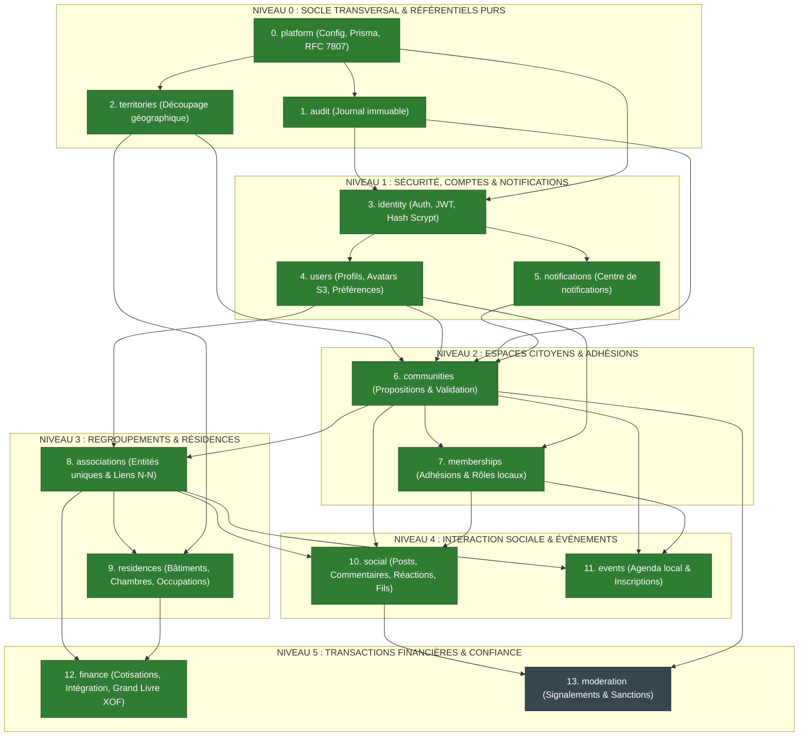

# My Community — Feuille de Route d'Implémentation Séquentielle par Module

**Version :** 1.0  
**Date :** 22 octobre 2026  
**Objectif :** Garantir un ordre d'implémentation strict et unilatéral des modules (graphe acyclique) pour **interdire formellement le chevauchement et éliminer les allers-retours / réécritures** sur des modules déjà stabilisés.  
**Références Architecturales :**  
- [Frontières des Modules & Règles de Dépendance](file:///c:/Sikirou/eskay/my_community/docs/architecture/module-boundaries.md)  
- [ADR-011 : Principes SOLID](file:///c:/Sikirou/eskay/my_community/docs/adr/ADR-011-principes-solid-architecture.md)  
- [ADR-012 : Design Patterns Pragmatiques](file:///c:/Sikirou/eskay/my_community/docs/adr/ADR-012-design-patterns-pragmatiques-anti-sur-ingenierie.md)  

---

## 1. Principe Zéro Chevauchement : L'Ordre Topologique Strict

Pour ne jamais avoir à modifier un module après l'avoir implémenté, les dépendances s'organisent en **Graphe Acyclique Dirigé (DAG)**.  
Un module de niveau $N$ ne peut être développé que si **tous ses prérequis de niveau $\le N-1$ sont achevés et verrouillés**.



---

## 2. Tableau de Bord d'Avancement des Modules

Chaque module suit un statut strict :
- ⚪ **À VENIR (BLOCKED)** : Prérequis amont non verrouillés. Interdiction de commencer.
- 🟡 **EN COURS (IN PROGRESS)** : En cours de développement selon la recette en 6 étapes.
- 🟢 **VERROUILLÉ (LOCKED / FROZEN)** : Tests 100% verts, façade publique figée. Interdiction d'y toucher (extensibilité via OCP / événements uniquement).

| Séquence | Module | Niveau | Prérequis Obligatoires | Statut | Responsabilité Clé |
| :---: | :--- | :---: | :--- | :---: | :--- |
| **0** | **`platform`** | L0 | *Aucun* | 🟢 **VERROUILLÉ** | PrismaService, ConfigService, validation des variables, filtre d'erreur RFC 7807. |
| **1** | **`audit`** | L0 | `platform` | 🟢 **VERROUILLÉ** | Port `AuditLoggerPort`, persistance `audit_logs`, écriture asynchrone non-bloquante. |
| **2** | **`territories`** | L0 | `platform` | 🟢 **VERROUILLÉ** | Hiérarchie géographique sans cycle (Pays $\rightarrow$ Dépt $\rightarrow$ Commune $\rightarrow$ Quartier). |
| **3** | **`identity`** | L1 | `platform`, `audit` | 🟢 **VERROUILLÉ** | Inscription, connexion, validation credentials, hash Scrypt, JWT & sessions. |
| **4** | **`users`** | L1 | `identity`, `audit` | 🟢 **VERROUILLÉ** | Profil utilisateur, prénom, nom, bio, ville, avatar S3, préférences. |
| **5** | **`notifications`**| L1 | `identity` | 🟢 **VERROUILLÉ** | Centre de notifications in-app, lecture/non-lu, émission découplée. |
| **6** | **`communities`** | L2 | `territories`, `users`, `audit`, `notifications` | 🟢 **VERROUILLÉ** | Cycle de vie des propositions citoyennes, instruction, activation, slug unique. |
| **7** | **`memberships`** | L2 | `communities`, `users`, `audit`, `notifications` | 🟢 **VERROUILLÉ** | Demande d'adhésion, acceptation manager, rôles locaux (`MEMBER`, `ADMIN`). |
| **8** | **`associations`** | L3 | `communities`, `users`, `audit` | 🟢 **VERROUILLÉ** | Association unique, rattachements territoriaux multiples (N-N), bureau exécutif. |
| **9** | **`residences`** | L3 | `associations`, `territories`, `identity`, `audit` | 🟢 **VERROUILLÉ** | Logements étudiants/communautaires, chambres, occupations temporelles (ADR-010). |
| **10** | **`social`** | L4 | `communities`, `associations`, `memberships`, `moderation` | 🟢 **VERROUILLÉ** | Posts, visibilité contextuelle, commentaires arborescents (Depth=2), réactions affectives. |
| **11** | **`events`** | L4 | `communities`, `associations`, `memberships`, `notifications` | 🟢 **VERROUILLÉ** | Calendrier d'événements, inscriptions, rappels. |
| **12** | **`finance`** | L5 | `associations`, `residences`, `identity`, `audit` | 🟢 **VERROUILLÉ** | Cotisations, frais d'intégration résidence, baux bailleurs, transactions XOF, journal immuable (ADR-006). |
| **13** | **`moderation`** | L5 | `social`, `communities`, `users`, `audit` | ⚪ **À VENIR** | Signalements de contenu/comportement, instruction par les modérateurs, sanctions. |

---

## 3. La "Recette Invariante en 6 Étapes" par Module

Pour chaque module, sans aucune exception, l'implémentation suit **obligatoirement** ce cycle séquentiel :

```text
module-name/
├── Étape 1 : domain/                      # 1. Domaine Pur & Invariants (0 dépendance)
│   ├── entities/                          #    Entités métier avec Static Factory create()
│   ├── value-objects/                     #    Value Objects immuables (ex: Slug, Code)
│   ├── policies/                          #    Règles métier pures (Specification Pattern)
│   └── events/                            #    Événements de Domaine
│
├── Étape 2 : application/ports/           # 2. Abstractions Découplées (ISP & DIP)
│   ├── module-reader.port.ts              #    Port de consultation (Query)
│   └── module-writer.port.ts              #    Port de mutation (Command)
│
├── Étape 3 : application/                 # 3. Cas d'Usage Uniques (SRP & OCP)
│   ├── commands/                          #    1 Cas d'Usage = 1 Scénario d'écriture
│   └── queries/                           #    1 Cas d'Usage = 1 Scénario de lecture
│
├── Étape 4 : infrastructure/              # 4. Adaptateurs & Mappers Pragmatiques
│   ├── persistence/                       #    Repository Prisma implémentant les Ports
│   └── mappers/                           #    Data Mapper (toDomain, toResponseDto)
│
├── Étape 5 : presentation/ & Façade       # 5. Exposition REST & Contrat Public
│   ├── http/controllers/                  #    Contrôleur mince validant les DTOs
│   ├── http/dto/                          #    DTOs validés (class-validator)
│   └── index.ts                           #    Façade publique STRICTE du module
│
└── Étape 6 : test/ & Verrouillage         # 6. Porte de Sortie & Gel (Gate Lock)
    └── unit / integration tests           #    100% tests passants, 0 warning linter
```

---

## 4. Protocole de Verrouillage Formel (Gate Lock)

Un module passe au statut **🟢 VERROUILLÉ (LOCKED)** uniquement lorsque les critères suivants sont satisfaits :

1. **Intégrité Hexagonale & SOLID :**
   - Aucune dépendance vers Prisma ou NestJS dans `domain/`.
   - Les cas d'usage dépendent uniquement de ports abstraits (`application/ports/`).
   - Les ports sont séparés en lecture (`ReaderPort`) et écriture (`WriterPort`).
2. **Couverture de Tests Unitaires :**
   - Tests de domaine validant les invariants et cas d'erreur.
   - Tests de cas d'usage avec `InMemoryRepository` (preuve LSP & DIP).
   - Commande `pnpm --filter @my-community/api run test` : **100% de succès**.
3. **Contrôle Qualité du Code :**
   - Linter `oxlint src/ test/` : **0 erreur, 0 avertissement**.
4. **Façade Publique Hermétique :**
   - Le fichier `index.ts` n'expose que ce qui est contractuellement requis pour les autres modules.
   - Aucun détail d'infrastructure interne (tables, mappers privés) n'est exporté.

> [!CAUTION]
> **Règle d'Or Anti-Régression :**  
> Dès qu'un module est verrouillé, les modules suivants **DOIVENT S'ADAPTER à sa façade publique**.  
> Il est **strictement interdit** de modifier un module verrouillé pour satisfaire un besoin de convenance d'un module aval. Si une extension est nécessaire, elle s'effectue via un nouvel écouteur d'événement de domaine ou un adaptateur dédié (respect de l'Open/Closed Principle).

---

## 5. Prochaines Étapes Immédiates d'Exécution

Pour amorcer le développement sans aucun chevauchement, l'ordre d'action opérationnel est :

1. **Finaliser le Niveau 0 :**
   - [x] Consolider `platform` (PrismaService, gestion centralisée des erreurs RFC 7807).
   - [x] Implémenter le module `audit` (Niveau 0) avec son port `AuditLoggerPort` et son adaptateur Prisma.
   - [x] Implémenter le module `territories` (Niveau 0 - référentiel pur du Bénin : pays, départements, communes).
   - [x] 🔒 **Verrouiller Niveau 0.** (12/12 tests unitaires passants, 0 warning linter).
2. **Implémenter le Niveau 1 :**
   - [x] Implémenter `identity` (Inscription, Auth, JWT, Hashing, 12 tests unitaires, Scrypt, Tokens). 🔒 **Verrouillé.**
   - [x] Implémenter `users` (Profils, Avatars, mise à jour, consultation). 🔒 **Verrouillé.**
   - [x] Implémenter `notifications` (Infrastructure in-app, anti-IDOR, lecture/non-lu). 🔒 **Verrouillé.**
   - [x] 🔒 **Verrouiller Niveau 1.** (31 tests unitaires passants, 0 warning linter).
3. **Stabiliser et Verrouiller le Niveau 2 :**
   - [x] Finaliser l'adaptateur Prisma et les contrôleurs de `communities` (Propositions citoyennes, revue admin, slug). 🔒 **Verrouillé.**
   - [x] Implémenter `memberships` (Adhésions et rôles locaux, contextual RBAC). 🔒 **Verrouillé.**
   - [x] 🔒 **Verrouiller Niveau 2.** (25 tests unitaires passants, 0 warning linter).
4. **Implémenter et Verrouiller le Niveau 3 :**
   - [x] Implémenter `associations` (Entités uniques, rattachements multi-communautaires N-N, rôles de bureau). 🔒 **Verrouillé.**
   - [x] Implémenter `residences` (Campus, bâtiments, chambres, occupations temporelles ADR-010). 🔒 **Verrouillé.**
   - [x] 🔒 **Verrouiller Niveau 3.** (27 tests unitaires passants, 0 warning linter).
5. **Niveau 4 :**
   - [x] Implémenter `social` (Posts, fils d'actualité, commentaires arborescents Depth=2, réactions affectives). 🔒 **Verrouillé.** (15 tests unitaires passants).
   - [x] Implémenter `events` (Agenda communautaire, inscriptions, rappels). 🔒 **Verrouillé.** (11 tests unitaires passants).
   - [x] 🔒 **Verrouiller Niveau 4.** (26 tests unitaires passants, 0 erreur de compilation, 0 warning linter).
6. **Niveau 5 (À venir) :**
   - [ ] Implémenter `finance` (Cotisations, intégration résidence, grand livre XOF immuable ADR-006).
   - [ ] Implémenter `moderation` (Signalements, instruction par modérateurs, sanctions).
   - [ ] 🔒 **Verrouiller Niveau 5.**
