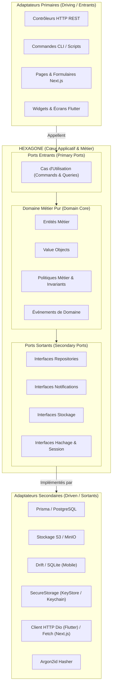
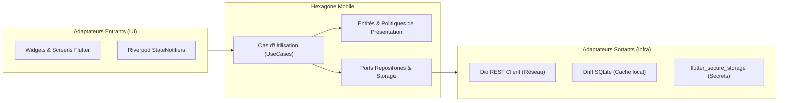

# My Community — Architecture Hexagonale Globale (Ports & Adaptateurs)

**Version :** 1.0  
**Date :** 21 octobre 2026  
**Périmètre :** Système Complet — Backend (NestJS) · Web (Next.js) · Mobile (Flutter)  
**Paradigme :** Ports and Adapters (Alistair Cockburn) / Clean Architecture  

---

## 1. Philosophie et Principes Fondateurs

L'architecture hexagonale (**Ports & Adapters**) est adoptée de manière **systémique et uniforme** sur les trois piliers applicatifs de My Community : le **Backend NestJS**, l'application **Web Next.js** et l'application **Mobile Flutter**.

### Règle d'Or de l'Architecture Hexagonale & SOLID
> **Le cœur métier (Domaine & Cas d'utilisation) est totalement agnostique des technologies extérieures.**  
> Il ne connaît ni NestJS, ni Prisma, ni PostgreSQL, ni Next.js, ni Flutter, ni Dio, ni Drift.  
> Les dépendances pointent **toujours de l'extérieur vers l'intérieur**, incarnant le **Principe d'Inversion des Dépendances (DIP)** et la **Responsabilité Unique (SRP)**.  
> L'ensemble du système applique formellement les [Principes SOLID](file:///c:/Sikirou/eskay/my_community/docs/architecture/principes-solid.md) (Réf: [ADR-011](file:///c:/Sikirou/eskay/my_community/docs/adr/ADR-011-principes-solid-architecture.md)).



---

## 2. Déclinaison Hexagonale sur le Backend (NestJS)

Chacun des 12 modules métier (`communities`, `finance`, `social`, etc.) constitue son propre hexagone indépendant.

### 2.1 Structure d'un Module Hexagonal Backend
```text
src/modules/communities/
├── domain/                                  # CŒUR 1 : Domaine Métier Pur (0 dépendance)
│   ├── entities/
│   │   ├── community.entity.ts              # Entité avec invariants métier
│   │   └── proposal.entity.ts
│   ├── value-objects/
│   │   ├── community-slug.vo.ts             # Validation intrinsèque du slug
│   │   └── community-name.vo.ts
│   ├── policies/
│   │   └── community-validation.policy.ts   # Règles d'éligibilité et de transition
│   ├── events/
│   │   └── community-approved.domain-event.ts
│   └── errors/
│       └── proposal-already-reviewed.error.ts
│
├── application/                             # CŒUR 2 : Orchestration Applicative
│   ├── ports/
│   │   ├── in/                              # Ports Entrants (Contrats de cas d'usage)
│   │   │   ├── propose-community.use-case.ts
│   │   │   └── approve-community.use-case.ts
│   │   └── out/                             # Ports Sortants (Contrats de dépendances)
│   │       ├── community-reader.port.ts     # Ségrégation ISP : Lecture
│   │       ├── community-writer.port.ts     # Ségrégation ISP : Écriture
│   │       ├── proposal-repository.port.ts
│   │       ├── audit-logger.port.ts
│   │       └── notification-emitter.port.ts
│   ├── commands/                            # DTOs de commande interne
│   │   └── approve-community.command.ts
│   └── queries/                             # DTOs de requête interne
│       └── get-community-feed.query.ts
│
├── infrastructure/                          # ADAPTATEURS SECONDAIRES (Driven)
│   ├── persistence/
│   │   ├── repositories/
│   │   │   ├── prisma-community.repository.ts # Implémente community-repository.port.ts
│   │   │   └── prisma-proposal.repository.ts
│   │   └── mappers/
│   │       └── community.mapper.ts          # Mappe modèle Prisma <-> Entité Domaine
│   └── external/
│       └── audit-service.adapter.ts         # Implémente audit-logger.port.ts
│
├── presentation/                            # ADAPTATEURS PRIMAIRES (Driving)
│   └── http/
│       ├── controllers/
│       │   ├── communities.controller.ts    # Reçoit HTTP, appelle les ports entrants
│       │   └── proposals.controller.ts
│       └── dto/                             # Validation entrante HTTP (class-validator)
│           ├── propose-community.dto.ts
│           └── community-response.dto.ts
│
├── communities.module.ts                    # Câblage IoC NestJS (liaison Ports <-> Adaptateurs)
└── index.ts                                 # Façade publique du module
```

### 2.2 Règle d'Isolation du Backend :
- Les fichiers dans `domain/` et `application/` n'importent **jamais** `@nestjs/*`, ni `@prisma/client`, ni aucune bibliothèque tierce de base de données.
- L'injection de dépendances NestJS est configurée dans le fichier `communities.module.ts` pour associer l'interface du port sortant à sa classe adaptatrice concrète :
  ```typescript
  {
    provide: COMMUNITY_REPOSITORY_PORT,
    useClass: PrismaCommunityRepository,
  }
  ```

---

## 3. Déclinaison Hexagonale sur le Mobile (Flutter)

L'application mobile Flutter adopte la même rigueur hexagonale dans son architecture feature-first.



### 3.1 Structure d'une Feature Flutter Hexagonale (`lib/features/communities/`)
```text
features/communities/
├── domain/                                  # Cœur Métier Mobile Pur (Pur Dart)
│   ├── models/
│   │   ├── community.dart                   # Entité immuable (Freezed)
│   │   └── proposal.dart
│   ├── value_objects/
│   └── policies/
│       └── community_feed_filter.dart       # Règle de filtrage local
│
├── application/                             # Cas d'Usage Mobile
│   ├── ports/
│   │   ├── in/                              # Contrats appelés par l'UI
│   │   │   ├── get_communities_use_case.dart
│   │   │   └── submit_proposal_use_case.dart
│   │   └── out/                             # Ports de données
│   │       ├── community_remote_port.dart   # Contrat d'appel API distant
│   │       └── community_local_cache_port.dart # Contrat de cache local SQLite
│   └── use_cases/
│       └── get_communities_use_case_impl.dart # Stratégie : Réseau avec fallback Cache
│
├── infrastructure/                          # Adaptateurs Sortants (Driven)
│   ├── remote/
│   │   ├── community_api_adapter.dart       # Implémente community_remote_port via Dio
│   │   └── dtos/
│   └── local/
│       └── community_drift_adapter.dart     # Implémente community_local_cache_port via Drift
│
└── presentation/                            # Adaptateurs Entrants (Driving)
    ├── controllers/
    │   └── community_list_notifier.dart     # Riverpod StateNotifier
    ├── views/
    │   ├── community_list_screen.dart       # Écran Flutter
    │   └── widgets/
    │       └── community_card.dart
    └── states/
        └── community_state.dart
```

---

## 4. Déclinaison Hexagonale sur le Web (Next.js)

L'application Web Next.js (App Router) suit la même séparation pour isoler la logique métier d'affichage de la couche React.

### 4.1 Structure d'une Feature Next.js Hexagonale (`src/features/communities/`)
```text
features/communities/
├── domain/                                  # Cœur Métier Frontend (TypeScript pur)
│   ├── entities/
│   │   └── community.entity.ts              # Modèle de données métier
│   └── policies/
│       └── can-manage-community.policy.ts   # Évaluation des droits UI
│
├── application/                             # Cas d'Usage Frontend
│   ├── ports/
│   │   ├── in/
│   │   │   └── load-community-feed.port.ts
│   │   └── out/
│   │       └── community-api.port.ts        # Interface d'accès à l'API backend
│   └── use-cases/
│       └── load-community-feed.use-case.ts  # Orchestre la récupération et le tri
│
├── infrastructure/                          # Adaptateurs Sortants
│   └── api/
│       └── community-http.adapter.ts        # Implémente community-api.port via fetch
│
└── presentation/                            # Adaptateurs Entrants
    ├── hooks/
    │   └── use-community-feed.ts            # Hook React branché sur le cas d'usage
    ├── components/
    │   ├── community-header.tsx
    │   └── post-feed-list.tsx
    └── pages/ or app/
        └── (dashboard)/communities/page.tsx # Page serveur Next.js
```

---

## 5. Synthèse des Bénéfices de l'Architecture Hexagonale Globale

| Bénéfice | Impact pour My Community |
| :--- | :--- |
| **Testabilité Maximale** | Les tests unitaires du Domaine et de l'Application s'exécutent en millisecondes avec des faux adaptateurs en mémoire (sans conteneur Docker, sans réseau, sans simulateur mobile). |
| **Pérénité du Code** | Si le framework change (ex: passer de NestJS à Fastify, ou de Drift à Isar), seuls les adaptateurs d'infrastructure sont réécrits. Le cœur métier reste intact. |
| **Cohérence Mentale pour l'Équipe** | Un développeur passe du Backend NestJS à l'application Flutter ou au Web Next.js en retrouvant exactement les mêmes concepts : `domain`, `application/ports`, `infrastructure` et `presentation`. |
| **Étanchéité Métier** | Impossible qu'un composant d'interface ou un contrôleur HTTP altère directement la base de données sans passer par un cas d'utilisation audité. |
