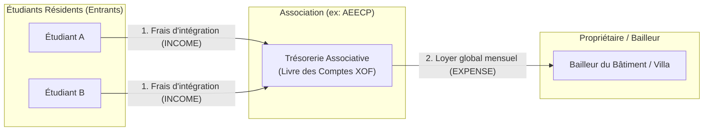
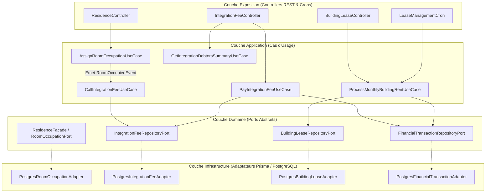
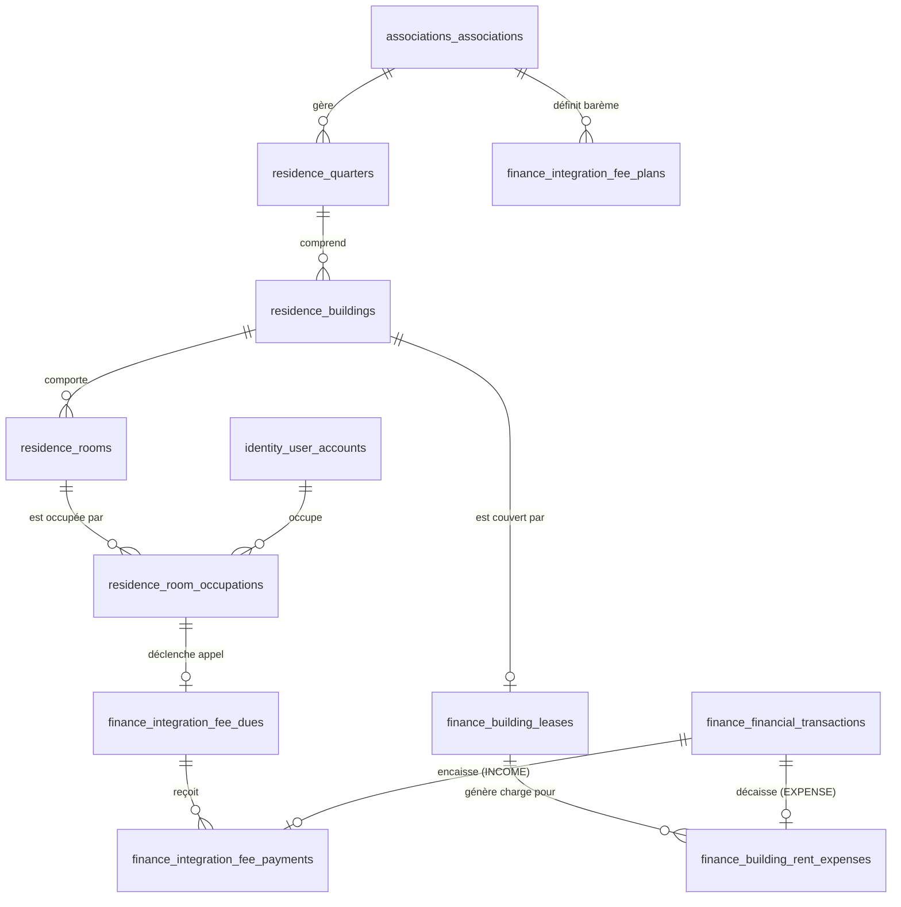
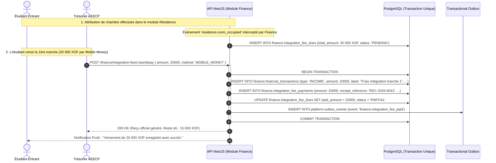
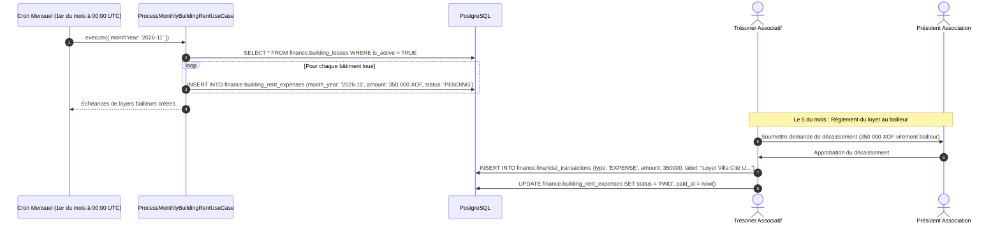

# My Community — Intégration Architecturale des Modules Résidence & Finance

**Version :** 2.0  
**Date :** 21 octobre 2026  
**Statut :** Spécification d'Intégration & Architecture Hexagonale  
**Modèle Économique :** Prise en charge des loyers par l'association & Frais d'intégration pour les entrants  
**Modules concernés :** `residences`, `finance`, `associations`, `identity`, `audit`  

---

## 1. Modèle Économique & Principes Directeurs

Dans les organisations communautaires et estudiantines (comme l'**AEECP**), la relation économique entre le logement, les résidents et l'association repose sur une règle de gestion fondamentale :

> [!IMPORTANT]
> **Règle Économique Fondamentale :**  
> 1. **L'étudiant entrant NE PAIE PAS la location mensuelle du logement.** Il s'acquitte uniquement de **frais d'intégration** (forfait d'adhésion / droits d'entrée en résidence), réglables en une ou plusieurs tranches.  
> 2. **C'est l'ASSOCIATION qui est titulaire du bail et qui paie la location** (le loyer global mensuel ou trimestriel) au propriétaire bailleur de chaque bâtiment ou villa louée.



### 1.1 Découplage Temporel Personne ↔ Résidence (ADR-010)
Conformément à l'[**ADR-010**](file:///c:/Sikirou/eskay/My%20community/doc/adr/ADR-010-decouplage-temporel-occupations-residences.md) :
- Les étudiants ne sont jamais liés directement aux bâtiments par une clé étrangère statique.
- La relation physique est matérialisée par un **Contrat d'Occupation (`RoomOccupation`)**.
- L'attribution d'une chambre déclenche l'émission des **frais d'intégration**, mais ne génère **aucun loyer mensuel à la charge de l'étudiant**.

---

## 2. Architecture Hexagonale & Inversion de Dépendance



---

## 3. Modèle de Données PostgreSQL Multi-Schémas



### 3.1 Schéma `residence` (Parc Immobilier & Occupations)

```sql
CREATE SCHEMA IF NOT EXISTS residence;

-- 1. Quartiers ou campus
CREATE TABLE residence.quarters (
  id UUID PRIMARY KEY DEFAULT gen_random_uuid(),
  association_id UUID NOT NULL REFERENCES associations.associations(id) ON DELETE CASCADE,
  name VARCHAR(120) NOT NULL,
  city VARCHAR(100) NOT NULL,
  description TEXT,
  created_at TIMESTAMPTZ NOT NULL DEFAULT now(),
  updated_at TIMESTAMPTZ NOT NULL DEFAULT now()
);

-- 2. Bâtiments (Villas, cités louées par l'association)
CREATE TABLE residence.buildings (
  id UUID PRIMARY KEY DEFAULT gen_random_uuid(),
  quarter_id UUID NOT NULL REFERENCES residence.quarters(id) ON DELETE CASCADE,
  name VARCHAR(100) NOT NULL,
  address TEXT NOT NULL,
  landlord_name VARCHAR(120) NOT NULL,       -- Nom du propriétaire / bailleur
  landlord_phone VARCHAR(50),
  landlord_iban_or_momo VARCHAR(80),         -- Coordonnées de paiement du loyer bailleur
  floors_count INT NOT NULL DEFAULT 1,
  created_at TIMESTAMPTZ NOT NULL DEFAULT now(),
  updated_at TIMESTAMPTZ NOT NULL DEFAULT now()
);

-- 3. Chambres
CREATE TABLE residence.rooms (
  id UUID PRIMARY KEY DEFAULT gen_random_uuid(),
  building_id UUID NOT NULL REFERENCES residence.buildings(id) ON DELETE CASCADE,
  room_number VARCHAR(50) NOT NULL,
  capacity INT NOT NULL DEFAULT 1 CHECK (capacity > 0),
  status VARCHAR(20) NOT NULL DEFAULT 'AVAILABLE' CHECK (status IN ('AVAILABLE', 'OCCUPIED', 'MAINTENANCE')),
  created_at TIMESTAMPTZ NOT NULL DEFAULT now(),
  updated_at TIMESTAMPTZ NOT NULL DEFAULT now(),
  UNIQUE (building_id, room_number)
);

-- 4. Occupations de chambres (Contrat de séjour - ADR-010)
CREATE TABLE residence.room_occupations (
  id UUID PRIMARY KEY DEFAULT gen_random_uuid(),
  room_id UUID NOT NULL REFERENCES residence.rooms(id) ON DELETE RESTRICT,
  occupant_user_id UUID NOT NULL REFERENCES identity.user_accounts(id) ON DELETE RESTRICT,
  association_id UUID NOT NULL REFERENCES associations.associations(id) ON DELETE CASCADE,
  start_date DATE NOT NULL,
  end_date DATE,
  is_active BOOLEAN NOT NULL DEFAULT TRUE,
  status VARCHAR(20) NOT NULL DEFAULT 'ACTIVE' CHECK (status IN ('PENDING', 'ACTIVE', 'TERMINATED', 'CANCELLED')),
  created_at TIMESTAMPTZ NOT NULL DEFAULT now(),
  updated_at TIMESTAMPTZ NOT NULL DEFAULT now()
);

CREATE INDEX idx_residence_room_occupations_active ON residence.room_occupations (occupant_user_id, is_active) WHERE is_active = TRUE;
CREATE INDEX idx_residence_room_occupations_room ON residence.room_occupations (room_id, is_active) WHERE is_active = TRUE;
```

---

### 3.2 Schéma `finance` (Baux Bailleurs & Frais d'Intégration)

```sql
CREATE SCHEMA IF NOT EXISTS finance;

-- -----------------------------------------------------------------------------
-- A. FLUX SORTANT : LOCATION DU BÂTIMENT PAYÉE PAR L'ASSOCIATION (EXPENSE)
-- -----------------------------------------------------------------------------

-- Contrat de bail entre l'association et le propriétaire du bâtiment
CREATE TABLE finance.building_leases (
  id UUID PRIMARY KEY DEFAULT gen_random_uuid(),
  building_id UUID NOT NULL REFERENCES residence.buildings(id) ON DELETE CASCADE,
  association_id UUID NOT NULL REFERENCES associations.associations(id) ON DELETE CASCADE,
  monthly_rent_amount DECIMAL(12, 2) NOT NULL CHECK (monthly_rent_amount > 0),
  currency VARCHAR(3) NOT NULL DEFAULT 'XOF',
  payment_day_of_month INT NOT NULL DEFAULT 5 CHECK (payment_day_of_month BETWEEN 1 AND 28),
  lease_start_date DATE NOT NULL,
  lease_end_date DATE,
  is_active BOOLEAN NOT NULL DEFAULT TRUE,
  created_at TIMESTAMPTZ NOT NULL DEFAULT now(),
  updated_at TIMESTAMPTZ NOT NULL DEFAULT now(),
  UNIQUE (building_id)
);

-- Échéances de loyers payées par l'association aux bailleurs
CREATE TABLE finance.building_rent_expenses (
  id UUID PRIMARY KEY DEFAULT gen_random_uuid(),
  lease_id UUID NOT NULL REFERENCES finance.building_leases(id) ON DELETE CASCADE,
  month_year VARCHAR(7) NOT NULL,            -- Format 'YYYY-MM'
  amount DECIMAL(12, 2) NOT NULL,
  status VARCHAR(20) NOT NULL DEFAULT 'PENDING' CHECK (status IN ('PENDING', 'PAID', 'OVERDUE')),
  transaction_id UUID REFERENCES finance.financial_transactions(id) ON DELETE RESTRICT,
  due_date DATE NOT NULL,
  paid_at TIMESTAMPTZ,
  created_at TIMESTAMPTZ NOT NULL DEFAULT now(),
  UNIQUE (lease_id, month_year)
);

-- -----------------------------------------------------------------------------
-- B. FLUX ENTRANT : FRAIS D'INTÉGRATION VERSÉS PAR LES RÉSIDENTS (INCOME)
-- -----------------------------------------------------------------------------

-- Barème des frais d'intégration fixé par l'association
CREATE TABLE finance.integration_fee_plans (
  id UUID PRIMARY KEY DEFAULT gen_random_uuid(),
  association_id UUID NOT NULL REFERENCES associations.associations(id) ON DELETE CASCADE,
  academic_year VARCHAR(20) NOT NULL,        -- Ex: '2026-2027'
  name VARCHAR(100) NOT NULL,                -- Ex: "Forfait Intégration Résidence 2026"
  amount DECIMAL(12, 2) NOT NULL CHECK (amount > 0),
  currency VARCHAR(3) NOT NULL DEFAULT 'XOF',
  installments_allowed INT NOT NULL DEFAULT 2, -- Nombre de tranches de paiement possibles
  created_at TIMESTAMPTZ NOT NULL DEFAULT now(),
  updated_at TIMESTAMPTZ NOT NULL DEFAULT now(),
  UNIQUE (association_id, academic_year)
);

-- Appel individuel de frais d'intégration pour chaque nouvel entrant
CREATE TABLE finance.integration_fee_dues (
  id UUID PRIMARY KEY DEFAULT gen_random_uuid(),
  occupation_id UUID NOT NULL REFERENCES residence.room_occupations(id) ON DELETE CASCADE,
  user_id UUID NOT NULL REFERENCES identity.user_accounts(id) ON DELETE CASCADE,
  plan_id UUID NOT NULL REFERENCES finance.integration_fee_plans(id) ON DELETE RESTRICT,
  total_amount DECIMAL(12, 2) NOT NULL CHECK (total_amount > 0),
  paid_amount DECIMAL(12, 2) NOT NULL DEFAULT 0 CHECK (paid_amount >= 0),
  status VARCHAR(20) NOT NULL DEFAULT 'PENDING' CHECK (status IN ('PENDING', 'PARTIAL', 'SETTLED')),
  due_date DATE NOT NULL,
  created_at TIMESTAMPTZ NOT NULL DEFAULT now(),
  updated_at TIMESTAMPTZ NOT NULL DEFAULT now(),
  CONSTRAINT chk_integration_fee_paid_limit CHECK (paid_amount <= total_amount),
  UNIQUE (occupation_id)
);

-- Versements sur frais d'intégration réglés par l'étudiant entrant
CREATE TABLE finance.integration_fee_payments (
  id UUID PRIMARY KEY DEFAULT gen_random_uuid(),
  due_id UUID NOT NULL REFERENCES finance.integration_fee_dues(id) ON DELETE RESTRICT,
  transaction_id UUID NOT NULL REFERENCES finance.financial_transactions(id) ON DELETE RESTRICT,
  amount DECIMAL(12, 2) NOT NULL CHECK (amount > 0),
  payment_method VARCHAR(30) NOT NULL,      -- CASH, MOBILE_MONEY, BANK_TRANSFER
  receipt_reference VARCHAR(80) UNIQUE NOT NULL,
  recorded_by UUID NOT NULL REFERENCES identity.user_accounts(id),
  paid_at TIMESTAMPTZ NOT NULL DEFAULT now()
);

CREATE INDEX idx_finance_integration_dues_status ON finance.integration_fee_dues (user_id, status);
CREATE INDEX idx_finance_building_expenses_pending ON finance.building_rent_expenses (due_date, status) WHERE status = 'PENDING';
```

---

## 4. Les Deux Grands Workflows Financiers

### 4.1 Parcours 1 : L'Étudiant Intrant Règle ses Frais d'Intégration (Recette)



---

### 4.2 Parcours 2 : L'Association Paye le Loyer Mensuel au Propriétaire Bailleur (Dépense)



---

## 5. Synthèse des Contrats d'API RESTful (v1)

```
# 🏠 Gestion Résidentielle
POST   /api/v1/residences/quarters                         # Créer un quartier/campus
POST   /api/v1/residences/buildings                        # Créer un bâtiment loué
POST   /api/v1/residences/rooms                            # Créer une chambre
POST   /api/v1/residences/occupations                      # Assigner une chambre à un entrant

# 💰 Frais d'Intégration des Entrants (Recettes)
POST   /api/v1/finance/integration-fee-plans               # Définir le barème des frais d'intégration
GET    /api/v1/finance/integration-fee-dues/me             # L'étudiant consulte ses frais d'intégration et son solde
POST   /api/v1/finance/integration-fee-dues/:dueId/pay     # Enregistrer un versement sur frais d'intégration
GET    /api/v1/finance/integration-fee-dues/debtors        # Liste des entrants n'ayant pas encore soldé leurs frais

# 🏢 Baux Bailleurs & Loyers de l'Association (Dépenses)
POST   /api/v1/finance/building-leases                     # Déclarer le contrat de bail d'un bâtiment
GET    /api/v1/finance/building-leases                     # Liste des bâtiments loués et montants des loyers dus
GET    /api/v1/finance/building-rent-expenses              # Échéancier des loyers à payer aux propriétaires
POST   /api/v1/finance/building-rent-expenses/:id/settle   # Enregistrer le paiement du loyer au propriétaire bailleur
```
