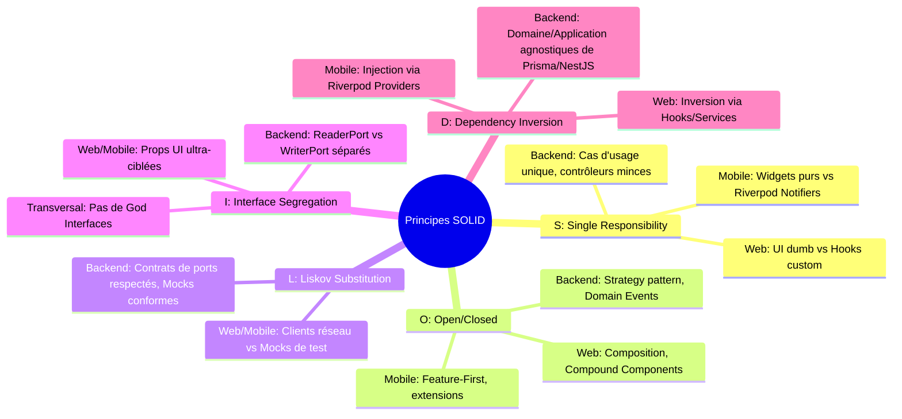
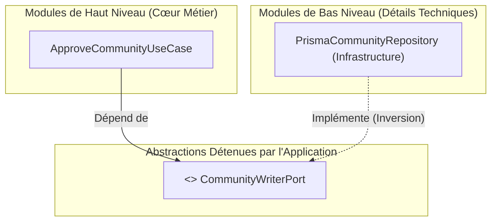

# My Community — Guide de Référence des Principes SOLID

**Version :** 1.0  
**Date :** 22 octobre 2026  
**Périmètre :** Système Complet — Backend (NestJS), Web (Next.js), Mobile (Flutter) & Packages  
**Référence ADR :** [ADR-011 : Exigence Formelle des Principes SOLID](file:///c:/Sikirou/eskay/my_community/docs/adr/ADR-011-principes-solid-architecture.md)

---

## 1. Introduction et Philosophie

Le projet **My Community** exige l'application systématique des **principes SOLID** formalisés par Robert C. Martin (Uncle Bob). Combinés à l'**Architecture Hexagonale (Ports & Adapters)** et au **Domain-Driven Design (DDD)**, ces principes constituent la garantie absolue que le système restera modulaire, extensible, résilient et testable à 100%.



---

## 2. Déclinaison Détaillée des 5 Principes

---

### S — Single Responsibility Principle (SRP) : Responsabilité Unique

> *« Une classe ou un module ne doit avoir qu'une seule et unique raison de changer. »*

#### A. Backend (NestJS Monolithe Modulaire)
- **Contrôleurs HTTP (`presentation/http/`) :**
  - **Rôle unique :** Réception de la requête HTTP, validation syntaxique des DTOs, appel du Cas d'Usage, sérialisation de la réponse HTTP.
  - **Interdit :** Aucune logique métier, aucun calcul de solde, aucune requête Prisma ou SQL directe.
- **Cas d'Usage (`application/commands/` & `application/queries/`) :**
  - **Rôle unique :** Orchestration d'un seul scénario utilisateur (ex: `ApproveCommunityUseCase`, `ProposeCommunityUseCase`).
  - **Interdit :** Regrouper tout le CRUD d'une ressource dans un "Service" géant de 1500 lignes.
- **Domaine Pur (`domain/`) :**
  - **Entités & Value Objects :** Préservation des invariants métier purs (ex: validité d'un montant XOF, calcul de transition de statut).
  - **Interdit :** Importer `@Injectable()`, `@prisma/client`, ou des détails de transport.
- **Repositories & Mappers (`infrastructure/persistence/`) :**
  - **Rôle unique :** Persistance physique et traduction fidèle entre le modèle de base de données et l'entité du domaine.

#### B. Frontend Web (Next.js - App Router)
- **Composants d'Affichage Purs (Dumb UI) :** Ne gèrent que le rendu visuel et les interactions utilisateur (clics, saisies).
- **Hooks Personnalisés (`useCommunityApproval`, etc.) :** Encapsulent la logique d'état, les mutations et la synchronisation avec le serveur.
- **Couche d'Accès aux Données (`lib/api/`) :** Gère la communication réseau et la gestion des erreurs HTTP RFC 7807.

#### C. Mobile (Flutter)
- **Widgets Flutter :** Strictement cantonnés à la hiérarchie de rendu graphique.
- **Notifiers Riverpod :** Gèrent l'état et l'orchestration du cas d'usage pour un écran ou une feature donnée.
- **DataSources (Drift / Dio) :** Isolent l'accès au cache SQLite local et aux requêtes réseau distantes.

---

### O — Open/Closed Principle (OCP) : Ouvert à l'Extension, Fermé à la Modification

> *« Les entités logicielles doivent être ouvertes à l'extension, mais fermées à la modification. »*

#### A. Backend : Patron Stratégie & Événements de Domaine
- **Strategy Pattern pour les passerelles interchangeables :**
  Pour intégrer plusieurs moyens de paiement (MTN Mobile Money, Moov Money, Celtiis, Stripe, virement bancaire), on ne modifie pas le cas d'usage de versement de cotisation. On définit un contrat abstrait `PaymentGatewayPort` et chaque moyen de paiement est une stratégie indépendante :

```typescript
// Contrat extensible
export interface PaymentGatewayPort {
  readonly provider: PaymentProvider;
  processPayment(command: ProcessPaymentCommand): Promise<PaymentResult>;
}

// Le cas d'usage utilise la bonne stratégie sans modifier son propre code
@Injectable()
export class ProcessContributionPaymentUseCase {
  constructor(private readonly gatewayRegistry: PaymentGatewayRegistry) {}

  async execute(command: ExecutePaymentCommand): Promise<PaymentResult> {
    const gateway = this.gatewayRegistry.get(command.provider);
    return gateway.processPayment(command);
  }
}
```

- **Domain Events pour les effets secondaires :**
  Lorsqu'une communauté est approuvée, le cas d'usage `ApproveCommunityUseCase` ne doit pas être modifié pour envoyer un SMS, indexer la communauté dans un moteur de recherche, ou créer un canal de discussion. Il émet simplement un événement de domaine `CommunityApprovedDomainEvent`. Les écouteurs (`AuditListener`, `NotificationListener`, `SearchIndexerListener`) s'abonnent de façon découplée.

#### B. Frontend Web & Mobile : Composition
- Utilisation de **Compound Components** (ex: `Card`, `Card.Header`, `Card.Body`, `Card.Footer`) et du pattern `children` / `asChild` permettant d'étendre la présentation sans retoucher au composant conteneur.

---

### L — Liskov Substitution Principle (LSP) : Substituabilité de Liskov

> *« Les sous-types doivent pouvoir se substituer à leurs types de base sans altérer la cohérence du système. »*

#### A. Backend : Respect Absolu des Contrats de Ports
Toute classe concrète implémentant un port abstrait (`PrismaCommunityRepository`, `InMemoryCommunityRepository` pour les tests unitaire) doit :
1. **Respecter scrupuleusement les signatures :** Si la méthode `findById(id: string)` promet `Promise<CommunityEntity | null>`, elle ne doit jamais renvoyer `undefined` ni lever une exception technique non traitée.
2. **Préserver les invariants du domaine :** L'adaptateur de test en mémoire (`InMemory`) doit simuler fidèlement le comportement transactionnel et l'intégrité relationnelle requise.
3. **Ne jamais altérer les préconditions :** Une implémentation ne peut pas exiger des paramètres supplémentaires obligatoires non définis sur le port parent.

```typescript
// Contrat abstrait
export abstract class CommunityReaderPort {
  abstract findById(id: string): Promise<CommunityEntity | null>;
}

// Implémentation Production (Prisma)
export class PrismaCommunityRepository implements CommunityReaderPort {
  async findById(id: string): Promise<CommunityEntity | null> {
    const record = await this.prisma.community.findUnique({ where: { id } });
    return record ? CommunityMapper.toDomain(record) : null;
  }
}

// Implémentation Test (InMemory) — Totalement substituable !
export class InMemoryCommunityRepository implements CommunityReaderPort {
  private items = new Map<string, CommunityEntity>();
  async findById(id: string): Promise<CommunityEntity | null> {
    return this.items.get(id) ?? null;
  }
}
```

---

### I — Interface Segregation Principle (ISP) : Ségrégation des Interfaces

> *« Aucun client ne doit être contraint de dépendre d'interfaces ou de méthodes qu'il n'utilise pas. »*

#### A. Backend : Bannissement des "God Repositories"
Un repository unique contenant 30 méthodes pour créer, modifier, lister, rechercher par critères, purger, et exporter viole l'ISP.

**Règle My Community :**
Ségréguer systématiquement les interfaces d'accès aux données :
1. **Ports de Lecture (`ReaderPorts`) :**
   ```typescript
   export abstract class CommunityReaderPort {
     abstract findById(id: string): Promise<CommunityEntity | null>;
     abstract findBySlug(slug: string): Promise<CommunityEntity | null>;
     abstract listAll(params: ListCommunitiesParams): Promise<PaginatedResult<CommunityEntity>>;
   }
   ```
2. **Ports d'Écriture (`WriterPorts`) :**
   ```typescript
   export abstract class CommunityWriterPort {
     abstract save(community: CommunityEntity): Promise<void>;
     abstract updateStatus(id: string, status: CommunityStatus): Promise<void>;
     abstract delete(id: string): Promise<void>;
   }
   ```
3. **Avantage direct :**
   - Un Cas d'Usage de consultation (`GetCommunityFeedQuery`) n'injecte que `CommunityReaderPort`. Il est structurellement incapable d'effectuer une écriture accidentelle !
   - Un Cas d'Usage de commande (`ApproveCommunityUseCase`) n'injecte que ce dont il a besoin (`CommunityWriterPort` + `AuditLoggerPort`).

#### B. Frontend Web & Mobile : Ségrégation des Props UI
Interdiction de transmettre un modèle complexe de 40 champs à un composant qui n'en utilise que 2 :
- **Anti-pattern :** `<CommunityBadge community={entireCommunityObjectWithAllRelations} />`
- **Conforme ISP :** `<CommunityBadge name={community.name} status={community.status} />`

---

### D — Dependency Inversion Principle (DIP) : Inversion des Dépendances

> *« 1. Les modules de haut niveau ne doivent pas dépendre des modules de bas niveau. Tous deux doivent dépendre d'abstractions. »*  
> *« 2. Les abstractions ne doivent pas dépendre des détails. Les détails doivent dépendre des abstractions. »*

#### A. Backend : Découplage du Domaine et de l'Application
- **Module de haut niveau :** `application/` et `domain/` (le cœur de métier, la raison d'être de l'entreprise).
- **Module de bas niveau :** `infrastructure/` (Prisma, PostgreSQL, MinIO, Redis, Twilio).

**Règle d'Or :**
Le cœur de métier ne contient **aucun import** vers Prisma, PostgreSQL ou NestJS.  
Il exprime ses besoins sous forme de **Ports abstraits** (`application/ports/`).  
Les adaptateurs techniques (`infrastructure/persistence/`) implémentent ces ports.



**Câblage NestJS via Tokens d'Injection :**
```typescript
// Injection dans le Use Case via le Token abstrait
@Injectable()
export class ApproveCommunityUseCase {
  constructor(
    @Inject(COMMUNITY_WRITER_PORT)
    private readonly communityWriter: CommunityWriterPort,
    @Inject(AUDIT_LOGGER_PORT)
    private readonly auditLogger: AuditLoggerPort,
  ) {}
}

// Câblage dans le module NestJS
@Module({
  providers: [
    ApproveCommunityUseCase,
    {
      provide: COMMUNITY_WRITER_PORT,
      useClass: PrismaCommunityRepository,
    },
    {
      provide: AUDIT_LOGGER_PORT,
      useClass: PrismaAuditLoggerRepository,
    },
  ],
})
export class CommunitiesModule {}
```

#### B. Mobile (Flutter) : Inversion via Riverpod
Les Widgets et StateNotifiers ne créent jamais de client HTTP `Dio` ou d'instance `AppDatabase` en dur :
```dart
// Abstraction (Port)
abstract class CommunityRepositoryPort {
  Future<CommunityModel> getCommunity(String id);
}

// Provider Riverpod exposant l'abstraction
final communityRepositoryProvider = Provider<CommunityRepositoryPort>((ref) {
  // L'implémentation concrète peut être commutée (Dio vs Drift vs Mock) sans impacter les écrans
  return RemoteCommunityRepository(ref.watch(dioClientProvider));
});
```

---

## 3. Matrice de Conformité SOLID par Couche

| Couche | SRP | OCP | LSP | ISP | DIP |
| :--- | :--- | :--- | :--- | :--- | :--- |
| **Domaine (`domain/`)** | Uniquement les règles et invariants métier purs. | Entités extensibles par composition ou décorateurs métier. | Modèles invariables respectant leurs types sans effets de bord. | Pas de dépendance extérieure, types ciblés. | Dépendance nulle : 0 dépendance vers l'extérieur. |
| **Application (`application/`)** | 1 Cas d'Usage = 1 Scénario utilisateur unique. | Extension via Domain Events et Registry de stratégies. | Manipulation exclusive d'abstractions de ports interchangeables. | Ségrégation stricte `ReaderPort` vs `WriterPort`. | Dépend uniquement de ports abstraits locaux. |
| **Infrastructure (`infrastructure/`)** | Traduction pure technique / persistance. | Ajout de nouveaux adaptateurs sans toucher au domaine. | Tout adaptateur respecte fidèlement le port sans régression. | Implémente un ou plusieurs ports fins. | Les adaptateurs dépendent des ports applicatifs. |
| **Présentation (`presentation/`)** | Routage HTTP, parsing DTO, mapping réponse. | Intercepteurs et filtres transversaux. | Contrôleurs polymorphiques sur les DTOs validés. | DTOs spécialisés par opération (pas de DTO unique). | Dépend des Use Cases applicatifs (inversion IoC). |
| **Frontend Web (`web/`)** | Composants visuels découplés des Hooks et appels API. | Compound Components et slots configurables. | Composants de remplacement interchangeables (variants). | Props minimales et strictes par composant. | Les vues dépendent d'abstractions (Hooks/Services). |
| **Mobile Flutter (`mobile/`)** | Widgets purs vs Notifiers vs Repositories. | Feature-First modulaire et extensible. | Mock Repositories totalement substituables en tests. | Interfaces fines de sources de données locales/distantes. | Providers Riverpod injectant des contrats abstraits. |

---

## 4. Anti-Patterns Strictement Proscrits

1. ❌ **Le "God Service" ou "God Repository" :** Regrouper tout le code d'un module dans une classe monolithique de 1000 lignes (Violation SRP & ISP).
2. ❌ **L'Import Direct de Prisma dans un Contrôleur ou Cas d'Usage :** Utiliser `this.prisma.user.findMany()` en dehors du dossier `infrastructure/persistence/` (Violation DIP).
3. ❌ **Les if/else Tentaculaires pour les Moyens de Paiement ou Types d'Entités :** Remplacer le polymorphisme et le Strategy Pattern par des structures conditionnelles rigides (Violation OCP).
4. ❌ **Le Retour Incohérent ou Imprévu dans un Adaptateur :** Une implémentation de test qui lève une exception alors que le contrat abstrait prévoit `null` (Violation LSP).
5. ❌ **Le Fourre-tout des Props UI :** Passer un objet de 50 propriétés à un composant enfant qui n'en utilise qu'une seule (Violation ISP).
6. ❌ **L'Appel Réseau Direct dans un Composant Graphique :** Exécuter un `fetch()` ou `Dio.get()` directement dans la fonction de rendu d'une page (Violation SRP & DIP).

---

## 5. Check-list de Validation lors de la Revue de Code

Avant de valider ou fusionner une Pull Request :
- [ ] **S** : Chaque fichier a-t-il un rôle circonscrit et documenté ?
- [ ] **O** : Le code est-il prêt à accueillir une nouvelle variante métier sans réécrire le flux existant ?
- [ ] **L** : Est-il possible d'écrire un test unitaire avec un mock du port sans modifier le cas d'usage ?
- [ ] **I** : Le cas d'usage dépend-il uniquement des méthodes de repository dont il a expressément besoin ?
- [ ] **D** : Aucun import de Prisma, d'Express, de Dio ou de Drift n'apparaît-il dans les couches de domaine ou d'application ?
