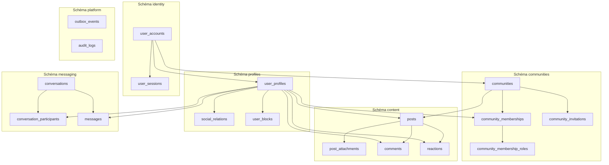

# My Community — Dictionnaire et Modèle de Données Modernisé (v2.0)

**Version :** 2.0  
**Date :** 21 octobre 2026  
**Moteur :** PostgreSQL 16+  
**Architecture :** Multi-Schémas étanches par domaine métier  
**Spécification DDL Complète :** Voir [**`schema-modernise-postgresql.md`**](file:///c:/Sikirou/eskay/My%20community/doc/database/schema-modernise-postgresql.md)

---

## 1. Dictionnaire Global des Entités par Schéma Métier

| Schéma | Table | Rôle Métier | Clé Primaire | Clés Étrangères Principales |
| :--- | :--- | :--- | :---: | :--- |
| **`identity`** | `user_accounts` | Comptes techniques et identifiants sécurisés | `id (UUID)` | - |
| **`identity`** | `user_sessions` | Sessions actives et tokens de rafraîchissement | `id (UUID)` | `user_id -> identity.user_accounts` |
| **`profiles`** | `user_profiles` | Profils publics, @handle, avatar, bio | `user_id (UUID)`| `user_id -> identity.user_accounts` |
| **`profiles`** | `user_socio_profiles` | Profil académique (étudiant/lycéen) & professionnel | `user_id (UUID)`| `user_id -> profiles.user_profiles` |
| **`profiles`** | `social_relations` | Abonnements unidirectionnels (Follow) | `(follower_id, following_id)` | `profiles.user_profiles` |
| **`profiles`** | `follow_requests` | Demandes de suivi sur profils privés | `id (UUID)` | `profiles.user_profiles` |
| **`profiles`** | `user_blocks` | Blocages bilatéraux stricts | `(blocker_id, blocked_id)` | `profiles.user_profiles` |
| **`communities`** | `communities` | Espaces collectifs et paramètres de groupe | `id (UUID)` | `creator_id -> identity.user_accounts` |
| **`communities`** | `community_memberships`| Adhésions effectives des membres | `id (UUID)` | `community_id -> communities`, `user_id -> identity.user_accounts` |
| **`communities`** | `community_membership_roles`| Rôles locaux (OWNER, ADMIN, MODERATOR, MEMBER) | `(membership_id, role)` | `membership_id -> community_memberships` |
| **`communities`** | `community_invitations` | Invitations avec expiration et token | `id (UUID)` | `community_id -> communities`, `inviter_id -> identity.user_accounts` |
| **`content`** | `posts` | Publications (profil individuel ou communauté) | `id (UUID)` | `author_id -> profiles.user_profiles`, `community_id -> communities` |
| **`content`** | `post_attachments` | Pièces jointes multimédias (S3) | `id (UUID)` | `post_id -> content.posts` |
| **`content`** | `comments` | Commentaires arborescents (Depth max = 2) | `id (UUID)` | `post_id -> content.posts`, `author_id -> profiles.user_profiles`, `parent_id -> comments` |
| **`content`** | `reactions` | Réactions affectives typées (LIKE, LOVE...) | `id (UUID)` | `user_id -> profiles.user_profiles`, cible polymorphique |
| **`content`** | `post_history` | Historique des modifications textuelles | `id (UUID)` | `post_id -> content.posts` |
| **`messaging`** | `conversations` | Fils de discussion 1-à-1 et groupes | `id (UUID)` | - |
| **`messaging`** | `conversation_participants`| Participants et statut de lecture | `(conversation_id, user_id)` | `messaging.conversations`, `profiles.user_profiles` |
| **`messaging`** | `messages` | Messages temps réel et métadonnées | `id (UUID)` | `conversation_id -> conversations`, `sender_id -> profiles.user_profiles` |
| **`moderation`** | `reports` | Signalements d'abus et files d'instruction | `id (UUID)` | `reporter_id -> identity.user_accounts` |
| **`moderation`** | `moderation_actions` | Sanctions appliquées (locales ou plateforme) | `id (UUID)` | `report_id -> reports`, `moderator_id -> identity.user_accounts` |
| **`residence`** | `quarters` | Quartiers et campus gérés par l'association | `id (UUID)` | `association_id -> associations` |
| **`residence`** | `buildings` | Bâtiments loués par l'association (avec bailleur) | `id (UUID)` | `quarter_id -> residence.quarters` |
| **`residence`** | `rooms` | Chambres physiques et capacités | `id (UUID)` | `building_id -> residence.buildings` |
| **`residence`** | `room_occupations` | Contrats d'occupation temporelle des résidents (ADR-010) | `id (UUID)` | `room_id -> rooms`, `occupant_user_id -> identity.user_accounts` |
| **`finance`** | `building_leases` | Baux de location des bâtiments payés par l'association | `id (UUID)` | `building_id -> residence.buildings`, `association_id -> associations` |
| **`finance`** | `building_rent_expenses`| Échéances de loyers payées par l'association aux bailleurs (EXPENSE) | `id (UUID)` | `lease_id -> building_leases`, `transaction_id -> financial_transactions` |
| **`finance`** | `integration_fee_plans` | Barèmes des frais d'intégration fixés par l'association | `id (UUID)` | `association_id -> associations` |
| **`finance`** | `integration_fee_dues` | Appels individuels de frais d'intégration pour les entrants | `id (UUID)` | `occupation_id -> room_occupations`, `user_id -> identity.user_accounts` |
| **`finance`** | `integration_fee_payments`| Versements effectués par les entrants (INCOME) | `id (UUID)` | `due_id -> integration_fee_dues`, `transaction_id -> financial_transactions` |
| **`finance`** | `financial_transactions`| Grand livre comptable (Recettes, Dépenses en XOF) | `id (UUID)` | `association_id -> associations`, `recorded_by -> identity.user_accounts` |
| **`platform`** | `outbox_events` | Événements asynchrones garantis (Outbox) | `id (UUID)` | - |
| **`platform`** | `audit_logs` | Traçabilité immuable des actions critiques | `id (UUID)` | `actor_id -> identity.user_accounts` |

---

## 2. Graphe d'Architecture Multi-Schémas

