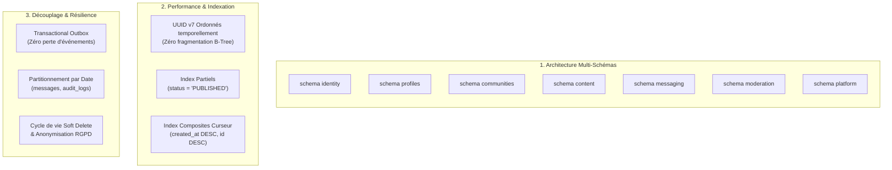
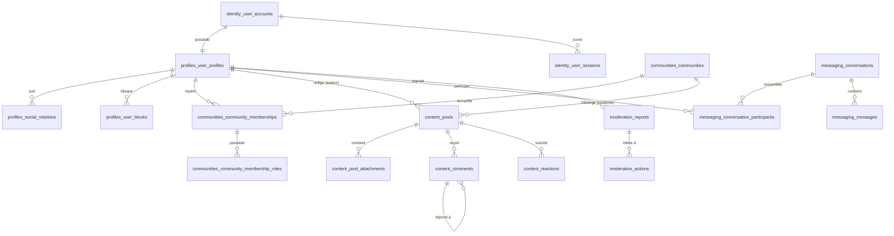
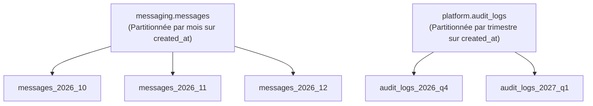

# My Community — Schéma de Base de Données PostgreSQL Modernisé

**Version :** 2.0  
**Date :** 21 octobre 2026  
**SGBD Cible :** PostgreSQL 16+  
**Extensions requises :** `pgcrypto`, `citext`  
**Paradigme :** Architecture Multi-Schémas isolée par domaine métier, UUID v7 temporels, Transactional Outbox  

---

## 1. Principes de la Modernisation

Pour accompagner l'évolution de My Community vers un réseau social international à haute charge, la base de données a été profondément modernisée selon 5 axes structurants :



### Les 5 Piliers Techniques de Modernisation :
1. **Isolation par Schémas PostgreSQL Dédiés :** Abandon du schéma `public` monolithique. Chaque domaine métier (`identity`, `profiles`, `communities`, `content`, `messaging`, `moderation`, `platform`) possède son propre schéma PostgreSQL étanche.
2. **Identifiants UUID Temporels Ordonnés :** Utilisation d'UUID v7 ou d'UUID ordonnés temporellement afin d'éliminer la fragmentation des index B-tree et d'accélérer les tris chronologiques des flux.
3. **Découplage Compte Technique vs Profil Social :** Séparation étanche entre les identifiants d'authentification (`identity.user_accounts`) et les informations publiques de profil (`profiles.user_profiles`).
4. **Fiabilité Événementielle (Transactional Outbox) :** Intégration native de la table `platform.outbox_events` garantissant la cohérence transactionnelle atomique entre les mutations de base et l'émission d'événements vers Redis/BullMQ.
5. **Optimisation Concurrence & Verrous :** Colonnes de compteurs optimisées, requêtes de fil par curseur opaque et index partiels éliminant le surcoût d'indexation sur les contenus archivés ou masqués.

---

## 2. Diagramme Relationnel Inter-Schémas



---

## 3. Script SQL DDL Complet de Référence (PostgreSQL 16+)

```sql
-- =============================================================================
-- MY COMMUNITY — SCRIPT DDL MODERNISÉ MULTI-SCHÉMAS (POSTGRESQL 16+)
-- Version : 2.0 (21 octobre 2026)
-- =============================================================================

-- -----------------------------------------------------------------------------
-- 0. EXTENSIONS ET SCHÉMAS SYSTÈME
-- -----------------------------------------------------------------------------
CREATE EXTENSION IF NOT EXISTS "pgcrypto";
CREATE EXTENSION IF NOT EXISTS "citext";

CREATE SCHEMA IF NOT EXISTS identity;
CREATE SCHEMA IF NOT EXISTS profiles;
CREATE SCHEMA IF NOT EXISTS communities;
CREATE SCHEMA IF NOT EXISTS content;
CREATE SCHEMA IF NOT EXISTS messaging;
CREATE SCHEMA IF NOT EXISTS moderation;
CREATE SCHEMA IF NOT EXISTS platform;

-- -----------------------------------------------------------------------------
-- 1. SCHÉMA IDENTITY (Comptes, Authentification, Sessions)
-- -----------------------------------------------------------------------------

CREATE TYPE identity.account_status AS ENUM ('ACTIVE', 'SUSPENDED', 'DELETED', 'PENDING_VERIFICATION');

CREATE TABLE identity.user_accounts (
  id UUID PRIMARY KEY DEFAULT gen_random_uuid(),
  email CITEXT UNIQUE,
  phone VARCHAR(32) UNIQUE,
  password_hash VARCHAR(255) NOT NULL,
  status identity.account_status NOT NULL DEFAULT 'ACTIVE',
  is_email_verified BOOLEAN NOT NULL DEFAULT FALSE,
  is_phone_verified BOOLEAN NOT NULL DEFAULT FALSE,
  mfa_enabled BOOLEAN NOT NULL DEFAULT FALSE,
  mfa_secret_encrypted TEXT,
  failed_login_attempts INT NOT NULL DEFAULT 0,
  locked_until TIMESTAMPTZ,
  created_at TIMESTAMPTZ NOT NULL DEFAULT now(),
  updated_at TIMESTAMPTZ NOT NULL DEFAULT now(),
  deleted_at TIMESTAMPTZ,
  CONSTRAINT chk_identity_account_contact CHECK (email IS NOT NULL OR phone IS NOT NULL)
);

CREATE TABLE identity.user_sessions (
  id UUID PRIMARY KEY DEFAULT gen_random_uuid(),
  user_id UUID NOT NULL REFERENCES identity.user_accounts(id) ON DELETE CASCADE,
  refresh_token_hash VARCHAR(255) NOT NULL,
  device_name VARCHAR(100),
  device_os VARCHAR(50),
  ip_address INET,
  user_agent TEXT,
  expires_at TIMESTAMPTZ NOT NULL,
  created_at TIMESTAMPTZ NOT NULL DEFAULT now(),
  revoked_at TIMESTAMPTZ
);

CREATE INDEX idx_identity_sessions_lookup ON identity.user_sessions (user_id, expires_at) 
WHERE revoked_at IS NULL;

-- -----------------------------------------------------------------------------
-- 2. SCHÉMA PROFILES (Présence sociale, Relations, Blocages)
-- -----------------------------------------------------------------------------

CREATE TABLE profiles.user_profiles (
  user_id UUID PRIMARY KEY REFERENCES identity.user_accounts(id) ON DELETE CASCADE,
  handle CITEXT UNIQUE NOT NULL,
  display_name VARCHAR(100) NOT NULL,
  bio VARCHAR(500),
  avatar_key TEXT,
  banner_key TEXT,
  locale VARCHAR(10) NOT NULL DEFAULT 'fr',
  timezone VARCHAR(50) NOT NULL DEFAULT 'UTC',
  is_private BOOLEAN NOT NULL DEFAULT FALSE,
  followers_count INT NOT NULL DEFAULT 0,
  following_count INT NOT NULL DEFAULT 0,
  communities_count INT NOT NULL DEFAULT 0,
  created_at TIMESTAMPTZ NOT NULL DEFAULT now(),
  updated_at TIMESTAMPTZ NOT NULL DEFAULT now(),
  CONSTRAINT chk_profiles_handle_format CHECK (handle ~ '^[a-zA-Z0-9_]{3,30}$')
);

-- Profil Socio-Professionnel & Académique (Étudiants, Professionnels, Alumni)
CREATE TYPE profiles.occupation_type AS ENUM ('NOT_SPECIFIED', 'STUDENT', 'PROFESSIONAL', 'OTHER');
CREATE TYPE profiles.verification_status AS ENUM ('UNVERIFIED', 'PENDING_REVIEW', 'VERIFIED', 'REJECTED');

CREATE TABLE profiles.user_socio_profiles (
  user_id UUID PRIMARY KEY REFERENCES profiles.user_profiles(user_id) ON DELETE CASCADE,
  occupation_type profiles.occupation_type NOT NULL DEFAULT 'NOT_SPECIFIED',
  
  -- Données Académiques / Scolaires (pour intégration aux associations étudiantes comme l'AEECP)
  institution_name VARCHAR(150),       -- Établissement (ex: Université d'Abomey-Calavi)
  field_of_study VARCHAR(120),         -- Filière / Discipline (ex: Informatique, Droit)
  degree_level VARCHAR(60),            -- Niveau d'études (ex: Licence 2, Master 1)
  academic_year VARCHAR(20),           -- Année académique en cours (ex: 2025-2026)
  student_id_number VARCHAR(60),       -- Numéro de carte / matricule
  student_card_key TEXT,               -- Clé S3 du justificatif d'inscription (sécurisé)
  
  -- Données Professionnelles (pour réseaux d'anciens, alumni ou associations pro)
  organization_name VARCHAR(150),      -- Entreprise / Employeur
  job_title VARCHAR(100),              -- Fonction / Métier
  industry_sector VARCHAR(80),         -- Secteur d'activité
  
  -- Statut libre / autre
  custom_status_description VARCHAR(255),
  
  -- Confidentialité et Contrôle de conformité associatif
  visibility VARCHAR(20) NOT NULL DEFAULT 'COMMUNITIES_ONLY' 
    CHECK (visibility IN ('PUBLIC', 'COMMUNITIES_ONLY', 'PRIVATE')),
  verification_status profiles.verification_status NOT NULL DEFAULT 'UNVERIFIED',
  verified_at TIMESTAMPTZ,
  verified_by UUID REFERENCES identity.user_accounts(id),
  
  created_at TIMESTAMPTZ NOT NULL DEFAULT now(),
  updated_at TIMESTAMPTZ NOT NULL DEFAULT now()
);

CREATE TABLE profiles.social_relations (
  follower_id UUID NOT NULL REFERENCES profiles.user_profiles(user_id) ON DELETE CASCADE,
  following_id UUID NOT NULL REFERENCES profiles.user_profiles(user_id) ON DELETE CASCADE,
  status VARCHAR(20) NOT NULL DEFAULT 'ACTIVE' CHECK (status IN ('ACTIVE', 'MUTED')),
  created_at TIMESTAMPTZ NOT NULL DEFAULT now(),
  PRIMARY KEY (follower_id, following_id),
  CONSTRAINT chk_no_self_follow CHECK (follower_id <> following_id)
);

CREATE TABLE profiles.follow_requests (
  id UUID PRIMARY KEY DEFAULT gen_random_uuid(),
  requester_id UUID NOT NULL REFERENCES profiles.user_profiles(user_id) ON DELETE CASCADE,
  target_id UUID NOT NULL REFERENCES profiles.user_profiles(user_id) ON DELETE CASCADE,
  status VARCHAR(20) NOT NULL DEFAULT 'PENDING' CHECK (status IN ('PENDING', 'ACCEPTED', 'REJECTED')),
  created_at TIMESTAMPTZ NOT NULL DEFAULT now(),
  responded_at TIMESTAMPTZ,
  UNIQUE (requester_id, target_id),
  CONSTRAINT chk_no_self_request CHECK (requester_id <> target_id)
);

CREATE TABLE profiles.user_blocks (
  blocker_id UUID NOT NULL REFERENCES profiles.user_profiles(user_id) ON DELETE CASCADE,
  blocked_id UUID NOT NULL REFERENCES profiles.user_profiles(user_id) ON DELETE CASCADE,
  reason VARCHAR(255),
  created_at TIMESTAMPTZ NOT NULL DEFAULT now(),
  PRIMARY KEY (blocker_id, blocked_id),
  CONSTRAINT chk_no_self_block CHECK (blocker_id <> blocked_id)
);

CREATE INDEX idx_profiles_relations_following ON profiles.social_relations (following_id, follower_id);
CREATE INDEX idx_profiles_blocks_reverse ON profiles.user_blocks (blocked_id, blocker_id);

-- -----------------------------------------------------------------------------
-- 3. SCHÉMA COMMUNITIES (Espaces collectifs, Adhésions, Rôles)
-- -----------------------------------------------------------------------------

CREATE TYPE communities.community_visibility AS ENUM ('PUBLIC', 'PRIVATE_LISTED', 'SECRET');
CREATE TYPE communities.join_policy AS ENUM ('OPEN', 'APPROVAL_REQUIRED', 'INVITE_ONLY');
CREATE TYPE communities.membership_status AS ENUM ('PENDING', 'ACTIVE', 'REJECTED', 'SUSPENDED', 'LEFT');
CREATE TYPE communities.community_role AS ENUM ('OWNER', 'ADMIN', 'MODERATOR', 'MEMBER');

CREATE TABLE communities.communities (
  id UUID PRIMARY KEY DEFAULT gen_random_uuid(),
  slug CITEXT UNIQUE NOT NULL,
  name VARCHAR(120) NOT NULL,
  description TEXT,
  visibility communities.community_visibility NOT NULL DEFAULT 'PUBLIC',
  join_policy communities.join_policy NOT NULL DEFAULT 'OPEN',
  avatar_key TEXT,
  banner_key TEXT,
  rules TEXT,
  creator_id UUID NOT NULL REFERENCES identity.user_accounts(id),
  status VARCHAR(20) NOT NULL DEFAULT 'ACTIVE' CHECK (status IN ('ACTIVE', 'SUSPENDED', 'ARCHIVED')),
  members_count INT NOT NULL DEFAULT 1,
  created_at TIMESTAMPTZ NOT NULL DEFAULT now(),
  updated_at TIMESTAMPTZ NOT NULL DEFAULT now(),
  search_vector TSVECTOR GENERATED ALWAYS AS (
    to_tsvector('french', coalesce(name, '') || ' ' || coalesce(description, ''))
  ) STORED
);

CREATE TABLE communities.community_memberships (
  id UUID PRIMARY KEY DEFAULT gen_random_uuid(),
  community_id UUID NOT NULL REFERENCES communities.communities(id) ON DELETE CASCADE,
  user_id UUID NOT NULL REFERENCES identity.user_accounts(id) ON DELETE CASCADE,
  status communities.membership_status NOT NULL DEFAULT 'ACTIVE',
  joined_at TIMESTAMPTZ,
  created_at TIMESTAMPTZ NOT NULL DEFAULT now(),
  updated_at TIMESTAMPTZ NOT NULL DEFAULT now(),
  UNIQUE (community_id, user_id)
);

CREATE TABLE communities.community_membership_roles (
  membership_id UUID NOT NULL REFERENCES communities.community_memberships(id) ON DELETE CASCADE,
  role communities.community_role NOT NULL,
  granted_at TIMESTAMPTZ NOT NULL DEFAULT now(),
  granted_by UUID REFERENCES identity.user_accounts(id),
  PRIMARY KEY (membership_id, role)
);

CREATE TABLE communities.community_invitations (
  id UUID PRIMARY KEY DEFAULT gen_random_uuid(),
  community_id UUID NOT NULL REFERENCES communities.communities(id) ON DELETE CASCADE,
  inviter_id UUID NOT NULL REFERENCES identity.user_accounts(id),
  invitee_id UUID REFERENCES identity.user_accounts(id),
  invitee_email CITEXT,
  status VARCHAR(20) NOT NULL DEFAULT 'PENDING' CHECK (status IN ('PENDING', 'ACCEPTED', 'DECLINED', 'EXPIRED')),
  token VARCHAR(128) UNIQUE NOT NULL,
  expires_at TIMESTAMPTZ NOT NULL,
  created_at TIMESTAMPTZ NOT NULL DEFAULT now(),
  responded_at TIMESTAMPTZ,
  CONSTRAINT chk_invitation_target CHECK (invitee_id IS NOT NULL OR invitee_email IS NOT NULL)
);

CREATE INDEX idx_communities_memberships_lookup ON communities.community_memberships (user_id, community_id, status);
CREATE INDEX idx_communities_search_gin ON communities.communities USING GIN (search_vector);

-- -----------------------------------------------------------------------------
-- 4. SCHÉMA CONTENT (Publications, Commentaires, Réactions, Médias)
-- -----------------------------------------------------------------------------

CREATE TYPE content.content_visibility AS ENUM ('PUBLIC', 'FOLLOWERS_ONLY', 'COMMUNITY_MEMBERS', 'PRIVATE');
CREATE TYPE content.content_status AS ENUM ('DRAFT', 'PUBLISHED', 'EDITED', 'HIDDEN', 'REMOVED');
CREATE TYPE content.media_type AS ENUM ('IMAGE', 'VIDEO', 'DOCUMENT', 'AUDIO');
CREATE TYPE content.reaction_type AS ENUM ('LIKE', 'LOVE', 'CELEBRATE', 'SUPPORT', 'INSIGHTFUL');

CREATE TABLE content.posts (
  id UUID PRIMARY KEY DEFAULT gen_random_uuid(),
  author_id UUID NOT NULL REFERENCES profiles.user_profiles(user_id) ON DELETE CASCADE,
  community_id UUID REFERENCES communities.communities(id) ON DELETE CASCADE,
  content_text TEXT,
  visibility content.content_visibility NOT NULL DEFAULT 'PUBLIC',
  status content.content_status NOT NULL DEFAULT 'PUBLISHED',
  allow_comments BOOLEAN NOT NULL DEFAULT TRUE,
  is_pinned BOOLEAN NOT NULL DEFAULT FALSE,
  likes_count INT NOT NULL DEFAULT 0,
  comments_count INT NOT NULL DEFAULT 0,
  shares_count INT NOT NULL DEFAULT 0,
  published_at TIMESTAMPTZ NOT NULL DEFAULT now(),
  edited_at TIMESTAMPTZ,
  created_at TIMESTAMPTZ NOT NULL DEFAULT now(),
  updated_at TIMESTAMPTZ NOT NULL DEFAULT now(),
  search_vector TSVECTOR GENERATED ALWAYS AS (
    to_tsvector('french', coalesce(content_text, ''))
  ) STORED,
  CONSTRAINT chk_posts_content_present CHECK (content_text IS NOT NULL OR status = 'DRAFT')
);

CREATE TABLE content.post_attachments (
  id UUID PRIMARY KEY DEFAULT gen_random_uuid(),
  post_id UUID NOT NULL REFERENCES content.posts(id) ON DELETE CASCADE,
  media_key TEXT NOT NULL,
  media_type content.media_type NOT NULL,
  file_size_bytes BIGINT NOT NULL,
  dimensions JSONB,
  alt_text VARCHAR(255),
  sort_order INT NOT NULL DEFAULT 0,
  created_at TIMESTAMPTZ NOT NULL DEFAULT now()
);

CREATE TABLE content.comments (
  id UUID PRIMARY KEY DEFAULT gen_random_uuid(),
  post_id UUID NOT NULL REFERENCES content.posts(id) ON DELETE CASCADE,
  author_id UUID NOT NULL REFERENCES profiles.user_profiles(user_id) ON DELETE CASCADE,
  parent_id UUID REFERENCES content.comments(id) ON DELETE CASCADE,
  content_text VARCHAR(1000) NOT NULL,
  status content.content_status NOT NULL DEFAULT 'PUBLISHED',
  likes_count INT NOT NULL DEFAULT 0,
  created_at TIMESTAMPTZ NOT NULL DEFAULT now(),
  updated_at TIMESTAMPTZ NOT NULL DEFAULT now()
);

CREATE TABLE content.reactions (
  id UUID PRIMARY KEY DEFAULT gen_random_uuid(),
  user_id UUID NOT NULL REFERENCES profiles.user_profiles(user_id) ON DELETE CASCADE,
  target_type VARCHAR(20) NOT NULL CHECK (target_type IN ('POST', 'COMMENT')),
  target_id UUID NOT NULL,
  reaction_type content.reaction_type NOT NULL DEFAULT 'LIKE',
  created_at TIMESTAMPTZ NOT NULL DEFAULT now(),
  UNIQUE (user_id, target_type, target_id)
);

CREATE TABLE content.post_history (
  id UUID PRIMARY KEY DEFAULT gen_random_uuid(),
  post_id UUID NOT NULL REFERENCES content.posts(id) ON DELETE CASCADE,
  previous_text TEXT NOT NULL,
  edited_at TIMESTAMPTZ NOT NULL DEFAULT now()
);

-- Index composites stratégiques pour la distribution et le fil d'actualité
CREATE INDEX idx_content_posts_feed ON content.posts (status, published_at DESC, id DESC) 
WHERE status IN ('PUBLISHED', 'EDITED');

CREATE INDEX idx_content_posts_community_feed ON content.posts (community_id, published_at DESC) 
WHERE community_id IS NOT NULL AND status IN ('PUBLISHED', 'EDITED');

CREATE INDEX idx_content_posts_author_feed ON content.posts (author_id, published_at DESC) 
WHERE status IN ('PUBLISHED', 'EDITED');

CREATE INDEX idx_content_comments_post_depth ON content.comments (post_id, parent_id, created_at ASC) 
WHERE status = 'PUBLISHED';

CREATE INDEX idx_content_reactions_target ON content.reactions (target_type, target_id, reaction_type);

-- -----------------------------------------------------------------------------
-- 5. SCHÉMA MESSAGING (Messagerie Instantanée & Temps Réel)
-- -----------------------------------------------------------------------------

CREATE TYPE messaging.conversation_type AS ENUM ('DIRECT', 'GROUP');
CREATE TYPE messaging.message_type AS ENUM ('TEXT', 'IMAGE', 'VIDEO', 'DOCUMENT', 'SYSTEM');
CREATE TYPE messaging.message_delivery_status AS ENUM ('SENT', 'DELIVERED', 'READ', 'DELETED');

CREATE TABLE messaging.conversations (
  id UUID PRIMARY KEY DEFAULT gen_random_uuid(),
  type messaging.conversation_type NOT NULL DEFAULT 'DIRECT',
  title VARCHAR(120),
  avatar_key TEXT,
  last_message_at TIMESTAMPTZ,
  created_at TIMESTAMPTZ NOT NULL DEFAULT now(),
  updated_at TIMESTAMPTZ NOT NULL DEFAULT now()
);

CREATE TABLE messaging.conversation_participants (
  conversation_id UUID NOT NULL REFERENCES messaging.conversations(id) ON DELETE CASCADE,
  user_id UUID NOT NULL REFERENCES profiles.user_profiles(user_id) ON DELETE CASCADE,
  role VARCHAR(20) NOT NULL DEFAULT 'MEMBER' CHECK (role IN ('ADMIN', 'MEMBER')),
  status VARCHAR(20) NOT NULL DEFAULT 'ACCEPTED' CHECK (status IN ('ACCEPTED', 'PENDING_REQUEST', 'REJECTED', 'ARCHIVED')),
  last_read_message_id UUID,
  is_muted BOOLEAN NOT NULL DEFAULT FALSE,
  joined_at TIMESTAMPTZ NOT NULL DEFAULT now(),
  PRIMARY KEY (conversation_id, user_id)
);

CREATE TABLE messaging.messages (
  id UUID PRIMARY KEY DEFAULT gen_random_uuid(),
  conversation_id UUID NOT NULL REFERENCES messaging.conversations(id) ON DELETE CASCADE,
  sender_id UUID NOT NULL REFERENCES profiles.user_profiles(user_id) ON DELETE CASCADE,
  type messaging.message_type NOT NULL DEFAULT 'TEXT',
  content_text TEXT,
  media_key TEXT,
  status messaging.message_delivery_status NOT NULL DEFAULT 'SENT',
  sequence_number BIGSERIAL,
  created_at TIMESTAMPTZ NOT NULL DEFAULT now(),
  updated_at TIMESTAMPTZ NOT NULL DEFAULT now()
);

CREATE INDEX idx_messaging_messages_seq ON messaging.messages (conversation_id, sequence_number ASC);
CREATE INDEX idx_messaging_participants_user ON messaging.conversation_participants (user_id, status);

-- -----------------------------------------------------------------------------
-- 6. SCHÉMA MODERATION (Signalements, Sanctions et Recours)
-- -----------------------------------------------------------------------------

CREATE TYPE moderation.report_status AS ENUM ('OPEN', 'UNDER_REVIEW', 'ACTION_TAKEN', 'DISMISSED');
CREATE TYPE moderation.action_scope AS ENUM ('COMMUNITY', 'PLATFORM');
CREATE TYPE moderation.sanction_type AS ENUM ('HIDE_CONTENT', 'REMOVE_CONTENT', 'WARN_USER', 'BAN_MEMBER', 'SUSPEND_ACCOUNT');

CREATE TABLE moderation.reports (
  id UUID PRIMARY KEY DEFAULT gen_random_uuid(),
  reporter_id UUID NOT NULL REFERENCES identity.user_accounts(id),
  target_type VARCHAR(30) NOT NULL CHECK (target_type IN ('POST', 'COMMENT', 'USER', 'COMMUNITY', 'MESSAGE')),
  target_id UUID NOT NULL,
  community_id UUID REFERENCES communities.communities(id) ON DELETE SET NULL,
  reason_category VARCHAR(50) NOT NULL,
  description TEXT,
  status moderation.report_status NOT NULL DEFAULT 'OPEN',
  assigned_to UUID REFERENCES identity.user_accounts(id),
  resolved_at TIMESTAMPTZ,
  resolution_note TEXT,
  created_at TIMESTAMPTZ NOT NULL DEFAULT now()
);

CREATE TABLE moderation.moderation_actions (
  id UUID PRIMARY KEY DEFAULT gen_random_uuid(),
  report_id UUID REFERENCES moderation.reports(id) ON DELETE SET NULL,
  moderator_id UUID NOT NULL REFERENCES identity.user_accounts(id),
  action_type moderation.sanction_type NOT NULL,
  scope moderation.action_scope NOT NULL DEFAULT 'COMMUNITY',
  target_user_id UUID REFERENCES identity.user_accounts(id),
  target_community_id UUID REFERENCES communities.communities(id),
  duration_interval INTERVAL,
  reason TEXT NOT NULL,
  created_at TIMESTAMPTZ NOT NULL DEFAULT now()
);

CREATE INDEX idx_moderation_reports_queue ON moderation.reports (community_id, status, created_at ASC);

-- -----------------------------------------------------------------------------
-- 7. SCHÉMA PLATFORM (Transactional Outbox & Audit Immuable)
-- -----------------------------------------------------------------------------

CREATE TABLE platform.outbox_events (
  id UUID PRIMARY KEY DEFAULT gen_random_uuid(),
  aggregate_type VARCHAR(50) NOT NULL,
  aggregate_id UUID NOT NULL,
  event_name VARCHAR(100) NOT NULL,
  payload JSONB NOT NULL,
  status VARCHAR(20) NOT NULL DEFAULT 'PENDING' CHECK (status IN ('PENDING', 'PROCESSING', 'PUBLISHED', 'FAILED')),
  retry_count INT NOT NULL DEFAULT 0,
  last_error TEXT,
  created_at TIMESTAMPTZ NOT NULL DEFAULT now(),
  published_at TIMESTAMPTZ
);

CREATE TABLE platform.audit_logs (
  id UUID PRIMARY KEY DEFAULT gen_random_uuid(),
  actor_id UUID REFERENCES identity.user_accounts(id),
  action VARCHAR(100) NOT NULL,
  resource_type VARCHAR(50) NOT NULL,
  resource_id UUID NOT NULL,
  ip_address INET,
  metadata JSONB,
  created_at TIMESTAMPTZ NOT NULL DEFAULT now()
);

-- Index pour le worker de relais Outbox (sélection rapide avec verrouillage SKIP LOCKED)
CREATE INDEX idx_platform_outbox_queue ON platform.outbox_events (created_at ASC) 
WHERE status IN ('PENDING', 'FAILED');

CREATE INDEX idx_platform_audit_timeline ON platform.audit_logs (resource_type, resource_id, created_at DESC);
```

---

## 4. Stratégie de Partitionnement et Passage à l'Échelle

Pour soutenir des dizaines de millions de lignes sans dégradation de latence, les tables à forte volumétrie temporelle font l'objet d'un partitionnement déclaratif PostgreSQL par intervalle de temps :



### Exemple de Partitionnement sur `messaging.messages` :
```sql
-- Création de la table partitionnée
CREATE TABLE messaging.messages_partitioned (
  id UUID DEFAULT gen_random_uuid(),
  conversation_id UUID NOT NULL,
  sender_id UUID NOT NULL,
  type messaging.message_type NOT NULL DEFAULT 'TEXT',
  content_text TEXT,
  media_key TEXT,
  status messaging.message_delivery_status NOT NULL DEFAULT 'SENT',
  sequence_number BIGSERIAL,
  created_at TIMESTAMPTZ NOT NULL DEFAULT now(),
  updated_at TIMESTAMPTZ NOT NULL DEFAULT now(),
  PRIMARY KEY (id, created_at)
) PARTITION BY RANGE (created_at);

-- Partitions mensuelles automatisées (pg_partman)
CREATE TABLE messaging.messages_y2026m10 PARTITION OF messaging.messages_partitioned
  FOR VALUES FROM ('2026-10-01 00:00:00+00') TO ('2026-11-01 00:00:00+00');
```

---

## 5. Matrice Comparée : Ancien Schéma MVP vs Schéma Modernisé 2.0

| Caractéristique | Ancien Schéma MVP (v1.0) | Schéma Modernisé 2.0 | Gain Technique & Métier |
| :--- | :--- | :--- | :--- |
| **Organisation Schémas** | Monolithique `public` unique | 7 schémas métier étanches (`identity`, `content`...) | Isolation des droits, zéro interférence inter-modules |
| **Identité vs Profil** | Table unique `users` | `identity.user_accounts` + `profiles.user_profiles` | Sécurité des mots de passe, conformité RGPD, profil évolutif |
| **Relations Sociales** | Non supportées (seulement adhésions) | `social_relations` (abonnements) + `user_blocks` | Expérience réseau social international fluide |
| **Portée des Publications** | Uniquement communauté locale | Modèle dual : Profil individuel ou Communauté hôte | Flexibilité d'expression et protection de visibilité |
| **Sécurité des Médias** | Clés stockées sans règle de durée | Pièces jointes liées avec URLs signées éphémères (TTL) | Aucune fuite d'images privées par copie de lien |
| **Messagerie Privée** | Absente du schéma | `conversations`, `participants`, `messages` | Chat temps réel 1-à-1 et groupes avec rattrapage |
| **Fiabilité Événements** | Événements mémoire in-app | `platform.outbox_events` (Transactional Outbox) | Zéro perte de notifications lors des pannes |
| **Index de Performance** | Index basiques monocolonnes | Index partiels et composites curseur | Latence constante à l'échelle de millions de lignes |
