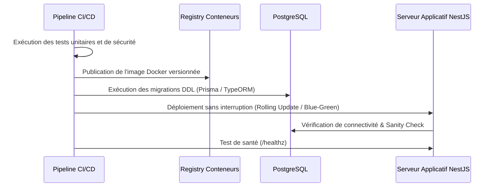

# My Community — Guide Opérationnel de Déploiement

**Version :** 1.0  
**Date :** 21 octobre 2026  

---

## 1. Pré-requis Système

- **PostgreSQL 15+** avec extension `pgcrypto` activée.
- **Node.js LTS (v20+)** pour le runtime NestJS.
- **Stockage Objet S3** (AWS S3, MinIO ou Cloudflare R2).
- **Redis 7+** pour la gestion de session et le cache éphémère.

---

## 2. Procédure de Déploiement d'une Nouvelle Version

---

## 3. Checklist de Mise en Production

- [ ] L'extension `pgcrypto` est bien installée sur la base cible.
- [ ] Tous les index de performance (`idx_posts_community_feed`, etc.) sont appliqués.
- [ ] Les variables de secret JWT et chiffrement S3 sont configurées via le gestionnaire de secrets.
- [ ] Les sauvegardes automatiques de la base de données sont programmées et testées.
- [ ] Le bucket S3 bloque formellement tout accès public direct en lecture.
