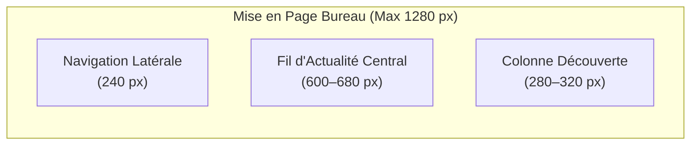

# My Community — Espacements, Grille et Mises en Page (Layout)

**Version :** 1.0  
**Système de Grille :** Grille modulaire de 4 px / 8 px  
**Périmètre :** Responsive Web & Ergonomie Tactile Mobile  

---

## 1. Échelle des Espacements (Spacing Tokens)

Tous les espacements internes (`padding`), externes (`margin`) et séparations (`gap`) dérivent de multiples de 4 ou 8 px :

| Token | Valeur en Pixels | Constante Dart | Usage Courant |
| :--- | :---: | :--- | :--- |
| **`space-1`** | 4 px | `AppSpacing.xs` | Micro-espacements, décalages d'icônes, padding de badges. |
| **`space-2`** | 8 px | `AppSpacing.sm` | Espacement interne compact, gaps entre tags et labels. |
| **`space-3`** | 12 px | `AppSpacing.md` | Marges intérieures des champs de saisie, cartes denses. |
| **`space-4`** | 16 px | `AppSpacing.lg` | **Padding standard** de cartes, marges latérales mobiles (`mobile-gutter`). |
| **`space-6`** | 24 px | `AppSpacing.xl` | Séparations entre sections, marges d'écrans tablettes. |
| **`space-8`** | 32 px | `AppSpacing.xxl` | Espacement de grand format, en-têtes de profil, héros. |
| **`space-12`** | 48 px | `AppSpacing.xxxl`| Marges majeures sur grand écran web. |

---

## 2. Rayons de Courbure (Radii)

Les arrondis apportent douceur et modernité tout en conservant une structure rigoureuse :

| Token | Valeur | Usage |
| :--- | :---: | :--- |
| **`radius-sm`** | 6 px | Badges carrés, sous-menus, tooltips. |
| **`radius-md`** | 10 px | **Boutons standard**, champs de texte, cartes imbriquées. |
| **`radius-lg`** | 16 px | **Cartes de publication**, cartes de communautés, modales. |
| **`radius-xl`** | 24 px | Tiroirs latéraux (*Bottom Sheets* mobiles), bannières. |
| **`radius-pill`**| 999 px | Avatars, pilules de filtres, badges d'état. |

---

## 3. Directives de Mise en Page Web (Next.js)

### Breakpoints et Comportements Web :
| Seuil de Largeur | Navigation | Disposition Principale |
| :--- | :--- | :--- |
| **< 640 px (Mobile Web)** | Barre inférieure compacte | 1 colonne pleine largeur, marges de 16 px. |
| **640–1023 px (Tablette)** | Barre latérale repliable (icônes) | 1 colonne centrée (max 680 px). |
| **1024–1279 px (Laptop)** | Barre latérale complète (240 px) | Fil central + suggestions réduites. |
| **≥ 1280 px (Grand Écran)**| 3 colonnes complètes | Nav (240 px) + Fil (680 px) + Découverte (320 px). |

---

## 4. Directives d'Ergonomie Mobile (Flutter)

- **Cible Tactile Minimale :** Toute action tactile doit mesurer au moins **44 × 44 pixels** logiques.
- **Navigation au Pouce :** Les 5 destinations maîtresses (Accueil, Découvrir, Créer, Notifications, Profil) sont ancrées dans la barre inférieure (`NavigationBar`).
- **Gutter Horizontal :** Marges latérales d'écran fixées à **16 px** (`AppSpacing.lg`).
