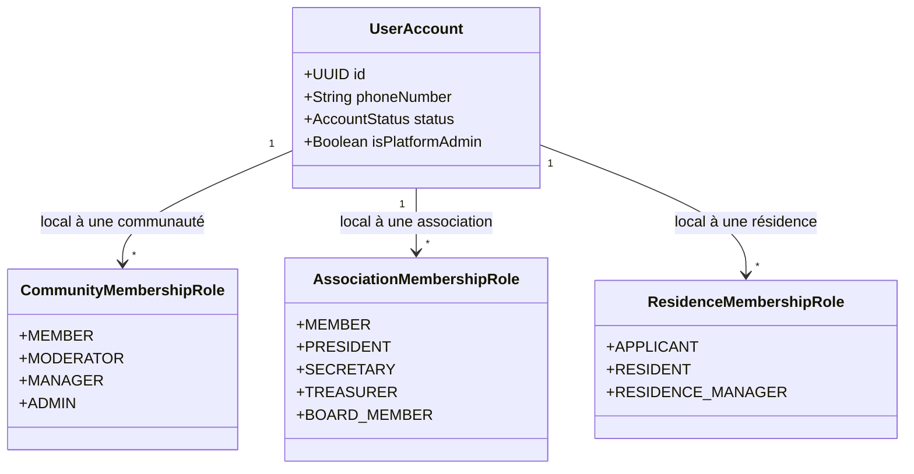
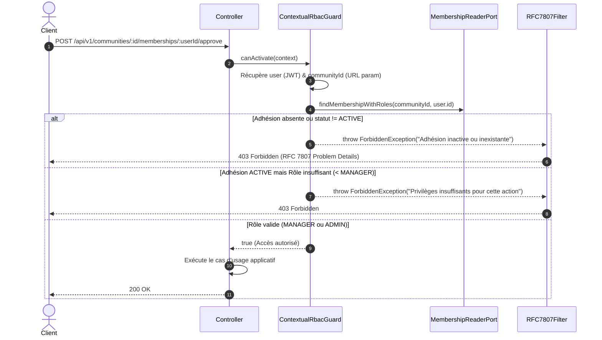

# My Community — Spécification Complète des Rôles, Permissions et RBAC Contextuel

**Version :** 1.0  
**Statut :** Officiel & Approuvé  
**Date :** 22 octobre 2026  
**Références :** [ADR-005 (Autorisation Contextuelle)](file:///c:/Sikirou/eskay/my_community/docs/adr/ADR-005-modele-autorisation-contextuelle.md) · [ADR-006 (Immuabilité Finance & Audit)](file:///c:/Sikirou/eskay/my_community/docs/adr/ADR-006-tracabilite-financiere-immuable.md) · [Spécifications Fonctionnelles](file:///c:/Sikirou/eskay/my_community/docs/03-specifications-fonctionnelles.md)

---

## 1. Contexte et Principes Architecturaux Fondamentaux

Dans **My Community**, les utilisateurs interagissent au sein d'échelons territoriaux multiples et d'organisations diverses (quartiers, villages, associations de développement, résidences).

Un rôle global monolithique (`user.role = 'ADMIN'`) est **formellement proscrit** car il induit un risque critique de faille d'autorisation (escalade de privilèges, fuite de données inter-communautés, violation du secret associatif).

### Les 4 Piliers du Modèle de Sécurité :

1. **RBAC Contextuel par Ressource (Resource-Bound RBAC) :**
   Une permission n'est jamais absolue ; elle est évaluée en fonction du quadruplet :
   $$\text{Autorisation} = f(\text{Identité } (userId), \text{ Périmètre } (communityId \mid associationId), \text{ Statut Adhésion } (ACTIVE), \text{ Rôle Local})$$

2. **Étanchéité Hermétique Communauté $\leftrightarrow$ Association :**
   - Une association peut opérer dans une communauté territoriale ($N-N$).
   - **Règle absolue :** Le Responsable/Manager d'une communauté n'a **aucun droit d'accès ni de regard** sur les données privées, assemblées générales, membres internes ou la trésorerie d'une association partenaire.
   - Réciproquement, le Bureau d'une association n'a aucun pouvoir de modération ou de gestion sur la communauté territoriale qui l'accueille.

3. **Défense en Profondeur et Non-Confiance Frontend :**
   Le masquage d'un bouton ou d'un onglet dans l'application Web ou Mobile ne constitue pas une mesure de sécurité. Tout contrôle d'accès est exécuté et vérifié systématiquement côté backend par des **Guards NestJS dédiés** et des **Politiques de Domaine pures**.

4. **Prévention Native de l'IDOR (Insecure Direct Object Reference) :**
   Toute requête manipulant un identifiant UUID de ressource (`postId`, `transactionId`, `membershipId`) vérifie d'abord l'appartenance de la ressource au contexte d'accès de l'utilisateur.

---

## 2. Typologie des Rôles



### 2.1 Rôles Plateforme (Globaux)
| Rôle | Périmètre | Description |
| :--- | :--- | :--- |
| **`VISITOR`** | Public | Utilisateur non authentifié. Accès en lecture seule aux informations publiques. |
| **`CITIZEN`** | Personnel | Tout citoyen disposant d'un compte actif. Peut soumettre des propositions et adhérer à des groupes. |
| **`PLATFORM_ADMIN`** | Système global | Administrateur central. Approbation des propositions de communautés, gestion des référentiels territoriaux, audit global. |

### 2.2 Rôles Communautaires (Contextuels par Communauté)
Stockés dans `community_membership_roles` rattaché à une adhésion `ACTIVE` :
| Rôle | Niveau Privilège | Capacités et Permissions |
| :--- | :---: | :--- |
| **`MEMBER`** | Niveau 1 | Consultation des publications du flux privé, publication de messages, commentaires, réactions, inscription aux événements locaux. |
| **`MODERATOR`** | Niveau 2 | Privilèges `MEMBER` + modération des contenus (masquage de messages signalés, avertissements, clôture de commentaires). |
| **`MANAGER`** | Niveau 3 | Privilèges `MODERATOR` + validation/rejet des demandes d'adhésion, suspension temporaire de membres, mise à jour des informations de la communauté, nomination de modérateurs. |
| **`ADMIN` / `OWNER`** | Niveau 4 | Privilèges `MANAGER` + gestion de la gouvernance locale, délégation des rôles de managers, configuration des canaux de communication. |

### 2.3 Rôles Associatifs (Contextuels par Association)
Stockés dans `association_membership_roles` :
| Rôle | Niveau Privilège | Capacités et Permissions |
| :--- | :---: | :--- |
| **`MEMBER`** | Adhérent | Consultation des annonces associatives, participation aux votes d'AG, paiement de cotisations personnelles. |
| **`SECRETARY`** | Bureau | Rédaction des procès-verbaux, tenue du registre des adhérents, envoi des convocations. |
| **`TREASURER`** | Bureau | Émission des appels de fonds/cotisations, saisie et enregistrement des recettes/dépenses en XOF, consultation des balances comptables. |
| **`PRESIDENT`** | Bureau | Représentation légale, validation des clôtures d'exercice, nomination des membres du bureau exécutif. |
| **`BOARD_MEMBER`** | Conseil | Consultation élargie des états financiers et rapports de gestion sans pouvoir de signature ou de mutation financière. |

---

## 3. Matrice Granulaire des Permissions par Module

### Légende :
- ✅ : Autorisé sans restriction
- 🔒 : Autorisé **uniquement** si le rôle requis est détenu sur la ressource ciblée
- ❌ : Formellement refusé (HTTP 403 Forbidden)
- 👁️ : Visible publiquement (HTTP 200)

| Domaine / Action Opérationnelle | Visiteur | Citoyen Connecté | Membre Communauté | Modérateur Communauté | Manager Communauté | Trésorier Asso | Président Asso | Admin Plateforme |
| :--- | :---: | :---: | :---: | :---: | :---: | :---: | :---: | :---: |
| **Territoires & Référentiel** |
| Consulter les départements / communes | 👁️ | 👁️ | 👁️ | 👁️ | 👁️ | 👁️ | 👁️ | ✅ |
| Modifier la table des territoires | ❌ | ❌ | ❌ | ❌ | ❌ | ❌ | ❌ | ✅ |
| **Identité & Profils** |
| S'inscrire / Se connecter | ✅ | ✅ | ✅ | ✅ | ✅ | ✅ | ✅ | ✅ |
| Consulter son propre profil / tokens | ❌ | ✅ | ✅ | ✅ | ✅ | ✅ | ✅ | ✅ |
| Consulter le profil public d'un membre | ❌ | 👁️ | 👁️ | 👁️ | 👁️ | 👁️ | 👁️ | 👁️ |
| **Communautés & Propositions** |
| Soumettre une proposition citoyenne | ❌ | ✅ | ✅ | ✅ | ✅ | ✅ | ✅ | ✅ |
| Approuver / Rejeter une proposition | ❌ | ❌ | ❌ | ❌ | ❌ | ❌ | ❌ | ✅ |
| Consulter les infos publiques d'une communauté| 👁️ | 👁️ | 👁️ | 👁️ | 👁️ | 👁️ | 👁️ | 👁️ |
| Modifier la fiche d'une communauté | ❌ | ❌ | ❌ | ❌ | 🔒 *(Manager)* | ❌ | ❌ | ✅ |
| **Adhésions & Rôles Communautaires**|
| Demander à adhérer à une communauté | ❌ | ✅ | Déjà membre | Déjà membre | Déjà membre | ✅ | ✅ | ✅ |
| Valider / Rejeter une adhésion locale | ❌ | ❌ | ❌ | ❌ | 🔒 *(Manager)* | ❌ | ❌ | ⚠️ *(Secours)* |
| Suspendre / Révoquer un membre local | ❌ | ❌ | ❌ | ❌ | 🔒 *(Manager)* | ❌ | ❌ | ✅ |
| Nommer un modérateur local | ❌ | ❌ | ❌ | ❌ | 🔒 *(Manager)* | ❌ | ❌ | ✅ |
| **Social & Publications** |
| Voir les publications publiques | 👁️ | 👁️ | 👁️ | 👁️ | 👁️ | 👁️ | 👁️ | 👁️ |
| Voir les publications du flux privé | ❌ | ❌ | 🔒 *(Membre)* | 🔒 *(Membre)* | 🔒 *(Membre)* | ❌ | ❌ | ⚠️ *(Audit)* |
| Publier un message dans la communauté | ❌ | ❌ | 🔒 *(Membre)* | 🔒 *(Membre)* | 🔒 *(Membre)* | ❌ | ❌ | ❌ |
| Masquer / Modérer un message non conforme | ❌ | ❌ | ❌ | 🔒 *(Modo)* | 🔒 *(Manager)* | ❌ | ❌ | ✅ |
| **Associations & Gestion Associative**|
| Déclarer une nouvelle association | ❌ | ✅ | ✅ | ✅ | ✅ | ✅ | ✅ | ✅ |
| Gérer les adhérents de l'association | ❌ | ❌ | ❌ | ❌ | ❌ | 🔒 *(Bureau)* | 🔒 *(Bureau)* | ⚠️ *(Audit)* |
| Enregistrer une recette / dépense (XOF) | ❌ | ❌ | ❌ | ❌ | ❌ | 🔒 *(Trésorier)* | 🔒 *(Président)*| ❌ |
| Clôturer un exercice comptable | ❌ | ❌ | ❌ | ❌ | ❌ | 🔒 *(Avis)* | 🔒 *(Président)*| ❌ |
| **Audit & Sécurité** |
| Consulter l'historique d'audit d'une entité | ❌ | ❌ | ❌ | ❌ | 🔒 *(Périmètre)*| 🔒 *(Périmètre)*| 🔒 *(Périmètre)*| ✅ *(Global)* |

---

## 4. Implémentation Technique Backend (NestJS & Clean Architecture)

### 4.1 Décorateurs Métier d'Autorisation
Les décorateurs permettent d'annoter les méthodes des contrôleurs de façon déclarative et typée :

```typescript
// 1. Authentification obligatoire (JWT Bearer valide)
@UseGuards(JwtAuthGuard)

// 2. Rôle Plateforme requis
@RequirePlatformRole('PLATFORM_ADMIN')

// 3. Rôle Communautaire contextuel (extrait l'ID de la communauté depuis params/body/query)
@RequireCommunityRole(CommunityRole.MANAGER)

// 4. Rôle Associatif contextuel (extrait l'ID de l'association)
@RequireAssociationRole(AssociationRole.TREASURER)
```

### 4.2 Fonctionnement du `ContextualRbacGuard`



### 4.3 Politiques de Domaine Pures (Clean Architecture)
Les règles d'autorisation complexes ne résident pas dans les contrôleurs ni dans Prisma, mais dans des **Specifications / Policies** pures dans la couche `domain/` :
- Exemple : `CommunityApprovalPolicy.canBeApproved(proposal, reviewer)`
- Exemple : `MembershipActionPolicy.canManageRoles(actorRoles, targetRoles)`

---

## 5. Règle d'Immuabilité de l'Audit et Détection d'Intrusion

Chaque décision critique d'autorisation (octroi de rôle, suspension de membre, modification financière, tentative d'accès frauduleuse) génère un enregistrement immédiat et asynchrone via `AuditLoggerPort` :
- `actor_id` : UUID de l'acteur
- `action` : Ex: `MEMBERSHIP_ROLE_GRANTED`, `MEMBERSHIP_SUSPENDED`, `ACCESS_DENIED`
- `resource_type` : `COMMUNITY`, `ASSOCIATION`, `USER_ACCOUNT`
- `resource_id` : Identifiant de la cible
- `payload` : Détail des rôles modifiés ou contexte de l'anomalie
- `created_at` : Timestamp précis PostgreSQL (UTC)
